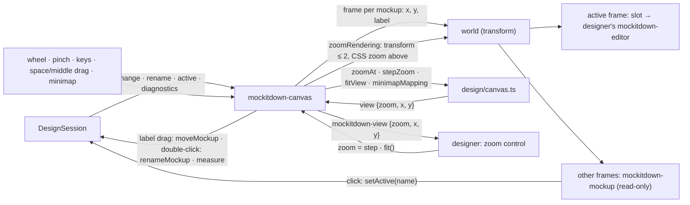

# The canvas

Realizes **A-WEB-5** (P1: `mockitdown-canvas`; K1 its own shadow root; K2 no editing rule) and implements
**R-TOOL-011** C1 to C13 (#41): every mockup of a design document as a frame on an infinite canvas,
zoomed from 10 % to 400 % and panned with the mouse, the trackpad, the keyboard, a zoom control and a
minimap. It is [the designer](designer.md)'s view in Design and Preview modes (C9, R-TOOL-003.C9), with
the designer's [editor](editor.md) in the active mockup's frame. Moving frames by their labels,
renaming them in place and placing new mockups (R-TOOL-012) are on [Mockup frames](frames.md).

## Data flow



## Files

| File | What it holds |
|---|---|
| `typescript/src/design/canvas.ts` | the view arithmetic, no DOM: `ZOOM_MIN`, `ZOOM_MAX`, `ZOOM_STEPS`, `FIT_MARGIN`, `TRANSFORM_MAX`, `clampZoom`, `stepZoom`, `zoomAt`, `centreAt`, `fitView`, `unionBox`, `viewBox`, `zoomRendering`, `minimapMapping`, `toMinimap`, `fromMinimap` (`CanvasView`, `CanvasBox`, `MinimapMapping`) |
| `typescript/src/elements/canvas.ts` | `CanvasElement` (`CANVAS_TAG`, `CANVAS_ATTRIBUTES`, `VIEW_EVENT`, `MINIMAP_WIDTH`, `MINIMAP_HEIGHT`): `session`, `zoom`, `view`, `frames`, `rendered`, `fit()`, `reveal(name)`, `fitSelection()` |
| `typescript/src/elements/designer.ts` | the canvas in the `view` slot holding the editor, the `canvas` property, the zoom control (part `zoom`), Preview mode through the canvas's `preview` attribute, the list revealing frames, the appearance toggle as the canvas's `appearance` |
| `typescript/src/elements/editor.ts` | `#scale`: client pixels per CSS pixel of the editor, so its outlines, text field and drop marks stay on their elements in a scaled canvas (C13) |
| `typescript/src/elements/define.ts`, `src/mockitdown.ts`, `src/design/index.ts` | the tag defined and exported; the arithmetic exported from `mockitdown/design` |

## How it works

- **The view** (C2, C11): `{zoom, x, y}`, `(x, y)` being the canvas point at the viewport's top left
  corner, so a canvas point `c` is drawn at `(c - x) × zoom`. It starts as the document's `view` when the
  canvas joins a session and is never written back. Every change goes through `#setView`, which clamps
  the zoom, redraws and dispatches `mockitdown-view`; the designer redraws its zoom control from it.
- **Frames** (C1, C9, C10): `#draw` reconciles one `div` per mockup (part `frame`, `data-mockup`) in
  document order inside the world, at `left: x; top: y`. With the `preview` attribute absent, the active
  mockup's frame holds the canvas's `<slot>`, so the canvas's child (the designer's editor, which stays
  in the designer's shadow root) is shown there; every other frame holds a `mockitdown-mockup` whose
  attributes are the fence options of `mockupOptions`, the canvas's `appearance` and its bases, and
  whose code is set only when it changed. A click on an inactive frame calls `session.setActive`.
- **Widths** (C1): a rendering's figure is an inline-size container whose device frames shrink to fit
  it, so its natural width is 0. After every redraw and every `diagnostics` notification (a render the
  change caused), `#remeasure` waits a microtask (so the editor has seen the same notification), awaits
  every frame's `rendered` and sets the frame's width to the rendering's natural width: the cells'
  `--mkd-w` device widths, or a fit frame's laid-out width, plus the stage's gaps. A hidden canvas is
  not measured; the resize observer measures again when it is shown.
- **Drawing the zoom** (C8): `zoomRendering(z)` gives `{transform: z, layout: 1}` up to 200 % and
  `{transform: 1, layout: z}` above it. The world gets `translate(-x·z, -y·z) scale(transform)`; each
  frame gets the CSS `zoom` `layout`, which lays it out again at that size (a frame's `left`/`top` are
  multiplied by its zoom, so the positions hold). `--mkd-canvas-zoom` on the world keeps the labels and
  the active outline at the same size on the screen.
- **Input** (C3, C4, C6): `wheel` (not passive) zooms with Cmd/Ctrl (a pinch arrives as Ctrl+wheel in
  Chromium) by `e^(-0.005 · deltaY)`, the delta capped at ±60 per event, about the pointer; otherwise it
  pans by the deltas over the zoom (lines × 16 px; Shift turns a vertical wheel horizontal). Safari's
  `gesturechange` scales the zoom the gesture began with. Keys on the canvas (so also from the editor
  inside it), never in a text field: Cmd/Ctrl+`=`/`+` and `-` step about the centre, Cmd/Ctrl+0 fits,
  Cmd/Ctrl+1 is 100 %, Shift+Digit2 calls `fitSelection`, Space held arms a pan. A capturing
  `pointerdown` on the host takes a middle press, or a left press with Space held, before the editor sees
  it, captures the pointer and pans; the click after a left pan is swallowed.
- **Fitting** (C4, C5): `fit()` fits the union of the frames' boxes (`#boxes`: position and
  `offsetWidth`/`offsetHeight`, which are layout sizes, unaffected by transforms and CSS zoom);
  `reveal(name)` one frame, throwing `there is no mockup named "…"`; `fitSelection()` the union of the
  selected nodes' elements in the slotted editor's shadow root (`data-mkd-node`, `data-mkd-derived`),
  converted from client to canvas coordinates, else the active frame. `fitView` clamps, so a small
  element ends at 400 %, centred.
- **The minimap** (C7): 160 × 110 px in the bottom right corner; `minimapMapping` scales the union of
  the frames and the viewport's box into it. A press outside the viewport rectangle centres the view
  there; a press anywhere then drags, the mapping frozen until release, panning by the distance over the
  scale. It is redrawn with the view and, through a resize observer, when a frame or the viewport
  changes size.
- **The editor in a canvas** (C13): the editor measures `k` = its overlay's client width over its
  `offsetWidth` (1 outside a canvas) and divides every client-rectangle offset and size by it; its
  outline borders and size tags are divided by `--mkd-editor-scale` so they keep their screen size.

## Use

```js
import { fitView, zoomAt } from "mockitdown/design";
designer.canvas.zoom = 2;              // about the viewport's centre
designer.canvas.fit();                 // all frames, 40 px margins
designer.canvas.reveal("Inbox");       // centre and fit; throws for an unknown name
canvas.addEventListener("mockitdown-view", (e) => status(e.detail.zoom));
```

## Tests

IT-69: `typescript/tests/unit/canvas.test.ts` (the arithmetic with hand-computed values) and
`typescript/tests/browser/canvas.spec.mjs` (TC-1 and TC-2 on `pages/designer.html` with three mockups).
IT-55's Preview check reads the previews from the canvas's frames. See [Testing](../testing.md).

## Debugging

- A frame is 0 px wide or clipped: `#remeasure` found no laid-out rendering (the canvas hidden, or the
  rendering not done); `canvas.frames` shows the boxes, `await canvas.rendered` waits for the measuring.
- Outlines are offset from their elements: the editor's `#scale` reads its overlay; a host stylesheet
  changing the overlay's box breaks the ratio.
- Ctrl+plus zooms the page instead: the focus is outside the canvas (the keys are the canvas's own;
  click on it first).
- The view jumps on `open`: the canvas takes the new document's `view`.

## Revision history

| Version | Date | Change |
|---|---|---|
| 0.3.57 | 2026-11-28 | Page written: `mockitdown-canvas`, the arithmetic in `design/canvas.ts`, the designer's canvas, zoom control and Preview on the canvas, the editor's scale, IT-69 (#41) |
| 0.3.58 | 2026-11-28 | Labels drag and rename their frames, the canvas measures frames for `session.measure`; see [Mockup frames](frames.md) (#42) |
