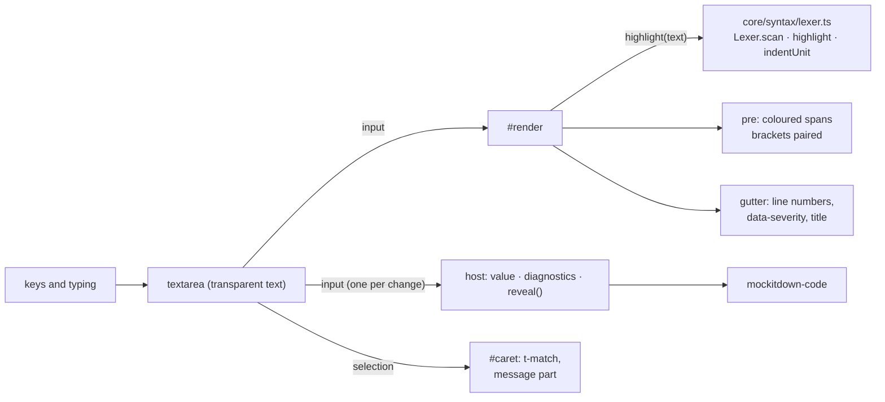

# The code view element

Realizes **A-WEB-5** (P1 for `mockitdown-code`, K1, K2) and **ADR-20** (no editor library), and
implements **R-TOOL-008** C1 to C13 (#38) and **R-TOOL-003** C15 (the designer's Code mode shows the
active mockup in a code view), and since #39 R-TOOL-008 C14 to C16 (`applyEdits`, `mark`,
`mockitdown-caret`), which [two-way editing](two-way-editing.md) (R-TOOL-009) uses to join it to the
session; the view itself holds no editing rule.

## Data flow



## Files

| File | What it holds |
|---|---|
| `typescript/src/elements/code.ts` | `CodeElement` (`CODE_TAG`, `CODE_ATTRIBUTES`), the types `CodeDiagnostic` and `CodeRange`; its only import is the core lexer |
| `typescript/src/core/syntax/lexer.ts` | `Lexer.scan()` (tolerant tokens), `highlight(source)` (`Highlight`, `HighlightKind`) and `indentUnit(source)` (moved here from `edit.ts`); `startsWith` compares ASCII text without allocating |
| `typescript/src/elements/define.ts`, `typescript/src/mockitdown.ts` | the tag in `ELEMENT_TAGS`, defined by the entry; the element and its types exported |
| `typescript/src/elements/designer.ts` | Code mode's (and the dock's) `<mockitdown-code part="code">`, joined to the session by `CodeSync` (#39) |
| `typescript/pages/code.html` | the test page: a bare code view beside a `mockitdown-mockup` rendering it, with `check()`'s diagnostics |

## How it works

- **Layers** (C2, C3): the shadow root holds a gutter, a `<pre>` (part `highlight`, `aria-hidden`) and a
  `<textarea>` (part `text`) laid over it with the same font, padding, `white-space: pre` and
  `tab-size`; the text area's text is transparent and its caret coloured. Its `scroll` event moves the
  `<pre>` and the line numbers with a transform.
- **Colouring** (C2, C10): `highlight(source)` runs `new Lexer(source).scan()`, which reads tokens as
  `tokens()` does but, where one throws, restores the lexer's position and emits an `ERROR` token (the
  rest of the line for a string, one character otherwise) or takes an unterminated block comment to the
  end; comments are merged in by offset. An identifier starting with a capital is `name`; a lower-case
  one after `.` is `member` when the token before the dot is `(`, `[`, `{`, `,`, `:`, `;`, `=`, an
  operator or a keyword (or there is none), else `modifier`. `#render` turns the ranges into one HTML
  string (`<span class="t-<kind>">`) and sets it, followed by a space so that a final empty line has
  height.
- **Brackets** (C5): the one-character `punct` ranges `( ) { } [ ]` are paired with a stack; a closer
  whose top does not match is unmatched and leaves the stack. Their spans carry `t-bracket`, `data-at`
  (the offset) and `t-unmatched`. `#caret` (on `keyup`, `mouseup`, `focus`, `select`, `selectionchange`
  and after each render) looks up a bracket ending or starting at a collapsed caret and adds `t-match`
  to it and its match.
- **Gutter and messages** (C4): one `<div part="line" data-line="n">` per line, redrawn when the line
  count or the diagnostics change; a line with diagnostics gets `data-severity` (error before warning)
  and `title` (`severity: message` per line). The caret's line's messages go into the `message` part
  (`role="status"`, the text area's `aria-describedby`), hidden when empty. A diagnostic is placed by
  `location.line`, else `line`; line 0 is not shown.
- **Keys** (C6, C12): Enter inserts a line feed and the line's indentation, plus `indentUnit(value)`
  after `{` or `(`; `}` with only blanks before the caret replaces one unit of them (a tab, or up to the
  unit's spaces); Tab with a selection, and Shift+Tab, rewrite the touched lines (a selection ending at
  a line start does not take that line; blank lines are not indented) and select them; Tab alone
  inserts a unit. Escape sets a flag that lets the next Tab through. Every change goes through
  `#replace`: select the range, `document.execCommand("insertText")`, else `setRangeText`.
- **One input event** (C7): Chromium sends two `input` events for `"\n  "`; while `#replace` runs, a
  first listener on the text area stops them, and `#replace` then dispatches one `InputEvent("input",
  {bubbles, composed})` from the text area, which reaches the host retargeted. Setting `value` renders
  without an event.
- **`reveal(range)`** (C1): clamps the offsets, focuses without scrolling, selects, and sets
  `scrollTop` (a third of the view above the line) and `scrollLeft` (from a measured character width)
  when the start is out of view.
- **`readonly` and `appearance`** (C11): `readonly` is mirrored to the text area, so the editing keys
  do nothing and Tab moves the focus; the colours are custom properties with light defaults, the dark
  ones under `prefers-color-scheme: dark` unless `appearance="light"`, and with `appearance="dark"`.
- **For two-way editing** (C14-C16, #39): `applyEdits(edits)` builds the new text, maps the selection
  (inside an edited range to its start), keeps the visible lines by adding the line delta of the edits
  above the first one to `scrollTop`, and renders without an event; `mark(range)` draws a second
  transparent `<pre>` (part `mark`) holding the text up to the range's end with the range in a `span`
  part, moved with the same transform, and scrolls a new range into view unless the text area has the
  focus; `mouseup` and the release of an arrow, Home, End, Page Up or Page Down dispatch
  `mockitdown-caret` with the selection.
- **Initial text** (C13): on connection, if no value was set, the light DOM text without its shared
  indentation (and with a final line feed) becomes the value.

## Use

```js
const code = document.querySelector("mockitdown-code");
code.value = source;                               // no event
code.diagnostics = check(source);                  // Diagnostic[] or {severity, message, line}
code.addEventListener("input", () => (mockup.code = code.value));
code.reveal({ start: 120, end: 128 });
highlight('Text("a").bold()');                     // [{start: 0, end: 4, kind: "name"}, …]
```

## Tests

IT-66: `typescript/tests/unit/code.test.ts` (`highlight` against hand-counted ranges, the tolerant
cases, the compiled module graph of `dist/elements/code.js`) and `typescript/tests/browser/code.spec.mjs`
(TC-1 on `pages/code.html` and the designer's Code mode; TC-2's timing, about 10 ms median for a
keystroke in a 1000-line source in Chromium). See [Testing](../testing.md).

## Debugging

- The caret drifts from the coloured text: the `<pre>` and the text area no longer share the font,
  padding, `white-space` or `tab-size` (check `--mkd-code-font` on both); the transform follows the
  text area's `scroll` event.
- A host sees two `input` events for Enter: `#replacing` was not set around `execCommand`, or the
  holding listener was registered after the rendering one.
- A bracket is not matched: it is inside a string or comment (not a token), or the text has an earlier
  unmatched closer; `t-unmatched` shows which.

## Revision history

| Version | Date | Change |
|---|---|---|
| 0.3.54 | 2026-11-28 | Page written: `mockitdown-code`, `highlight` and `Lexer.scan`, the designer's read-only Code mode, IT-66 (#38) |
| 0.3.55 | 2026-11-28 | `applyEdits`, `mark` (parts `mark`, `span`, `--mkd-code-span`) and `mockitdown-caret`; the designer's code view editable; see [Two-way editing](two-way-editing.md) (#39) |
