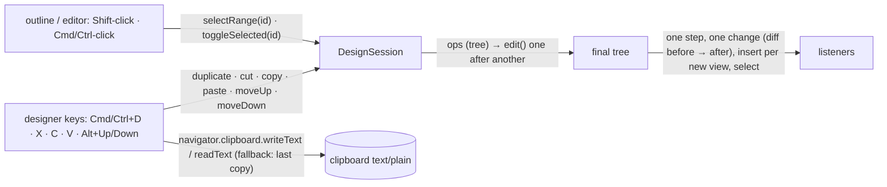

# Commands on the selection

Realizes the commands of **A-WEB-4** (P1 "`DesignSession` with its history and commands", K2) and the
components' share of **A-WEB-5** (K2: they hold no editing rule); implements **R-EDIT-008** C1 to C14
(#36): duplicate, copy, cut, paste, move up and down, and multi-select with Shift- and Cmd/Ctrl-click,
each command one undo step (C10, R-EDIT-007). Wrap, unwrap, convert and extract component (R-EDIT-009)
and the host's command list (F-19.C22) come with the next stage.

## Data flow



## Files

| File | What it holds |
|---|---|
| `typescript/src/design/session.ts` | `selectRange`, `toggleSelected`, `copy`, `cut` (`CutResult`), `duplicate`, `paste`, `moveUp`, `moveDown`; the private `moveBy`, `clicked`, `selectedNodes`, `accepts`, `applyOps` (a command's operations as one step, `OpOf`), and the helpers `usedIdentifiers`, `freshIdentifiers`, `pastedViews`, `notPlaced` |
| `typescript/src/core/syntax/edit.ts` | `nodeCode(tree, node)` (a node's code at column 0, as a move carries it) and `identifiersOf(node)` (its `.id` strings), exported from `core/syntax` |
| `typescript/src/design/index.ts` | exports `CutResult` |
| `typescript/src/elements/outline.ts` | `#onClick` passes Shift (`range`) or Cmd/Ctrl (`toggle`) to `#choose` |
| `typescript/src/elements/editor.ts` | `#onClick`: Shift- or Cmd/Ctrl-click on the innermost element under the pointer |
| `typescript/src/elements/designer.ts` | `#onKey` (the command keys), `#toClipboard`, `#paste`, `#copied` |

## How it works

- **One step per command.** `applyOps(name, ops, select)` runs each `OpOf` (a function of the tree as
  the earlier operations left it and the views inserted so far) through `edit()` on the session's tree,
  so the untouched nodes, and moved ones, keep their ids. A refusal at any point changes nothing. When
  the code changed, one `begin`/`record`/`settle` makes the step, one `change` carries the single
  edit `diff(before, after)`, an `insert` follows per inserted view, then the selection (`inserted`: the
  new views in source order; a list: those ids).
- **Copy** (C3): `nodeCode` takes the node's lines as `move` carries them (from its leading comment
  lines, with a comment trailing its last line when it owns its lines) and re-indents them so its first
  line is at column 0. The nodes are taken in source order.
- **Identifiers** (C2, C11): `usedIdentifiers` collects every `.id` of the mockup; `freshIdentifiers`
  parses the copy and renames, with the `rename` operation, each `.id("x")` already used to `x-<n>`,
  the smallest free `n` from 2, adding every identifier it keeps or makes to the set, so several copies
  in one command never collide. A duplicate always renames (its ids are the originals'); a paste after a
  cut keeps them.
- **Duplicate** (C1, C12): each copy is inserted at the original's statement index + 1 under its
  parent, from the last node backwards. **Paste** (C5, C6): `pastedViews` parses the text (leading
  blank lines and trailing white space trimmed), refuses imports, directives, structs, `let`s and
  empty text, and gives each top-level view's `nodeCode`. Into the one selected node when it is a
  container (`isContainer`, never a `ForEach`) and `canContain` accepts each pasted call's name in the
  mockup's pack (`mockupPack`), at `end`; else each after the previously pasted view, the first after
  the last selected node; else at the end of the top level.
- **Moves** (C7): nothing (no step) when the first selected node is the first statement child (up) or
  the last the last (down); else one `move` per node, in source order up (to index k − 1) and reversed
  down (to k + 2, `index` counting the children before the move).
- **Multi-select** (C8, C13): `selectRange(id)` takes the siblings of the selection's first node
  (the nodes sharing its `siblingGroup`) between it and `id`, the first node first; `toggleSelected(id)`
  removes or appends. Both fall back to `select([id])` for a non-sibling or an empty selection.
- **The designer** (C9, C14). `#onKey` acts only when the composed path passes through the session's
  outline or editor, outside text fields and Preview mode: Alt+ArrowUp/Down move, Cmd/Ctrl+D, X, C act
  on a non-empty selection, Cmd/Ctrl+V always (an empty selection pastes at the end). Copy and cut write
  `navigator.clipboard.writeText` (errors ignored) and keep the text in `#copied`; paste reads
  `readText` and uses `#copied` when that fails or is empty.

## Use

```js
const s = designer.session;
s.select([button]); s.duplicate();            // Button("A").id("ok-2") after it, selected
const { text } = s.cut();                     // removed; the next sibling selected
s.select([stack]); s.paste(text);             // the stack's last child
s.moveUp(); s.moveDown();                     // nothing at the edge, no step
s.selectRange(other); s.toggleSelected(id);   // Shift- and Cmd/Ctrl-click
```

## Tests

IT-64: `typescript/tests/unit/commands.test.ts` (R-EDIT-008 TC-1), `typescript/tests/browser/commands.spec.mjs`
(TC-2 on `pages/designer.html`, expected clipboard text `tests/browser/fixtures/copied-card.mockitdown`)
and `python/tests/test_clipboard.py` (that text in a fence, F-19.AC10). See [Testing](../testing.md).

## Debugging

- A paste lands after the node instead of inside: the node is not a container in the mockup's pack
  (`session.isContainer(id, pack)`), or the pack's role rules refuse one of the pasted elements
  (`canContain(pack, parent, child)`).
- A duplicate or move is refused with "not placed among its parent's children": the node is an
  argument (`Section(header: …)`), a modifier's content or a struct body statement, which
  `statementChildren` does not count.
- Cmd/Ctrl+V pastes something old: the browser refused `readText`, so the designer used its own last
  copy.

## Revision history

| Version | Date | Change |
|---|---|---|
| 0.3.52 | 2026-11-28 | Page written: the selection commands, multi-select, the designer's command keys and clipboard, IT-64 (#36) |
