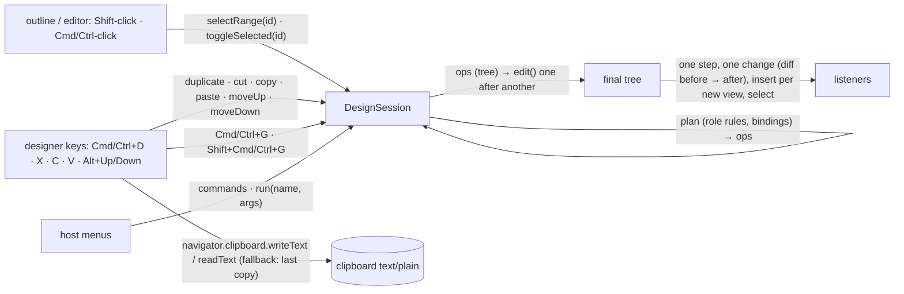

# Commands on the selection

Realizes the commands of **A-WEB-4** (P1 "`DesignSession` with its history and commands", K2) and the
components' share of **A-WEB-5** (K2: they hold no editing rule); implements **R-EDIT-008** C1 to C14
(#36): duplicate, copy, cut, paste, move up and down, and multi-select with Shift- and Cmd/Ctrl-click,
each command one undo step (C10, R-EDIT-007); and **R-EDIT-009** C1 to C12 (#37): wrap, unwrap,
convert and extract component, the host's command list `session.commands` with `session.run`
(F-19.C22), and the designer's Cmd/Ctrl+G and Shift+Cmd/Ctrl+G.

## Data flow



## Files

| File | What it holds |
|---|---|
| `typescript/src/design/session.ts` | `selectRange`, `toggleSelected`, `copy`, `cut` (`CutResult`), `duplicate`, `paste`, `moveUp`, `moveDown`; the private `moveBy`, `clicked`, `selectedNodes`, `accepts`, `applyOps` (a command's operations as one step, `OpOf`), and the helpers `usedIdentifiers`, `freshIdentifiers`, `pastedViews`, `notPlaced` |
| `typescript/src/core/syntax/edit.ts` | `nodeCode(tree, node)` (a node's code at column 0, as a move carries it) and `identifiersOf(node)` (its `.id` strings), exported from `core/syntax` |
| `typescript/src/design/index.ts` | exports `CutResult` |
| `typescript/src/elements/outline.ts` | `#onClick` passes Shift (`range`) or Cmd/Ctrl (`toggle`) to `#choose` |
| `typescript/src/elements/editor.ts` | `#onClick`: Shift- or Cmd/Ctrl-click on the innermost element under the pointer |
| `typescript/src/elements/designer.ts` | `#onKey` (the command keys, Cmd/Ctrl+G and Shift+Cmd/Ctrl+G with `WRAP_DEFAULT`), `#toClipboard`, `#paste`, `#copied` |
| `typescript/src/design/session.ts` (#37) | `wrap`, `unwrap`, `convert`, `extractComponent`, `commands` (`DesignCommand`), `run` (`CommandArgs`, `CommandName`), `WRAP_DEFAULT`; the private `runPlan`, `placedSelection`, `planWrap`, `planUnwrap`, `planConvert`, `checkExtractSelection`, `planExtract`; `applyOps` takes a `TextStep` (`{op: "text", edits}`, re-parsed) and a selection function; helpers `holderOf`, `article`, `collectDeclarations`, `freeNames` |
| `typescript/src/core/roles.ts` (#37) | `labelUnderstood(pack, element, label)` and `ACTION_LABELS`: the value-independent part of R-EVAL-004.C7, which the evaluator's `understood` now calls and convert uses |

## How it works

- **One step per command.** `applyOps(name, ops, select)` runs each `OpOf` (a function of the tree as
  the earlier operations left it and the views inserted so far) through `edit()` on the session's tree,
  so the untouched nodes, and moved ones, keep their ids. A refusal at any point changes nothing. When
  the code changed, one `begin`/`record`/`settle` makes the step, one `change` carries the single
  edit `diff(before, after)`, an `insert` follows per inserted view, then the selection (`inserted`: the
  new views in source order; a list: those ids).
- **Copy** (C3): `nodeCode` takes the node's lines as `move` carries them (from its leading comment
  lines, with a comment trailing its last line when it owns its lines) and re-indents them so its first
  line is at column 0. The nodes are taken in source order.
- **Identifiers** (C2, C11): `usedIdentifiers` collects every `.id` of the mockup; `freshIdentifiers`
  parses the copy and renames, with the `rename` operation, each `.id("x")` already used to `x-<n>`,
  the smallest free `n` from 2, adding every identifier it keeps or makes to the set, so several copies
  in one command never collide. A duplicate always renames (its ids are the originals'); a paste after a
  cut keeps them.
- **Duplicate** (C1, C12): each copy is inserted at the original's statement index + 1 under its
  parent, from the last node backwards. **Paste** (C5, C6): `pastedViews` parses the text (leading
  blank lines and trailing white space trimmed), refuses imports, directives, structs, `let`s and
  empty text, and gives each top-level view's `nodeCode`. Into the one selected node when it is a
  container (`isContainer`, never a `ForEach`) and `canContain` accepts each pasted call's name in the
  mockup's pack (`mockupPack`), at `end`; else each after the previously pasted view, the first after
  the last selected node; else at the end of the top level.
- **Moves** (C7): nothing (no step) when the first selected node is the first statement child (up) or
  the last the last (down); else one `move` per node, in source order up (to index k − 1) and reversed
  down (to k + 2, `index` counting the children before the move).
- **Multi-select** (C8, C13): `selectRange(id)` takes the siblings of the selection's first node
  (the nodes sharing its `siblingGroup`) between it and `id`, the first node first; `toggleSelected(id)`
  removes or appends. Both fall back to `select([id])` for a non-sibling or an empty selection.
- **The designer** (C9, C14). `#onKey` acts only when the composed path passes through the session's
  outline or editor, outside text fields and Preview mode: Alt+ArrowUp/Down move, Cmd/Ctrl+D, X, C act
  on a non-empty selection, Cmd/Ctrl+V always (an empty selection pastes at the end). Copy and cut write
  `navigator.clipboard.writeText` (errors ignored) and keep the text in `#copied`; paste reads
  `readText` and uses `#copied` when that fails or is empty.

- **Restructuring** (R-EDIT-009). Each command is a planner returning `{ops, select}` or a refusal;
  `runPlan` applies the plan with `applyOps`, and `commands` calls the same planners to decide
  `enabled`. **Wrap** (C1, C2): with the role rules loaded, `canContain(pack, holder, name)` for the
  parent past `if`/`ForEach` (`holderOf`) and `canContain(pack, name, node)` for each node; then an
  insert of `<name> {\n}` at the first node's statement index and a `move` of the nodes into it at
  `end`, so they keep their ids; the inserted call is selected. **Unwrap** (C3, C11): one node, a call
  with statement children, its unlabelled content closure without parameters or `let`s, each child
  accepted by the holder; a `move` of the children to the node's index under its parent, then a
  `remove` of the node (taking its arguments, modifiers and labelled closures); the children are
  selected. **Convert** (C4, C5): both names elements of the pack with one role (else the refusal names
  both role titles); a `setName`, then a `setArgument` removal for each labelled argument that is no
  closure, view or binding and that `labelUnderstood` rejects, and for each positional one past the new
  element's `params`, from the last; the node is found by its ordinal, which a rename keeps, and
  selected under its new id. **Extract** (C6, C7): the name must match `^\p{Lu}[\p{L}\p{N}_]*$` and be
  no struct, pack element or view name the mockup has (no self-embedding struct, R-EVAL-005.C10);
  `collectDeclarations` lists every `let` and closure parameter outside the selection, plus the
  enclosing struct's properties, and `freeNames` the identifiers the selection uses without declaring
  them; then a `remove`, an insert of `<name>()` at the first node's index, and a `TextStep` writing
  `struct <name>: View { var body: some View { … } }` (the nodes' `nodeCode` in source order, two units
  deep, `indentUnit`) after the last struct's end with a blank line, else before the first top-level
  view's line. The call is selected.
- **The command list** (C8). `commands` gives the sixteen commands in menu order with label and
  shortcut (`Mod+D`, `Alt+ArrowUp`, `Mod+G`, `Mod+Shift+G`, …; null for convert and extract) and
  `enabled`: undo/redo from `canUndo`/`canRedo`; everything else needs the active code to parse; paste
  always; delete, cut and copy a selection; duplicate a placed one; the moves a placed one not at that
  edge; wrap the `VStack` plan; unwrap its plan; convert one selected element of the pack; extract the
  selection checks; newMockup, duplicateMockup and deleteMockup (before undo, no shortcut) are
  [the mockup commands](mockups.md) of R-TOOL-013. `run(name, args)` dispatches by name (copy returns
  `{text}`, `{mockup}` names the mockup to duplicate or delete).

## Use

```js
const s = designer.session;
s.select([button]); s.duplicate();            // Button("A").id("ok-2") after it, selected
const { text } = s.cut();                     // removed; the next sibling selected
s.select([stack]); s.paste(text);             // the stack's last child
s.moveUp(); s.moveDown();                     // nothing at the edge, no step
s.selectRange(other); s.toggleSelected(id);   // Shift- and Cmd/Ctrl-click
s.wrap("HStack"); s.unwrap();                 // into a new HStack, selected; and back
s.convert("VBtn");                            // vuetify: same role, unknown labels dropped
s.extractComponent("OrderCard");              // struct OrderCard: View { … } and OrderCard() in place
s.commands.filter((c) => c.enabled);          // a host's Edit menu
s.run("wrap", { name: "VStack" });
```

## Tests

IT-64: `typescript/tests/unit/commands.test.ts` (R-EDIT-008 TC-1), `typescript/tests/browser/commands.spec.mjs`
(TC-2 on `pages/designer.html`, expected clipboard text `tests/browser/fixtures/copied-card.mockitdown`)
and `python/tests/test_clipboard.py` (that text in a fence, F-19.AC10). IT-65:
`typescript/tests/unit/restructure.test.ts` (R-EDIT-009 TC-1, TC-2) and the Cmd/Ctrl+G test of
`typescript/tests/browser/commands.spec.mjs` (TC-2). See [Testing](../testing.md).

## Debugging

- A paste lands after the node instead of inside: the node is not a container in the mockup's pack
  (`session.isContainer(id, pack)`), or the pack's role rules refuse one of the pasted elements
  (`canContain(pack, parent, child)`).
- A duplicate or move is refused with "not placed among its parent's children": the node is an
  argument (`Section(header: …)`), a modifier's content or a struct body statement, which
  `statementChildren` does not count.
- Wrap or unwrap refused with a role sentence: `canContain(pack, parent, child)` gives the same reason;
  the parent is the element above any `if` or `ForEach`.
- Extract refused with "the selection uses x, declared outside it": `x` is a `let`, a closure parameter
  (often a `ForEach`'s) or a property of the struct holding the selection; select the `ForEach` and its
  `let`'s users together, or pass the value in by hand.
- Convert dropped an argument: `labelUnderstood(registry.get(pack), element, label)` says whether the
  new element understands it; closures, views and bindings are always kept.
- Cmd/Ctrl+V pastes something old: the browser refused `readText`, so the designer used its own last
  copy.

## Revision history

| Version | Date | Change |
|---|---|---|
| 0.3.52 | 2026-11-28 | Page written: the selection commands, multi-select, the designer's command keys and clipboard, IT-64 (#36) |
| 0.3.53 | 2026-11-28 | Wrap, unwrap, convert and extract component, `commands` and `run`, Cmd/Ctrl+G and Shift+Cmd/Ctrl+G, IT-65 (R-EDIT-009, #37) |
| 0.3.59 | 2026-11-28 | The mockup commands in `commands` and `run` (R-EDIT-009.C8, R-TOOL-013.C4; #43) |
