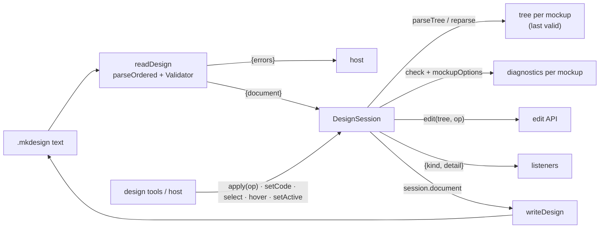

# Design documents and the design session

Realizes **A-WEB-4** (the design document and session module) over M-EDIT-1, M-EDIT-2 and M-EDIT-3;
implements R-EDIT-005 (reading, validating and writing `.mkdesign`) and R-EDIT-006 C1 to C6, C9, C10
and C12 to C18 (the session and its notifications) (#24), and C19, the `delete` command (#27). The DOM
events of the design-tool components (R-EDIT-006 C7, C8, C11) come with the components, the designer
finishing them ([The designer element](designer.md)); the session's history and the other commands
(A-WEB-4.P1) with the inspector stage.

## Data flow

## Modules

| File | What it holds |
|---|---|
| `typescript/src/design.ts` | the subpath entry `mockitdown/design` (`dist/design.js`, `package.json` `exports["./design"]`) |
| `typescript/src/design/index.ts` | the module's exports |
| `typescript/src/design/json.ts` | `parseOrdered` (JSON text to plain values, the read order of each object's keys kept in a `WeakMap`), `keysOf`, `stringify` and `writeObject` (the layout of `JSON.stringify(v, null, 2)`, known keys first), `JsonSyntaxError` |
| `typescript/src/design/document.ts` | `readDesign`, `writeDesign`, `newDesign`, `findMockup`, `mockupPack`, `mockupOptions`, the types `DesignDocument`, `DesignMockup`, `DesignSection`, `DesignView`, `DesignError`, and the key orders `DOCUMENT_KEYS`, `MOCKUP_KEYS`, `SECTION_KEYS`, `VIEW_KEYS` |
| `typescript/src/design/session.ts` | `DesignSession`, `DesignNotification`, `DESIGN_EVENTS` |

The module imports only the core (`core/api`, `core/assets`, `core/diagnostics`, `core/packs/registry`,
`core/syntax/edit`, `core/syntax/tree`), never `elements/`, so it runs in Node and in a desktop shell's
main process (A-WEB-4.K1, R-EDIT-005.C1).

## Reading and writing

- **Key order.** `JSON.parse` loses the order of keys that look like array indices (`"2"` comes first
  in a JavaScript object). `parseOrdered` is a small RFC 8259 parser (strings decoded by `JSON.parse` on
  their slice; `__proto__` defined as an own key; a repeated key keeps its first place and its last value,
  as `JSON.parse` does) that records each object's key order. `keysOf(obj)` gives the recorded keys still
  present, then keys a host added (R-EDIT-005.C15).
- **Writing.** `writeDesign` writes the document with `writeObject(document, "", DOCUMENT_KEYS, …)`:
  known keys first in their M-EDIT-1 order, then the rest in `keysOf` order; `sections`, `mockups` and
  `view` have writers of their own with `SECTION_KEYS`, `MOCKUP_KEYS` and `VIEW_KEYS`; `defaults`,
  `options` and unknown values keep their own order. Strings go through `JSON.stringify`, so code with
  tabs, CRLF and control characters round-trips exactly (C7). The result ends with one line feed (C5).
- **Validation.** `readDesign` checks, in document order, `format`, `version`, `name`, `defaults`,
  `imports`, each section, `mockups` and each mockup (name, duplicates, `x`, `y`, `options`, `code`) and
  `view`, collecting every problem (C12 to C14). Text that is not JSON gives one problem at path `""`
  (`not valid JSON: expected a string key at line 6, column 1`).
- **Pack and options.** `mockupPack` is the mockup's string `options.pack`, else the string
  `defaults.pack`, else `base`; `mockupOptions` spreads `defaults`, then `options`, then sets `pack` (C8, C9).

## The session

`new DesignSession(document, {renderOptions})` holds the live document object (changed in place, so
the read order of every object is kept) and, per mockup, a `MockupState`: the code its tree and
diagnostics were made from, its last valid `SyntaxTree` and its diagnostics. A state is made when a
mockup is first needed; one whose mockup's code was changed outside the session is re-parsed silently.

| Request | What happens | Notifications |
|---|---|---|
| `apply(op)` | `edit(tree, op)` on the active mockup's tree; code and tree replaced; refused when the code does not parse | `change` (kind `code`), `insert` for an insert op (the outermost new node), `select`/`hover` when they lost a node, `diagnostics` when changed |
| `setCode(name, code)` | one edit between the common prefix and suffix; `reparse` from the last valid tree (ids kept), the tree kept when the code does not parse | `change`, then as above |
| `setOptions(name, options)`, `moveMockup(name, x, y)` | options replaced (null removes them); position set | `change` of kind `options` or `move`, no edits; `diagnostics` after options |
| `select(ids)`, `hover(id)` | ids of the active mockup's tree; siblings share a parent node, else the struct or top level they stand in | `select`, `hover` |
| `setActive(name)` | selection and hover cleared | `active`, then `select`, `hover` when they were set |
| `insert(code, parent?)` | `insert` of one view as the last child of `parent`, by default the first selected node, else at the end of the top level (`parent: null`, R-EDIT-006.C20); the inserted node becomes the selection | `change`, `insert`, then `select` of the new node; the gallery's Add ([The gallery element](gallery-element.md)) |
| `delete()` | `remove` of the selection (R-EDIT-006.C19); the next selection is the statement after the last removed node in its body (`bodySiblings`), else the one before, else the parent, else none; refused when nothing is selected | `change`, then one `select` with the new selection, `hover` and `diagnostics` as for `apply` |

A request that changes nothing notifies nothing; a refused one returns `{error}` (an edit refusal also
its `diagnostics`). Diagnostics are `check(code, {...renderOptions, ...mockupOptions})` when packs are
loaded into the core (`assetsLoaded()` or a registered pack), else the syntax diagnostics of `parseTree`;
an unknown pack's `MockitdownError` becomes its diagnostic. `DESIGN_EVENTS` maps the five kinds the
components dispatch to `mockitdown-select`, `-change`, `-insert`, `-rename` and `-diagnostics`.

## Key symbols

| Symbol | Notes |
|---|---|
| `readDesign(text)` | `{document}` or `{errors: [{path, message}]}` |
| `writeDesign(document)` | the JSON text, two-space indent, final line feed |
| `newDesign(name)`, `findMockup`, `mockupPack`, `mockupOptions` | R-EDIT-005 C8 to C10 |
| `DesignSession` | `document`, `active`, `selection`, `hovered`, `mockup`, `code`, `options`, `tree`, `diagnostics`, `nodeFor`, `subscribe`, `apply`, `insert`, `delete`, `setCode`, `setOptions`, `moveMockup`, `select`, `hover`, `setActive` |
| `DesignNotification` | `{kind, detail}`, the details of R-EDIT-006.C5 |
| `parseOrdered`, `keysOf`, `writeObject` | internal (`design/json.ts`) |

## Tests

`typescript/tests/unit/design.test.ts` (R-EDIT-005 TC-1 to TC-3) over the hand-written fixtures of
`typescript/tests/fixtures/design/` and `malformed/expected.json`, and
`typescript/tests/unit/design-session.test.ts` (R-EDIT-006 TC-1): IT-52. Both import
`mockitdown/design` through the package's own subpath export. See [Testing](../testing.md).

## Debugging

- A document that does not round-trip: `writeDesign(readDesign(text).document)` against `text` with
  `diff`; a difference in key order means the object was rebuilt by the host (spread or `JSON.parse`),
  which loses the recorded order of index-like keys.
- A selection lost after typing: compare the edit `setCode` computed (`change.detail.edits`) with the
  node's `nameSpan` in the last valid tree; a name inside the changed text gets a new id.
- No diagnostics beyond syntax errors: the core has no packs loaded (`loadSharedAssets()` or
  `loadAssetsFromUrl()` first).

## Revision history

| Version | Date | Change |
|---|---|---|
| 0.3.40 | 2026-11-28 | Page written: `mockitdown/design`, the ordered JSON reader and writer, validation, the session and its notifications (#24) |
| 0.3.41 | 2026-11-28 | The first component, `mockitdown-editor`, joins a session (C11) and dispatches the events of a session of its own (C7, C8); see [The editor element](editor.md) (#25) |
| 0.3.42 | 2026-11-28 | `mockitdown-outline` joins a session and dispatches the events of a session of its own (C7, C8, C11); see [The outline element](outline.md) (#26) |
| 0.3.43 | 2026-11-28 | `session.delete()` (R-EDIT-006.C19) and `applyOp(op, select)`; the designer dispatches the events of its session once each and components inside it join it (C7, C8, C11); see [The designer element](designer.md) (#27) |
| 0.3.45 | 2026-11-28 | `session.insert(code, parent?)` (R-EDIT-006.C20), `applyOp(op, "inserted")`; the gallery joins a session as the other components do (#29) |
