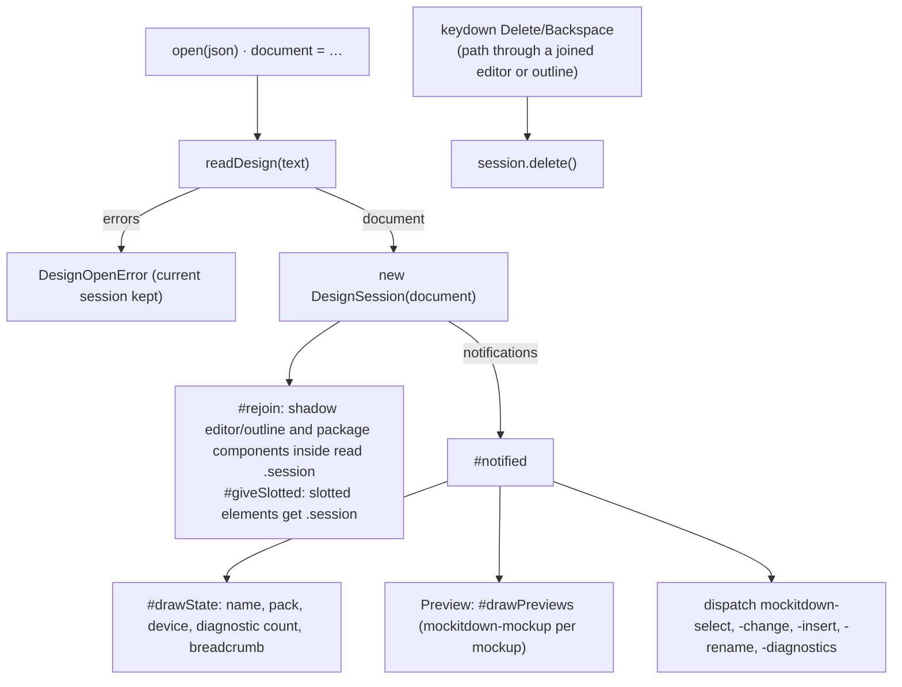

# The designer element

Realizes **A-WEB-5** (P1 for `mockitdown-designer` and `pages/designer.html`, K1, K2) and implements
**R-TOOL-003** (#27): `<mockitdown-designer>`, the composite designer that owns a design session and lays
out [the outline](outline.md), [the gallery](gallery-element.md) (a placeholder until #29), [the editable view](editor.md), a properties
placeholder, a toolbar and a status bar. It finishes R-EDIT-006 C7, C8 and C11 (the designer's own event
dispatch, and components joining a designer's session) and adds the session's `delete` command
(R-EDIT-006.C19, see [Design documents and the design session](design.md)).

## Files

| File (`typescript/`) | What |
|---|---|
| `src/elements/designer.ts` | `DesignerElement`, `DESIGNER_TAG`, `DESIGNER_ATTRIBUTES` (`mode`, `import-base`, `asset-base`), `DESIGNER_MODES`, `DESIGNER_SLOTS`, `PREVIEW_APPEARANCES`, `DEFAULT_LAYOUT`, `PANEL_MIN` (120), `PANEL_MAX` (640), `designerMode(value)`, `DesignOpenError`, the `DesignerLayout` types |
| `src/design/session.ts` | `DesignSession.delete()`; `apply` and `delete` share `applyOp(op, select?)` |
| `src/core/syntax/edit.ts` | `bodySiblings(tree, node)`: the statements of the body a node stands in (used by `delete`) |
| `src/elements/define.ts` | `ELEMENT_TAGS` and `defineElements()` now include `mockitdown-designer`, defined before the editor and the outline |
| `scripts/serve.mjs` | serves `.mkdesign` as `application/json` |
| `pages/designer.html`, `pages/designer-sample.mkdesign` | "Designer element": the sample document (Sign in on mui/phone, Inbox on base/fit with a comment, a `let`, a `ForEach` and the button in a card in a list; unknown keys at the document and mockup levels) and an event log |
| `tests/browser/designer.spec.mjs`, `tests/browser/fixtures/designer-deleted.mkdesign` | IT-55 (Playwright); the hand-written document after the delete |

## Use

```html
<mockitdown-designer id="d" style="height: 40rem"></mockitdown-designer>
<script type="module">
  import { writeDesign } from "mockitdown/design";
  await d.open(text);                              // DesignOpenError with .errors when invalid
  d.addEventListener("mockitdown-change", (e) => markEdited(e.detail.edits));
  d.layout = { right: { collapsed: true } };
  d.mode = "preview";
  save(writeDesign(d.toJSON()));
</script>
```

## How it works



- **Shadow DOM** (C2, C4): a grid of toolbar, main and status rows. The main row's
  `grid-template-columns` is written from `layout`: `240px 5px minmax(0,1fr) 5px 260px`, the 5 px
  columns being the resizers (`role="separator"`). Each panel's default content sits inside its named
  `<slot>`, so a slotted element replaces it. The left column holds the `outline` slot (a
  `mockitdown-outline`) above the `gallery` slot (a `mockitdown-gallery`, R-TOOL-003.C16 as built in #29, which also takes `import-base` and counts in `rendered`), the centre the `view` slot (a
  `mockitdown-editor`), the code view (a `mockitdown-code`, #38, editable since #39) and the preview pane, the right column the `inspector` slot
  (a `mockitdown-inspector`, #35, which joins the session like the gallery).
- **Session** (C1, C5, R-EDIT-006.C11): the constructor makes a session over an empty document; `open`
  makes a new one per document. The editor, the outline and the gallery find it themselves (`#designerSession`
  walks up through the shadow host); after `open` the designer reads `session` on each of them, which
  re-attaches them. Slotted elements are given it (`el.session = designer.session`) on `slotchange` and
  `open`, after `customElements.whenDefined` for an element not defined yet. Joined components never
  dispatch; the designer dispatches each notification of its session once (R-EDIT-006.C7, C8), so a
  change made through an outline outside the designer that was given its session is heard once too.
- **Delete** (C11): a `keydown` listener on the host sees Delete and Backspace from inside the shadow
  roots; when the composed path passes through an editor or outline on the designer's session (and not
  through a text field, and not in Preview), it calls `session.delete()`. The session picks the next
  selection with `bodySiblings` and applies the remove with it, so the host hears one `change` and one
  `select`.
- **Layout** (C3): pointer capture on a resizer; the size is clamped to 120–640 px. Left and Right on a
  focused resizer move it by 16 px. The toolbar's Outline and Properties buttons (`aria-pressed`) toggle
  `collapsed`. `layout` returns a copy; setting it merges the parts given.
- **Modes** (C8-C10, C15): `mode` reads the attribute through `designerMode` (unknown → `design`) and the
  setter writes the normalised value. Preview hides the side panels, the resizers, the toggles and the
  view, and builds one `<figure>` per mockup with a `mockitdown-mockup` carrying the fence options among
  `mockupOptions` as attributes and the code through its `code` property; a list of buttons beside them
  scrolls to a preview. The appearance toggle overrides `appearance` on every preview while a button is
  pressed (pressing it again restores each mockup's own). Leaving Preview removes the previews. Code
  mode shows the active mockup's code and diagnostics in a `mockitdown-code` (R-TOOL-003.C15) joined to
  the session by a `CodeSync`, editable (R-TOOL-009, #39); with `docked` the same code view sits below the
  view in Design mode (part `dock` toggles it), and the inspector's `mockitdown-edit-in-code` switches
  to Code mode and reveals the span. See [Two-way editing](two-way-editing.md).
- **Toolbar and status** (C10, C12): `#drawState` after `active`, `select`, `change`, `diagnostics` and
  `rename`: the active mockup's name, `mockupPack`, its `device` option else `registry.get(pack).device`,
  `N diagnostics` from `session.diagnostics`, and one crumb button per view node from the top level to
  the first selected node.

## Debugging

- `npm run serve`, open `http://127.0.0.1:8173/pages/designer.html`. In the console:
  `designer.session.selection`, `designer.layout`, `writeDesign(designer.toJSON())` (import
  `/dist/design.js`); the page logs every event the designer dispatches.
- Two events per action: a component inside joined its own session instead of the designer's (it was
  upgraded before the designer existed and not re-joined); `designer.shadowRoot.querySelector("mockitdown-editor").session === designer.session`.
- Delete does nothing: the focus is not in the outline or the view, nothing is selected, the mode is
  Preview, or the mockup's code does not parse (`session.delete()` returns the refusal).
- Panel sizes look wrong: read `designer.layout` and the main grid's `gridTemplateColumns`.

## Revision history

| Version | Date | Change |
|---|---|---|
| 0.3.43 | 2026-11-28 | Page written: `mockitdown-designer`, layout, slots, modes, Delete through `session.delete()`, the designer test page, IT-55 (#27) |
| 0.3.45 | 2026-11-28 | The gallery panel holds `mockitdown-gallery`, which joins the session and takes `import-base` (R-TOOL-003.C16); see [The gallery element](gallery-element.md) (#29) |
| 0.3.50 | 2026-11-28 | Undo and Redo in the toolbar (parts `undo`, `redo`, enabled by `canUndo` and `canRedo`, disabled in Preview), Cmd/Ctrl+Z, Shift+Cmd/Ctrl+Z and Ctrl+Y outside text fields (R-EDIT-007.C10); see [Undo and redo history](undo.md) (#34) |
| 0.3.51 | 2026-11-28 | The properties panel holds `mockitdown-inspector` instead of the placeholder, joined like the other components; see [The inspector element](inspector.md) (#35) |
| 0.3.52 | 2026-11-28 | Cmd/Ctrl+D, X, C, V and Alt+Up/Down with the focus in the outline or the view, the clipboard as `text/plain` with a fallback to the last copy (R-EDIT-008.C9, C14); see [Commands on the selection](commands.md) (#36) |
| 0.3.53 | 2026-11-28 | Cmd/Ctrl+G wraps the selection in a `VStack` and Shift+Cmd/Ctrl+G unwraps it, with the focus in the outline or the view (R-EDIT-009.C9); see [Commands on the selection](commands.md) (#37) |
| 0.3.54 | 2026-11-28 | Code mode shows the active mockup in a read-only `mockitdown-code` with its diagnostics, `#drawCode` setting `value` and `diagnostics` (R-TOOL-003.C15); see [The code view element](code-view.md) (#38) |
| 0.3.55 | 2026-11-28 | Code mode editable through `CodeSync`, the Dock code toggle (`docked`, part `dock`), `codeView`, Edit in code, the status bar's first error (part `status-message`); the centre a flex column whose view and preview scroll on their own; see [Two-way editing](two-way-editing.md) (#39) |
