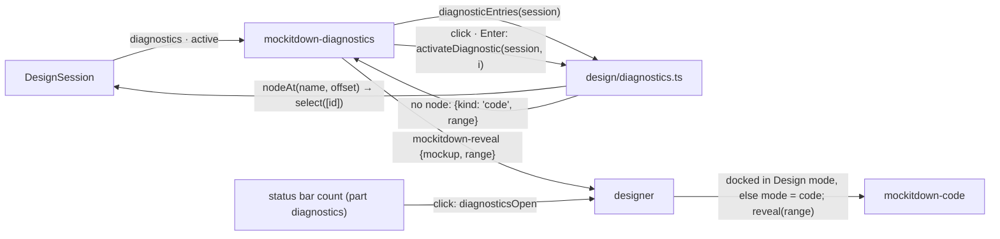

# The diagnostics list

Realizes **A-WEB-5** (P1: `mockitdown-diagnostics`; K2: the rules stay in `mockitdown/design`) and
implements **R-TOOL-010** C1 to C9 (#40): the active mockup's diagnostics, each leading to the element it
names or to its place in the code, opened from [the designer](designer.md)'s status bar. It touches
R-TOOL-003.C12 (the count is now a button).

## Data flow



## Files

| File | What it holds |
|---|---|
| `typescript/src/design/diagnostics.ts` | `diagnosticEntries(session, name?)` (`DiagnosticEntry`: index, severity, message, code, line, col, source, `where`), `diagnosticOffset(code, line, col)`, `diagnosticTarget(session, d, name?)` (`DiagnosticTarget`: `{kind: "node", mockup, node}` or `{kind: "code", mockup, range}`), `activateDiagnostic(session, index)`, `NO_PROBLEMS`, `REVEAL_EVENT` |
| `typescript/src/elements/diagnostics.ts` | `DiagnosticsElement` (`DIAGNOSTICS_TAG`): `session`, `activate(index)`, `focus()` (the first entry), `rendered` |
| `typescript/src/elements/designer.ts` | the count as a button (part `diagnostics`, `aria-expanded`), the list in the part `problems` above the status bar, `diagnosticsOpen`, Esc, `#reveal` |
| `typescript/src/elements/define.ts`, `src/mockitdown.ts`, `src/design/index.ts` | the tag defined and exported; the model exported from `mockitdown/design` |

## How it works

- **Entries** (C1, C8): `diagnosticEntries` maps `session.diagnostics(active)` in its order (evaluation
  order, as the session holds them; no sorting) to entries; `where` is `line:col`, prefixed with the
  file for an imported module's diagnostic, empty without a line. The element draws a `ul` of buttons
  (`data-severity`, `data-index`) or the "No problems" paragraph, and keeps the focused entry's focus
  across a redraw.
- **Where an entry leads** (C2, C5, C7): `diagnosticOffset` walks to the line and counts the column in
  code points (the lexer's columns: `🚀` is one), a column past the line's end giving its end. The
  offset is in `session.code(name)`, which is what the diagnostics were made from; `session.nodeAt`
  gives the innermost node, null while the code does not parse. An unknown argument is located at its
  label and an unknown element at its call's `(`, both inside the element's span. No node → a `code`
  target with the empty range at the offset, which the element dispatches as `mockitdown-reveal`. A
  diagnostic with a `source` (an imported file) or line 0 has no target; activating it does nothing.
- **Updates** (C3): the element redraws on `diagnostics` for the active mockup and on `active`.
- **Designer** (C4, C6, C9): the count button toggles `diagnosticsOpen`, which shows the panel and
  focuses the first entry. Esc anywhere in the designer closes an open list first (before the
  text-field check of the key handler), giving the focus back to the count when it was in the list.
  `#reveal` handles `mockitdown-reveal` for the active mockup: with `docked` in Design mode it reveals in
  the docked code view, otherwise it switches to Code mode first. The list stays open after an
  activation, so several problems can be visited in turn.
- The list joins the designer's session as the inspector does (walking up through shadow roots), and is
  in the designer's `#rejoin` list, so a new `open` re-attaches it.

## Use

```js
import { activateDiagnostic, diagnosticEntries } from "mockitdown/design";
diagnosticEntries(session);           // [{index, severity, message, line, col, where, …}]
activateDiagnostic(session, 0);       // selects, or {kind: "code", mockup, range}
designer.diagnosticsOpen = true;      // the list above the status bar
list.addEventListener("mockitdown-reveal", (e) => codeView.reveal(e.detail.range));
```

## Tests

IT-68: `typescript/tests/unit/diagnostics.test.ts` (entries, offsets, targets, activation, one redraw per
notification) and `typescript/tests/browser/diagnostics.spec.mjs` (TC-1 on `pages/designer.html`, in
Code mode and with the code docked). See [Testing](../testing.md).

## Debugging

- An entry selects nothing: check `diagnosticTarget(session, d)`; an imported file's diagnostic or one
  with line 0 has none, and broken code gives a `code` target (look for the reveal).
- The wrong node is selected: compare `diagnosticOffset(code, line, col)` with the node spans; columns
  are code points, offsets UTF-16.
- The list does not open from a host's own status bar (slot `status`): the count button is part of the
  default status content; set `designer.diagnosticsOpen` from the host's control.

## Revision history

| Version | Date | Change |
|---|---|---|
| 0.3.56 | 2026-11-28 | Page written: `mockitdown-diagnostics`, the model in `design/diagnostics.ts`, the designer's count button, `diagnosticsOpen`, Esc and `mockitdown-reveal`, IT-68 (#40) |
