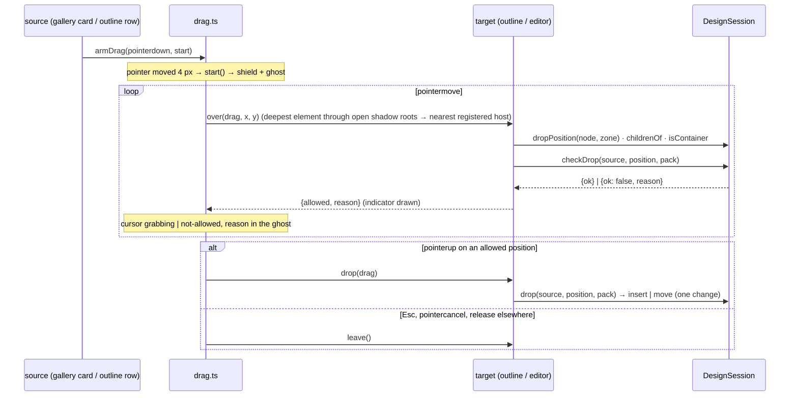

# Drag and drop

Realizes **A-WEB-5** (K1, K2) and implements **R-TOOL-005** (#30): a gallery card dragged onto the
outline or the editable view inserts its element where it is dropped, and outline rows dragged within
the outline move their nodes. The components only point and draw; the drop position, its check and the
drop are the design session's (R-TOOL-005.C8 to C10, R-EDIT-006.C20, C21), which uses the role rules
(R-PACK-016.C6, C16, [Role rules](roles.md)) and the edit operations, now with a top-level `move`
(R-EDIT-002.C32, [Editing core](editing.md)). It joins [the gallery element](gallery-element.md),
[the outline element](outline.md) and [the editor element](editor.md) inside
[the designer](designer.md).

## Files

| File (`typescript/`) | What |
|---|---|
| `src/elements/drag.ts` | the pointer drag: `armDrag(pointerdown, start)`, `registerDropTarget(host, {over, leave, drop})`, `dragging()`, `DRAG_THRESHOLD` (4 px); the shield (`data-mkd-drag-shield`, the cursor) and the ghost (`data-mkd-drag-ghost`, `data-mkd-drag-label`, `data-mkd-drag-reason`) |
| `src/elements/gallery.ts` | `pointerdown` on a card (not its Add button) arms a drag of `{kind: "element", name, code: insertCode(name, sample)}`, the element's sample call (R-TOOL-006.C1, [New elements](new-elements.md)) |
| `src/elements/outline.ts` | `pointerdown` on a row that is not derived arms a drag of `{kind: "nodes", mockup, nodes}` (the selection when the row is one of several selected rows); drop target: `#dragOver` (row thirds, the tree's end), `#markDrop` (`data-drop`, `.mkd-outline__row--drop-*`), `#dragDrop`; `#pack` from the evaluation |
| `src/elements/editor.ts` | drop target: `#dragOver` (innermost container, children's boxes inside it, `layoutAxis`, `insertionBar`), the `drop-target` and `drop-bar` parts drawn by `#drawOverlay`, `#dragDrop`; `#pack` from the render |
| `src/design/session.ts` | `DragSource`, `DropPosition`, `DropZone`, `DropCheck`; `childrenOf`, `isContainer`, `dropPosition`, `checkDrop`, `drop`; `insert(code, parent?, index = "end")`, `move(nodes, parent, index)` |
| `src/core/syntax/edit.ts` | `MoveOp.parent` may be `null` (`placeTop` for the moved lines); `statementChildren(tree, parent)` |
| `src/core/roles.ts` | `holdsChildren(pack, name)` |
| `tests/browser/drag-drop.spec.mjs`, `tests/browser/fixtures/drag-sample.mkdesign` | IT-58 (Playwright, real pointer drags) over a hand-written one-mockup document |
| `tests/unit/design-session.test.ts` ("drop positions, checks and drops…"), `tests/unit/roles.test.ts` ("holdsChildren…"), `shared/conformance/edit/move-top-level.*` | IT-58: the session API, `holdsChildren` and the top-level move, hand-written expectations |

## How it works

- **Why a pointer drag** (C7): HTML drag and drop cannot show `not-allowed` with a custom reason, does
  not let `dragover` read what is dragged, and cancels differently per browser. `armDrag` listens on the
  window in the capture phase for `pointermove`, `pointerup`, `pointercancel` and `keydown` (Esc,
  stopped there so that the editor does not also climb). Once the drag starts a full-page transparent
  shield takes the pointer, which keeps the components' hover handlers quiet and carries the cursor,
  and the click after the release lands on no card or row.
- **Finding the target**: `document.elementsFromPoint` (the shield skipped), then into each hit's open
  shadow root while the hit has one, gives the deepest element; its nearest ancestor (across shadow
  hosts) registered with `registerDropTarget` is the target. A target answers null where it has no
  position, and only for a drag of its own session (C11).
- **Outline** (C2): the row under the pointer by its shadow root's `elementsFromPoint`; the upper,
  middle and lower third give `before`, `inside`, `after`, turned into `{parent, index}` by
  `session.dropPosition` (before/after: the node's index among its parent's statement children, the top
  level for a top-level node; inside: `index: "end"`). Below the last row: `{parent: null, index: "end"}`.
  The row's `data-drop` is the zone, followed by ` refused`; the classes give inset lines or a box in
  `--mkd-drop-color` or `--mkd-drop-refused-color`. `#draw` re-applies the mark after a redraw.
- **Editor** (C3): of the marked elements under the pointer, the first whose node `session.isContainer`
  accepts is the container (a call other than `ForEach` with statement children, or whose element
  `holdsChildren`); none means the top level, the view itself. The children are `childrenOf(parent)`,
  each boxed by its outermost elements inside the container element (so one repetition of a `ForEach`
  is measured, not all of them). `layoutAxis` reads the first two boxes (side by side → horizontal),
  else the container's flex direction, else vertical; the index is the first child whose centre lies
  beyond the pointer on that axis. `insertionBar` puts a 3 px bar across the axis at the middle of the
  gap, at the edge of the only neighbour, or at the container's start.
- **The check** (C4, C9): `checkDrop` refuses a move of another mockup's nodes, a parent inside the
  dragged nodes ("Cannot move HStack into itself" / "… into one of its own descendants"), a parent
  whose element refuses a dragged element by `canContain` (a `ForEach` or an `if` defers to the element
  above it; skipped when the pack id is unknown), and finally whatever `edit(tree, op)` refuses, as a
  sentence. The pack is the one of the target's last evaluation (`screen.pack.id`).
- **The drop** (C5, C6): `session.drop` checks again, then `insert(code, parent, index)` (selected as
  Add selects) or `move(nodes, parent, index)` (the moved nodes keep their ids and become the
  selection): one edit operation, one `change`. There is no history yet; R-EDIT-007 will make each such
  operation one undo step.

## Debugging

- `npm run serve`, open `http://127.0.0.1:8173/pages/designer.html`, drag a card. A ghost that never
  appears: the pointer did not move 4 px with the button down, or a drag was already running.
- No indicator over a component: it is not on the drag's session (a host-given session differs from
  the designer's), its mockup is not the active one, or the outline's Mockups tab is shown.
- A refused position: the reason is in the ghost; `designer.session.checkDrop(source, position, pack)`
  in the console gives the same answer.

## Revision history

| Version | Date | Change |
|---|---|---|
| 0.3.46 | 2026-11-28 | Page written: pointer drag and drop between the gallery, the outline and the editor, the session's drop API, the top-level move, IT-58 (#30) |
| 0.3.47 | 2026-11-28 | A dropped card is its sample's call (`insertCode(name, sample)`, R-TOOL-006.C1) (#31) |
