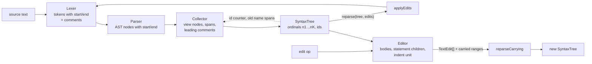

# Editing core

Realizes **A-WEB-1.P2** (the editing core) under ADR-21; implements R-EDIT-001: source spans, view
nodes and node ids in the TypeScript syntax tree (#20), and R-EDIT-002: the edit API's insert, remove
and move with the edit corpus (#21). The Python parser is unchanged (ADR-21.D1). The argument and
modifier operations (R-EDIT-003) and the edit-mode render option (R-EDIT-004) follow in later issues.

## Data flow

## Modules

| File | What it adds |
|---|---|
| `typescript/src/core/syntax/lexer.ts` | every `Token` has `start`/`end` (UTF-16 offsets, end exclusive); `Lexer.comments` lists every `//` and `/* … */` comment (`start`, `end`, `line`, `col`, `block`); an `Interpolation` knows its `offset`, so the tokens of `\( … )` carry offsets into the whole source |
| `typescript/src/core/syntax/parser.ts` | every AST node, `Import`, `Attribute`, `Property` and `StructDecl` gets `start`/`end` through `fin(node, start)`: from its first token to the end of the last token consumed, line breaks skipped. `Call.loc` is still the `(` (the renderer's columns are unchanged) |
| `typescript/src/core/syntax/ast.ts` | `start?`, `end?` on the node types (optional because the evaluator synthesises nodes of its own) |
| `typescript/src/core/syntax/tree.ts` | `parseTree`, `reparse`, `applyEdits`, `SyntaxTree`, `ViewNode`; `reparseCarrying` (internal) for moves |
| `typescript/src/core/syntax/edit.ts` | `edit`, `indentUnit` and the operation types (`InsertOp`, `RemoveOp`, `MoveOp`, `EditResult`, `EditRefusal`) |
| `shared/conformance/edit/` | the edit corpus: `<name>.mockitdown`, `.op.json`, `.expected.mockitdown` or `.error.txt`, `index.json` |

The lexer still scans by code point (columns match Python's) and counts offsets in code units
beside them, so an emoji is one column and two offsets.

## View nodes

The collector walks struct property defaults and bodies, then the top-level statements (`#Preview`
bodies are top-level statements already), and recognises:

- a **call** whose callee is an identifier or a dotted name (`Badge.Ribbon`): a dotted segment is part
  of the name when it starts with a capital letter (R-EDIT-001.C12), otherwise it is a modifier — so
  `Spacer.frame(height: 8)` is the node `Spacer` with a modifier. Calls are nodes wherever they stand:
  statements, arguments, modifier arguments (`.overlay(Circle())`), `let` values;
- an **identifier** that is a view statement, or the base of a modifier chain in one (`Divider`,
  `Color.red`);
- an **`if` statement** (an `else if` is a child of its `if`).

Modifier calls (and member accesses without parentheses) are collected in the node's `modifiers`; their
arguments and closures are searched for child nodes. Ordinals are assigned by the offset of the first
token; children are sorted the same way.

**Spans.** A node's span runs from its first token to the end of its whole expression (the modifier
chain and trailing closures). For a view statement or an `if` whose first token is the first on its
line, the span starts at the first of the contiguous comment-only lines directly above it
(R-EDIT-001.C11, C13): a blank line or a comment trailing code ends them, and a line may hold several
comments (`/* a */ // b`). Nodes inside arguments start at their first token (C14).

## Ids and `reparse`

Ids are `id1`, `id2`, … from an `IdSource` counter that a tree shares with every tree `reparse`
derives from it, so no id is reused in that family (C6). There is no global state; two unrelated
`parseTree` calls may both have an `id1`.

`reparse(tree, edits)` applies the edits with `applyEdits` (M-EDIT-3.I1 checked: a `RangeError` for
edits out of order, overlapping or outside the text), parses the new text and maps ids: for each new
node, its name span is tested against the edited ranges in the new text — an inserted or replaced range
that overlaps it, or a removal falling strictly inside it, means a new id (C10, C15); otherwise the
span is shifted back by the edits before it, and the old node with that exact name span and the same
name lends its id. A source that no longer parses returns `tree: null` with the syntax diagnostic; the
old tree stays valid for the next `reparse`.

## The edit API

`edit(input, op)` (R-EDIT-002) takes a source, or a `SyntaxTree` the host holds — the result's tree
then continues that tree's id counter, which is how a designer's selection survives an edit. It
returns `{edits, source, tree}`, or `{error, diagnostics}` with no `edits` key when refused. Every
refusal is a `Refusal` thrown inside the `Editor` and caught at the entry; nothing else is caught.

**Bodies.** `Editor` indexes the tree once: every statement list — the top level, each struct body,
every closure of a call or of its modifiers (trailing or passed as an argument), each braced `if`
branch — becomes a `Body` with its `{`/`}` offsets (closures from the AST, `if` braces from the
tokens) and its *statement children*: the view nodes whose expression is a whole `ExprStmt`, or an
`IfStmt`. A node's **content** is its unlabelled trailing closure, or an `if`'s braced branches
(the then branch takes the indexes up to its child count, C19); an `else if` is marked and refused.
Only statement children can be removed or moved (C20); views in arguments and `let` values cannot.

**Placing code** (`place`): the child indentation is the first content child's line indentation when
it starts its line, else the parent line's plus `indentUnit(source)` (C10, C11: a tab when any line is
tab-indented, else the smallest increase between consecutive non-blank lines, else four spaces). Each
block is re-indented line by line relative to its first line (C12). Then:

| Target | Edit |
|---|---|
| before child *k*, which starts its line | the block and a line feed at the start of that line (above its leading comments) |
| before child *k*, sharing a line | the code and `; ` before it (C27) |
| the end, `}` on its own line | the block and a line feed at the start of the `}` line |
| the end, `}` after code | `; ` and the code after the last statement (C27) |
| an empty `{}` / `{ }` | the inside replaced by a line feed, the block, a line feed and the parent's indentation (C28) |
| no content closure | ` {`, the block, the parent's indentation and `}` after the call's arguments, before its modifiers (C5) |

**Removing** (`removal`): a node *owns its lines* when only blanks precede it on its first line and
at most `;` and a comment follow it on its last. Such a node goes with its whole lines and the
trailing comment; blank lines that would touch a `{` (or a closure's `in`) above, or a `}` or the end
of the source below, go too (C25). A node sharing a line goes with the `;` after it, else the one
before it, else the spaces left at the line's end (C26). Ranges of several nodes are merged when
they touch or overlap.

**Moving** = the removals plus one insertion of the nodes' lines (with a trailing comment, C29), in
source order, the index counting the parent's children before the move. An insertion that falls inside
a removed range (an inline node removed with the separator before it) moves to the range's end. Edits
are sorted and an insertion touching a removal is merged into one replacement edit (M-EDIT-3.I1).

**Ids across a move** (C8): `reparse` alone would give moved code new ids (its names lie in an
inserted range). `edit` passes `reparseCarrying` a *carried range* — where the inserted text lands in
the new source and the old moved nodes with their descendants in source order — and the new nodes
whose first token lies in it take those ids one to one when the names match. Every other node keeps
its id by the R-EDIT-001 rules.

## The edit corpus

`shared/conformance/edit/` (R-EDIT-002.C15–C18, C30) holds 61 hand-checked cases: `insert-*` (16),
`remove-*` (13), `move-*` (13) and `refuse-*` (19). Each source opens with a `//` line and a blank line
(so the first node has no leading comment), and each `op.json` carries a `covers` list
(`insert:first`, `source:foreach`, `indent:tabs`, `refuse:not-siblings`, …) that the meta-test in
`edit-corpus.test.ts` checks against the C16 situations. The Python generator skips the folder
(R-REPO-004.C15). To add a case: write `<name>.mockitdown` and `<name>.op.json` (nodes by ordinal),
add it to `index.json`, write the expected text by hand, and run `npm run test:unit` after
`npm run build && npm run build:tests`; a refusal gets `<name>.error.txt` (the message and a line feed).

## Key symbols

| Symbol | Notes |
|---|---|
| `parseTree(source)` | `{tree, diagnostics}`; `tree` null and the one syntax diagnostic (as `check` reports it) when it does not parse |
| `reparse(tree, edits)` | `{tree, diagnostics}` for the edited text, ids kept per C10 |
| `applyEdits(text, edits)` | the edited text; throws `RangeError` on invalid edits |
| `SyntaxTree` | `source`, `module`, `comments`, `nodes` (ordinal order), `roots`, `byId(id)`, `byOrdinal("n3" or 3)`, `atOffset(offset)` (innermost, `start <= offset < end`), `text(span)` |
| `ViewNode` | `id`, `ordinal` (`"n3"`), `index` (3), `kind` (`call`, `ident`, `if`), `name`, `span`, `nameSpan`, `first`, `parent`, `children`, `syntax`, `expr`, `modifiers` |
| `Token.start`, `Token.end`, `Lexer.comments`, `Comment` | offsets and comments (C1, C2, C17) |
| `edit(input, op)` | `{edits, source, tree}` or `{error, diagnostics}`; `op` is `{op: "insert", parent, index, code}`, `{op: "remove", nodes}` or `{op: "move", nodes, parent, index}`; nodes by id, `"n3"` or 3; index 0…count or `"end"` |
| `indentUnit(source)` | the indentation unit of C11 |
| `reparseCarrying(tree, edits, carried)` | internal: `reparse` with carried ranges for moved code |

All are exported from the package entry (`mockitdown`, `mockitdown/node`).

## Tests

`typescript/tests/unit/tree.test.ts` (IT-47): R-EDIT-001 TC-1 over every conformance case and on
crafted sources, TC-2 with `reparse`. `typescript/tests/unit/edit-corpus.test.ts` and `edit.test.ts`
(IT-48): R-EDIT-002 TC-1 over the edit corpus, TC-2 refusals and ids. See [Testing](../testing.md).

## Debugging

- `node -e 'const m = await import("./dist/node.js"); const {tree} = m.parseTree(src); for (const n of tree.nodes) console.log(n.ordinal, n.name, JSON.stringify(tree.text(n.span)))'`
  from `typescript/` lists a source's nodes with their text.
- An id that is lost after an edit: print the edits' ranges in the new text against the node's
  `nameSpan`; an insertion exactly at a name's start does not touch it, a replacement covering it does.

- A corpus case that fails: print `edit(source, op)` and its `edits` against the expected file;
  `JSON.stringify(r.edits)` shows whether the wrong rule (line, inline, empty, no closure) fired.
- A moved node with a new id: the carried range did not hold exactly the old nodes (count or names);
  compare `r.tree.nodes` whose `first` lies in the inserted text with the moved subtree.

## Revision history

| Version | Date | Change |
|---|---|---|
| 0.3.35 | 2026-11-27 | Page written: offsets in the lexer and parser, comments, view nodes, ids and `reparse` (#20) |
| 0.3.36 | 2026-11-27 | The edit API (insert, remove, move), carried ids across a move and the edit corpus (#21) |
