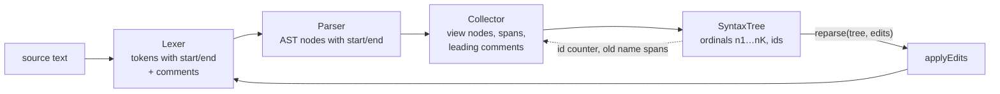

# Editing core

Realizes **A-WEB-1.P2** (the editing core) under ADR-21; implements R-EDIT-001: source spans, view
nodes and node ids in the TypeScript syntax tree (#20). The Python parser is unchanged (ADR-21.D1).
The structural edit API (R-EDIT-002, R-EDIT-003) and the edit-mode render option (R-EDIT-004) build on
this tree in later issues.

## Data flow

## Modules

| File | What it adds |
|---|---|
| `typescript/src/core/syntax/lexer.ts` | every `Token` has `start`/`end` (UTF-16 offsets, end exclusive); `Lexer.comments` lists every `//` and `/* … */` comment (`start`, `end`, `line`, `col`, `block`); an `Interpolation` knows its `offset`, so the tokens of `\( … )` carry offsets into the whole source |
| `typescript/src/core/syntax/parser.ts` | every AST node, `Import`, `Attribute`, `Property` and `StructDecl` gets `start`/`end` through `fin(node, start)`: from its first token to the end of the last token consumed, line breaks skipped. `Call.loc` is still the `(` (the renderer's columns are unchanged) |
| `typescript/src/core/syntax/ast.ts` | `start?`, `end?` on the node types (optional because the evaluator synthesises nodes of its own) |
| `typescript/src/core/syntax/tree.ts` | `parseTree`, `reparse`, `applyEdits`, `SyntaxTree`, `ViewNode` |

The lexer still scans by code point (columns match Python's) and counts offsets in code units
beside them, so an emoji is one column and two offsets.

## View nodes

The collector walks struct property defaults and bodies, then the top-level statements (`#Preview`
bodies are top-level statements already), and recognises:

- a **call** whose callee is an identifier or a dotted name (`Badge.Ribbon`): a dotted segment is part
  of the name when it starts with a capital letter (R-EDIT-001.C12), otherwise it is a modifier — so
  `Spacer.frame(height: 8)` is the node `Spacer` with a modifier. Calls are nodes wherever they stand:
  statements, arguments, modifier arguments (`.overlay(Circle())`), `let` values;
- an **identifier** that is a view statement, or the base of a modifier chain in one (`Divider`,
  `Color.red`);
- an **`if` statement** (an `else if` is a child of its `if`).

Modifier calls (and member accesses without parentheses) are collected in the node's `modifiers`; their
arguments and closures are searched for child nodes. Ordinals are assigned by the offset of the first
token; children are sorted the same way.

**Spans.** A node's span runs from its first token to the end of its whole expression (the modifier
chain and trailing closures). For a view statement or an `if` whose first token is the first on its
line, the span starts at the first of the contiguous comment-only lines directly above it
(R-EDIT-001.C11, C13): a blank line or a comment trailing code ends them, and a line may hold several
comments (`/* a */ // b`). Nodes inside arguments start at their first token (C14).

## Ids and `reparse`

Ids are `id1`, `id2`, … from an `IdSource` counter that a tree shares with every tree `reparse`
derives from it, so no id is reused in that family (C6). There is no global state; two unrelated
`parseTree` calls may both have an `id1`.

`reparse(tree, edits)` applies the edits with `applyEdits` (M-EDIT-3.I1 checked: a `RangeError` for
edits out of order, overlapping or outside the text), parses the new text and maps ids: for each new
node, its name span is tested against the edited ranges in the new text — an inserted or replaced range
that overlaps it, or a removal falling strictly inside it, means a new id (C10, C15); otherwise the
span is shifted back by the edits before it, and the old node with that exact name span and the same
name lends its id. A source that no longer parses returns `tree: null` with the syntax diagnostic; the
old tree stays valid for the next `reparse`.

## Key symbols

| Symbol | Notes |
|---|---|
| `parseTree(source)` | `{tree, diagnostics}`; `tree` null and the one syntax diagnostic (as `check` reports it) when it does not parse |
| `reparse(tree, edits)` | `{tree, diagnostics}` for the edited text, ids kept per C10 |
| `applyEdits(text, edits)` | the edited text; throws `RangeError` on invalid edits |
| `SyntaxTree` | `source`, `module`, `comments`, `nodes` (ordinal order), `roots`, `byId(id)`, `byOrdinal("n3" or 3)`, `atOffset(offset)` (innermost, `start <= offset < end`), `text(span)` |
| `ViewNode` | `id`, `ordinal` (`"n3"`), `index` (3), `kind` (`call`, `ident`, `if`), `name`, `span`, `nameSpan`, `first`, `parent`, `children`, `syntax`, `expr`, `modifiers` |
| `Token.start`, `Token.end`, `Lexer.comments`, `Comment` | offsets and comments (C1, C2, C17) |

All are exported from the package entry (`mockitdown`, `mockitdown/node`).

## Tests

`typescript/tests/unit/tree.test.ts` (IT-47): R-EDIT-001 TC-1 over every conformance case and on
crafted sources, TC-2 with `reparse`. See [Testing](../testing.md).

## Debugging

- `node -e 'const m = await import("./dist/node.js"); const {tree} = m.parseTree(src); for (const n of tree.nodes) console.log(n.ordinal, n.name, JSON.stringify(tree.text(n.span)))'`
  from `typescript/` lists a source's nodes with their text.
- An id that is lost after an edit: print the edits' ranges in the new text against the node's
  `nameSpan`; an insertion exactly at a name's start does not touch it, a replacement covering it does.

## Revision history

| Version | Date | Change |
|---|---|---|
| 0.3.35 | 2026-11-27 | Page written: offsets in the lexer and parser, comments, view nodes, ids and `reparse` (#20) |
