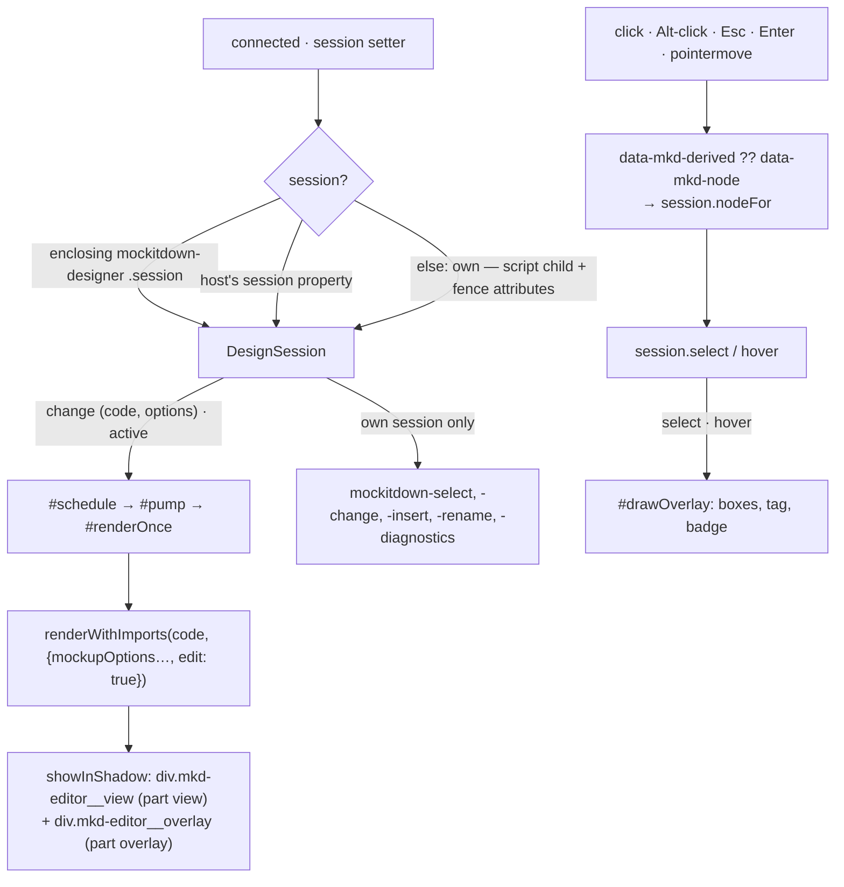

# The editor element

Realizes **A-WEB-5** (P1 for `mockitdown-editor` and `pages/editor.html`, K1, K2) and implements
**R-TOOL-001** (#25): `<mockitdown-editor>`, the editable view of one mockup of a design session. It
renders through the TypeScript core with the `edit` option (R-EDIT-004, see
[TypeScript core](typescript.md)), shares the render, import and stylesheet helpers of
[the mockup element](elements.md), and holds its state in a `DesignSession`
([Design documents and the design session](design.md)). It also does the editor's part of
R-EDIT-006 C7, C8 and C11: it joins a session and dispatches the events of a session of its own.


Drag and drop (R-TOOL-005, #30): the editor is a drop target that outlines the innermost container under the pointer and draws an insertion bar (`drop-target`, `drop-bar` parts); see [Drag and drop](drag-drop.md).

## Files

| File (`typescript/`) | What |
|---|---|
| `src/elements/editor.ts` | `EditorElement`, `EDITOR_TAG`, `EDITOR_ATTRIBUTES`, `elementName(el)`, `sizeTag(name, w, h)` |
| `src/elements/define.ts` | `ELEMENT_TAGS` (`mockitdown-mockup`, `mockitdown-editor`, since #26 `mockitdown-outline`) and `defineElements()`, moved out of `mockup.ts` so that the element modules do not import each other in a cycle |
| `src/elements/mockup.ts` | the shared helpers `baseUrls(el)`, `renderWithImports(code, options, importBase, assetBase, stale)` and `showInShadow(root, packs, html, extraCss, wrap)`, used by both elements |
| `pages/editor.html` | "Editor and outline elements": one editor over the sample (a `Button` in a `Card` in a `List` in a `VStack`, a `ForEach` of three rows) and a live readout of the selection and the hover |
| `tests/browser/editor.spec.mjs` | IT-53 (Playwright) |

## Use

```html
<script type="module" src="../dist/mockitdown.js"></script>

<mockitdown-editor pack="base" device="fit">
  <script type="text/mockitdown">
    List { Card { Button("Open") {} } }
  </script>
</mockitdown-editor>
```

```js
const ed = document.querySelector("mockitdown-editor");
await ed.rendered;
ed.session.subscribe(({ kind, detail }) => console.log(kind, detail));
ed.select(ed.session.tree(ed.mockup).nodes[0].id);
ed.code = 'Text("new code")';               // session.setCode: one change, then a re-render
ed.addEventListener("mockitdown-select", (e) => console.log(e.detail.nodes));   // own session only

// or show a mockup of a host's session
import { DesignSession, readDesign } from "./dist/design.js";
const other = document.createElement("mockitdown-editor");
other.setAttribute("mockup", "Inbox");
other.session = new DesignSession(readDesign(text).document);
```

## How it works



- **Session** (R-EDIT-006.C11, R-TOOL-001.C12): `#attach()` takes the `session` of the nearest
  `mockitdown-designer` ancestor (walking up through shadow roots), else the one the host set, else a
  session of its own: `newDesign("mockitdown-editor")` with `defaults` = the typed fence attributes and
  one mockup named by `mockup` (default `Mockup`) holding the script child's code (`scriptCode`, as the
  mockup element). A `MutationObserver` turns later script text into `setCode`; a fence attribute change
  rewrites the own document's `defaults` and re-renders. Fence attribute problems are shown as `fence`
  errors only for an own session.
- **Rendering** (C1, C2): the mockup shown is `mockup`, else `session.active`; it is rendered with
  `mockupOptions(document, name)` plus `edit: true`, imports fetched against `import-base` and images
  against `asset-base`, exactly as `mockitdown-mockup` (the same `renderWithImports` loop and import
  cache). The shadow root holds the view and the overlay; the editor's own CSS is one more adopted sheet.
  `change` notifications of its mockup (not `move`) and `active` (without a `mockup` attribute) re-render.
- **Mapping** (C4, C5): an element stands for `data-mkd-derived` if it has it, else `data-mkd-node`,
  through `session.nodeFor(mockup, ordinal)`. A click takes the marked elements of the event's
  `composedPath()` inside the view, innermost first.
- **Climbing** (C6, C15, C16): a click whose marked elements include the single selected node selects
  its parent (`tree.byId(id).parent`) and pushes the child on a trail; Esc does the same; Enter pops the
  trail when the child's parent is still the selection. A selection the editor did not make by climbing
  or returning clears the trail. A click on a selected root (no parent) selects the innermost again;
  Esc there does nothing. A click on no marked element clears the selection (C14).
- **Alt-click** (C7, C17): the marked elements of `shadowRoot.elementsFromPoint` (overlapping ones
  included), mapped and deduplicated; the editor remembers the stack and index and advances only while
  the stack and the selection are its own, wrapping at the end.
- **Activation** (C18): a click, an Alt-click or `select()` first makes the editor's mockup active. Hover
  goes to the session only while it is active; otherwise it is drawn locally.
- **Outlines** (C8-C10, C19, C20): the overlay is `position:absolute; inset:0; pointer-events:none;
  overflow:hidden` over a `position:relative` host, so the rendering's layout and attributes never
  change. `#drawOverlay()` empties it and draws, from `getBoundingClientRect()` relative to the host, a
  `selection` box for every element of each selected node and a `hover` box for the element under the
  pointer — or, for a node hovered elsewhere, for every element of it — with a `tag`
  (`sizeTag(data-el, w, h)`) on the first. A node's elements are those with its `data-mkd-node`, else
  the outermost with its `data-mkd-derived` (a `ForEach`, `if` or struct call draws nothing itself). A
  selected element that carries `data-mkd-derived` gets the `badge` "derived". Tags and badges move
  inside the box when fewer than 18 px remain above it. Redraws follow `select`, `hover`, every render,
  scrolling inside the shadow root (a capturing listener) and a `ResizeObserver` on the host; a new
  selection scrolls its first element into view (`block: "nearest"`).
- **Events** (R-EDIT-006.C7, C8, R-TOOL-001.C13): for an own session, each notification whose kind is
  in `DESIGN_EVENTS` is dispatched on the editor as a bubbling, composed `CustomEvent` with the
  notification's detail.
- **Focus** (C21): the editor sets `tabindex="0"` unless the page set one, and focuses itself on a
  click (`preventScroll`), so Esc and Enter reach its `keydown` listener.

## Debugging

- `npm run serve`, open `http://127.0.0.1:8173/pages/editor.html`; the readout beside the editor shows
  the selection and the hover. In the console: `$0.session.selection`, `$0.session.tree($0.mockup)`,
  `$0.shadowRoot.querySelector(".mkd-editor__overlay")`.
- Clicks select nothing: the element under the pointer carries neither `data-mkd-node` nor
  `data-mkd-derived` (a mark, the Elements table, chrome), or the code does not parse (the session's tree
  is the last valid one and `nodeFor` may answer null).
- Outlines in the wrong place: something between the host and the rendering scrolls without the scroll
  event reaching the shadow root, or the host's border moved the padding box (the overlay is placed in
  the padding box).
- An editor that renders nothing with a host session: its `mockup` attribute names no mockup of the
  document, or the document has none.

## Revision history

| Version | Date | Change |
|---|---|---|
| 0.3.41 | 2026-11-28 | Page written: `mockitdown-editor`, its session, pointer and key handling, overlay, `pages/editor.html`, IT-53 (#25) |
| 0.3.42 | 2026-11-28 | `pages/editor.html` also holds the outline, which shares the editor's session (#26) |
| 0.3.46 | 2026-11-28 | The editor as a drop target: container, insertion bar, `drop-target` and `drop-bar` parts (#30) |
