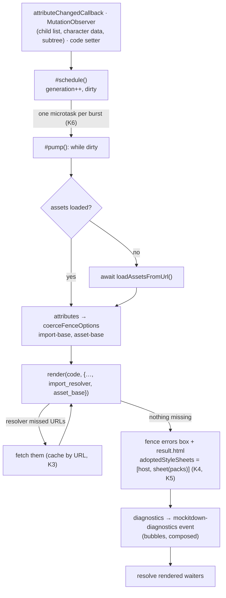

# The mockup element

Realizes **A-WEB-2** (P1, K1, K3–K6) and implements **R-WEB-002**: `<mockitdown-mockup>`, the custom
element that renders one mockup in a web page, over the TypeScript core (A-WEB-1, see
[TypeScript core](typescript.md)) and the browser asset loader (see
[Web development](web-dev.md)).

## Files

| File (`typescript/`) | What |
|---|---|
| `src/elements/mockup.ts` | `MockupElement`, `MOCKUP_TAG`, `MOCKUP_ATTRIBUTES`, `SCRIPT_TYPE`, `DIAGNOSTICS_EVENT`, `scriptCode(text)`, `shadowCss(css)`, `clearImportCache()`, and the helpers the editor and the outline share: `baseUrls(el)`, `renderWithImports(…)`, `evaluateWithImports(…)`, `showInShadow(…)` |
| `src/elements/define.ts` | `defineElements()` and `ELEMENT_TAGS` for every element (see [The editor element](editor.md), [The outline element](outline.md), [The designer element](designer.md)) |
| `src/mockitdown.ts` | the package entry: re-exports the core, the asset loader and the element modules, and calls `defineElements()` |
| `pages/mockup.html` | "Mockup element": the demo and test page (markup characters, pack switch, live editor, imports, diagnostics) |
| `tests/browser/mockup.spec.mjs` | IT-14, browser part (Playwright) |
| `tests/browser/fixtures/markup-characters.html` | the Python variant's HTML for the TC-1 source |
| `tests/unit/elements.test.ts` | IT-14, unit part (`node:test`) |

`tsconfig.json` now includes the `DOM` and `DOM.Iterable` libraries for `src/elements/`; the core
stays DOM-free by test (A-WEB-1.K1), and `src/types/node-shim.d.ts` no longer declares `URL`.

## Use

```html
<script type="module" src="../dist/mockitdown.js"></script>

<mockitdown-mockup pack="mui" device="fit" import-base="mockups/" asset-base="images/">
  <script type="text/mockitdown">
    import "components/pill"
    VStack { Text("a < b && c > d"); StatusPill(text: "Online") }
  </script>
</mockitdown-mockup>
```

```js
const m = document.querySelector("mockitdown-mockup");
m.setAttribute("pack", "swiftui");
await m.rendered;                      // after the render that change scheduled
m.code = 'Text("</script> is fine here")';
await m.rendered;
m.diagnostics;                         // Diagnostic[] of the last render
document.addEventListener("mockitdown-diagnostics", (e) => console.log(e.target, e.detail.diagnostics));
```

!!! warning "`</script` cannot appear in the script child (R-WEB-002.C9)"
    The HTML parser ends the `<script type="text/mockitdown">` element at the first `</script`, even
    inside a string of the mockup. Set such code from a script with the `code` property; the DOM
    carries it unchanged.

## How a render runs



- **Code** (`scriptCode`): the first `script` child element whose `type` is `text/mockitdown`; a
  whitespace-only first line (after `<script>`) and last line (before `</script>`) are dropped, the
  common indentation is removed character by character and blank lines are emptied, as
  `textwrap.dedent`. The result is the body a Markdown fence with the same lines would hand the
  renderer — no trailing line feed — so the figure's anchor prefix matches the fence's. Other children
  are ignored and, with no `<slot>` in the shadow root, never shown.
- **Attributes**: the keys of `FENCE_OPTIONS` (the fence's twelve plus `window`) and `import-base`,
  `asset-base` are observed. An empty boolean attribute is `"true"`; then `coerceFenceOptions` types
  them, and its problems become `fence` errors after the render's diagnostics, with their own error box
  above the rendering — what `mockitdown.fence.format` does in Python. Other attributes are not
  observed.
- **Edit** (R-WEB-002.C13): the boolean `edit` attribute is observed too, but is no fence attribute: present
  (empty, or a true value of `parseBool`) it renders with the `edit` option (R-EDIT-004), so every role
  root carries `data-mkd-node` and the derived ones `data-mkd-derived`; removing it re-renders without them.
- **Bases**: `import-base` (made a directory URL) and `asset-base` resolve against `document.baseURI`;
  without them imports resolve against the document URL and images against its directory.
- **Imports** (K3): the core's resolver is synchronous. The element's resolver answers from
  `importTexts` (URL → text, or null for a failed fetch) and records every URL it does not have; the
  element fetches them and renders again, at most 32 rounds. A path is tried as written, then with
  `.mockitdown` (R-WEB-001.C6, C10), so an import costs one round per candidate and nesting level, and
  `import "components/pill"` requests `components/pill` (404) before `components/pill.mockitdown`.
  Registered components (`registerComponents`) are found first and never fetched.
  `clearImportCache()` forgets fetched files.
- **Styles** (K4, K5): one constructed `CSSStyleSheet` per pack set (`packs.join(",")`), replaced in
  place when the CSS text changes, plus a host sheet `:host{display:block}`. `shadowCss` rewrites
  `body:not([data-md-color-scheme]) ` to `:host ` and `[data-md-color-scheme="slate"] ` to
  `:host-context([data-md-color-scheme="slate"]) `, so `appearance="auto"` follows the OS scheme in a
  shadow root (`:host-context` works in Chromium only; elsewhere the Material slate rule is dropped).
  Without constructed sheets the CSS goes into a `<style>` in front of the HTML.
- **Failures** (R-WEB-002.C12): an asset load failure or an exception during rendering becomes one
  error of code `element` (`cannot render: …`) in an error box. Every element renders in its own
  async chain, so nothing one element throws reaches another (C7).
- **`rendered`** (C8): pending observer records are taken first; then it resolves at once when the
  element is connected, rendered and not dirty, else when the pump ends clean. It never rejects. A
  render overtaken by a newer change (the generation moved while awaiting assets or imports) is
  discarded without touching the shadow root.

## Debugging

- `npm run serve`, open `http://127.0.0.1:8173/pages/mockup.html`; in the console,
  `$0.shadowRoot.innerHTML`, `$0.diagnostics`, `$0.code` on a selected element.
- A mockup that never renders: check that `dist/mockitdown.js` loaded as a module and that
  `dist/shared/manifest.json` is reachable (the error box names the URL and status).
- An import not found: the network panel shows the URLs tried, relative to `import-base`.
- Dark tokens with `appearance="auto"` not applied: the OS scheme drives it inside the shadow root;
  Material's palette toggle is followed in Chromium only.

## Revision history

| Version | Date | Change |
|---|---|---|
| 0.3.7 | 2026-11-25 | Page written: `mockitdown-mockup` element, demo page, IT-14 (#6) |
| 0.3.39 | 2026-11-28 | The `edit` attribute (R-WEB-002.C13, #23) |
| 0.3.41 | 2026-11-28 | The render, import and stylesheet steps factored into `baseUrls`, `renderWithImports` and `showInShadow` for the editor; `defineElements` and `ELEMENT_TAGS` moved to `define.ts` (#25) |
| 0.3.42 | 2026-11-28 | `evaluateWithImports` beside `renderWithImports` (one import loop, `withImports`) for the outline (#26) |
| 0.3.43 | 2026-11-28 | `ELEMENT_TAGS` includes `mockitdown-designer` (#27) |
