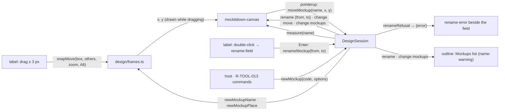

# Mockup frames

Implements **R-TOOL-012** C1 to C12 (#42) on **A-WEB-4** (the session holds the rules) and **A-WEB-5**
(the canvas forwards the user's actions, K2), over **M-EDIT-2** (a mockup's unique, case-sensitive
`name` and its `x`, `y`): moving a frame by its label with grid and edge snapping, renaming a mockup in
place, naming and placing a new mockup, and the Mockups list's warning about default names. Each move
and rename is one step of the [undo history](undo.md) (R-EDIT-007).

## Data flow



## Files

| File | What it holds |
|---|---|
| `typescript/src/design/frames.ts` | the rules, no DOM: `GRID` (8), `EDGE_SNAP` (6), `NEW_MOCKUP_GAP` (80), `NEW_MOCKUP_CODE`, `DEFAULT_NAME_WARNING`, `EMPTY_NAME`, `isDefaultName`, `newMockupName`, `nameTaken`, `renameRefusal`, `snapMove`, `newMockupPlace` |
| `typescript/src/design/session.ts` | `renameMockup(from, to)`, `newMockup(code?, options?)` (through `addMockup` and `box`), the `measure` property and option (`FrameMeasure`), `setName`, history steps keyed by mockup object (`StepKind` with `rename`, `Snapshot.name`, `Snapshot.list`) |
| `typescript/src/elements/canvas.ts` | the label's drag (`#onLabelDown`, `#onLabelMove`, `#onLabelUp`, `#movedTo`), the rename field (`#onLabelDoubleClick`, `#commitRename`, `#closeRename`; parts `rename-field`, `rename-error`), `session.measure` set to its frames' boxes |
| `typescript/src/elements/outline.ts` | the Mockups list's `data-default-name` and part `name-warning` |
| `typescript/src/design/code-sync.ts` | the shown mockup follows a `rename` |
| `typescript/src/design/index.ts` | the rules exported from `mockitdown/design` |

## How it works

- **Moving** (C1, C2, C7): a left press on a label (not in Preview mode, not in an open rename field,
  not a space or middle-button pan, which the host's capturing listener takes first) captures the
  pointer and keeps the frame's start, size and the other frames' boxes. Once the pointer has moved
  3 px, every move draws the frame at `snapMove` of the start plus the drag over the zoom; the release
  computes it again with the release's Alt state and calls `session.moveMockup` once, so a move is one
  step, notified as `change` of kind `move`, after which the canvas places the frames from the
  document. A press without a drag moves nothing and the click still activates the frame; the click
  after a drag is swallowed. A cancelled pointer puts the frame back.
- **Snapping** (C2): per axis, every edge of the moved box (`x`, `x + w`) against every edge of every
  other frame; the nearest within `EDGE_SNAP / zoom` canvas units (6 screen pixels) wins, else the
  position is rounded to the 8-unit grid. Alt returns the raw position.
- **Renaming** (C3 to C6, C10): a double-click on a label replaces its text with an input (part
  `rename-field`) and a hidden `role="alert"` span (part `rename-error`). Enter calls
  `session.renameMockup`; a refusal (`renameRefusal`: empty, or held by another mockup, compared
  case-sensitively) shows its message beside the field and keeps it open; typing hides it. Esc cancels;
  leaving the field renames when the name is accepted and cancels otherwise. While the field is open
  `#draw` leaves that label alone. The session's rename sets the name (`setName`: the active mockup and
  the document's `view.active` follow), records a step of kind `rename` and notifies `rename`
  `{from, to}`; undoing and redoing it notify `rename` back and forth, not `change`. The canvas rekeys
  its frame, the outline, gallery, inspector and designer redraw, and `CodeSync` follows the name.
- **History across renames**: steps hold the mockup object, and the session keys its per-mockup state
  (last valid tree, diagnostics) by the object, so steps recorded before a rename still undo on the
  renamed mockup, and a deleted and re-added name can never be confused with another mockup.
- **A new mockup** (C8, C11): `newMockup` takes `newMockupName` of the document's names and
  `newMockupPlace` of the active mockup's box and every frame's box: the active `y`, 80 units right of
  the rightmost frame overlapping the active one vertically (strictly; the active one always counts),
  (0, 0) without an active mockup. The boxes are the mockups' positions with the sizes the session's
  `measure` gives (the canvas showing the session sets it to its frames' laid-out sizes and clears it
  when it leaves), else the options' `width` and `height`, else 0. The mockup is appended, one step of
  kind `mockups` is recorded (its snapshots hold the list before and after), `change` of kind `mockups`
  is notified and the new mockup is made active. Undo restores the list and the previous active
  mockup. `newMockup` shares `addMockup` and `box` with `duplicateMockup`; the commands of
  `session.commands` are on [The active mockup and the mockup commands](mockups.md) (R-TOOL-013, #43).
- **Default names** (C9): see [The outline element](outline.md).

## Use

```js
import { snapMove, newMockupPlace, renameRefusal } from "mockitdown/design";
session.renameMockup("Message", "Inbox");   // {error: "A mockup named “Inbox” already exists"}
session.renameMockup("Message", "inbox");   // {mockup: "inbox"}, notifies rename
session.newMockup();                        // {mockup: "Mockup 1"} beside the active mockup
snapMove({ x: 13, y: 21, w: 100, h: 50 }, [], 1);   // {x: 16, y: 24}
```

## Tests

IT-70: `typescript/tests/unit/frames.test.ts` (the rules and the session's rename, move and new
mockup with hand-computed values) and `typescript/tests/browser/frames.spec.mjs` (R-TOOL-012 TC-1 and
TC-2 on `pages/designer.html`). See [Testing](../testing.md).

## Debugging

- A drag does nothing: the press must be on the label (above the frame), with the left button, not in
  Preview mode; a press with Space held pans instead.
- A new mockup lands at an odd place: no canvas measured the frames (`session.measure` is null), so the
  frames count as their options' `width` and `height`, or 0.
- A rename is refused silently: the field was left with a refused name, which cancels; press Enter to
  see the message.

## Revision history

| Version | Date | Change |
|---|---|---|
| 0.3.58 | 2026-11-28 | Page written: moving frames by their labels with snapping, renaming in place, `renameMockup`, `newMockup`, `measure`, the Mockups list's warning, the history keyed by mockup object, IT-70 (#42) |
| 0.3.59 | 2026-11-28 | `newMockup` through `addMockup`; the mockup commands moved to their own page (#43) |
