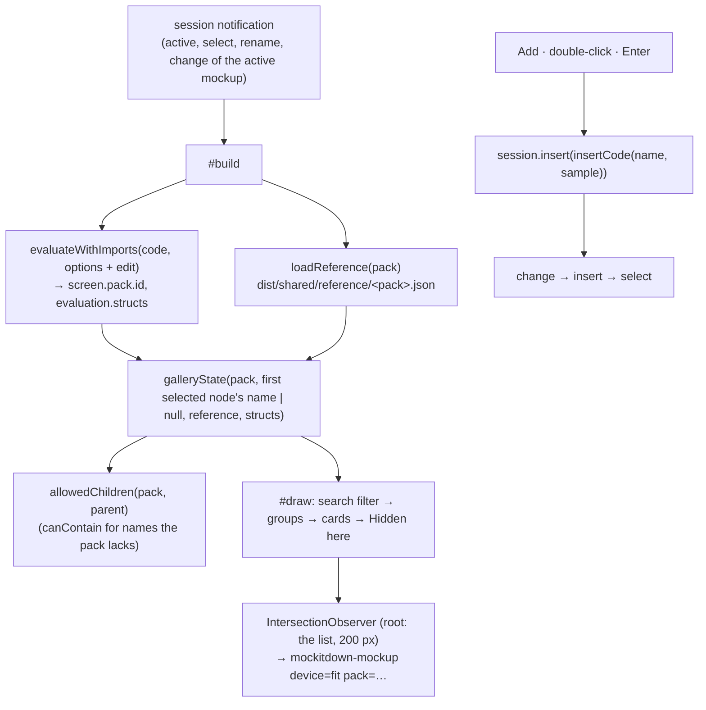

# The gallery element

Realizes **A-WEB-5** (P1 for `mockitdown-gallery`, K1, K2) and implements **R-TOOL-004** (#29):
`<mockitdown-gallery>`, the elements a design session's selection may hold, drawn as live previews with
an Add button. It reads the reference data that **R-WEB-001** C13 and C17 now publish in the package,
asks the role rules (R-PACK-016, [Role rules](roles.md)) what may go where, and inserts through the
session's new `insert` command (R-EDIT-006.C20, [Design documents and the design session](design.md)),
which uses the top-level `insert` of R-EDIT-002 ([Editing core](editing.md)) when nothing is selected.
[The designer](designer.md) holds it in its gallery panel (R-TOOL-003.C16).


Drag and drop (R-TOOL-005, #30): a card dragged onto the outline or the editor inserts the element where it is dropped; see [Drag and drop](drag-drop.md).

New elements (R-TOOL-006, #31): Add and a drop insert the element's sample call (`Toggle("Label")`, `List()`), and the editor opens its first text; see [New elements](new-elements.md).

## Files

| File (`typescript/`) | What |
|---|---|
| `src/elements/gallery.ts` | `GalleryElement`, `GALLERY_TAG`, `GALLERY_ATTRIBUTES` (`import-base`), `PREVIEW_MARGIN` (200), `CATEGORY_TITLES`; `referenceUrl(pack, base?)`, `loadReference(pack, base?)` (one fetch per URL, a failure forgotten), `galleryState(pack, parent, reference, structs)` (the cards and the hidden groups, pure), `matchesFilter(card, text)`, `insertCode(name, sample?)` (the sample's call, `sampleCall`, else `<Name>()`) |
| `scripts/copy-shared.mjs` | copies `shared/reference/*.json` into `dist/shared/reference/` and lists them under `reference` in `manifest.json`, not under `files` (R-WEB-001.C13, C17); `--check` covers them; reference files that left `shared/` are removed |
| `src/core/assets.ts` | `SharedManifest.reference` (optional) |
| `src/core/api.ts` | `Evaluation.structs`: the structs an evaluation knows, imported first, then declared (the Components group) |
| `src/core/syntax/edit.ts` | `InsertOp.parent` may be `null`: `placeTop(index, lines)` writes a top-level statement |
| `src/design/session.ts` | `DesignSession.insert(code, parent?)`; `applyOp(op, "inserted")` selects the inserted node |
| `src/elements/designer.ts` | the gallery slot's default content is a `mockitdown-gallery`; it joins on `open`, takes `import-base` and counts in `rendered` |
| `src/elements/define.ts`, `src/mockitdown.ts` | `mockitdown-gallery` defined and exported |
| `tests/browser/gallery-component.spec.mjs`, `tests/browser/fixtures/gallery-sample.mkdesign` | IT-57 (Playwright) over a hand-written two-mockup document |
| `tests/unit/reference.test.ts` | IT-57: R-WEB-001 TC-5 |
| `tests/unit/design-session.test.ts` ("insert adds a view…"), `shared/conformance/edit/insert-top-level*.{mockitdown,op.json,expected.mockitdown}` | IT-57: the session's `insert` and the top-level insert, hand-written expected code |

## Use

```html
<mockitdown-gallery id="g" style="height: 24rem"></mockitdown-gallery>
<script type="module">
  g.session = editor.session;          // inside a mockitdown-designer it joins the designer's session
  g.filter = "toggle";                 // the search field shows it too
  g.add("Toggle");                     // as Add: last child of the selection, else end of the top level
  g.state;                             // {mockup, pack, parent, cards, hidden}
</script>
```

## How it works



- **Data** (C2): `referenceUrl` resolves `reference/<pack>.json` against `defaultAssetsUrl()`, the base
  `loadAssetsFromUrl` uses, so the gallery fetches from the package's `dist/shared/` and never from the
  repository's `shared/`. A pack without reference data (a host's own pack) is listed from its
  registered elements, without previews.
- **Order** (C1, C5): Components first (the structs the selection may hold, by `canContain` with the
  struct's name, which the rules treat as `unknown`), then one group per role category in
  `ROLE_CATEGORIES` order; within a group the pack's own elements (`own: true`) before the inherited ones,
  each in reference order. An element whose role has no rule goes into Content.
- **Filtering** (C6, C7): the parent is the name of the first selected node, null with no selection.
  `allowedChildren` gives the allowed names and the refused groups by reason; Hidden here (`<details>`,
  `data-count`, "Hidden here (n)") lists the refused groups restricted to names in the reference data.
  The search (C4) narrows only the cards.
- **Previews** (C3): each card with a sample holds an empty preview box observed by an
  `IntersectionObserver` whose root is the gallery's scrolling list with a 200 px margin; when it
  intersects, a `mockitdown-mockup` (`device="fit"`, `pack`, `code` = the sample) is created and kept per
  pack and name, so a redraw after a selection moves the existing previews instead of rendering again.
  The box is 72 px high and shows the preview at half size, with no pointer events.
- **Insert** (C8): Add, `dblclick` on a card and Enter on a focused card call `add(name)`, which calls
  `session.insert(insertCode(name, sample))` with the shown pack's sample (R-TOOL-006.C1). The session inserts as the last child of the first selected node,
  else at the end of the top level (`parent: null`), and selects the inserted node: `change`, `insert`,
  `select`. The gallery dispatches them only for a session of its own (R-EDIT-006.C8); in the designer the
  designer does.
- **Keys** (C9): the cards are one tab stop (`tabindex` 0 on the current card, -1 elsewhere); Up, Down,
  Home and End move it.

## Debugging

- `npm run serve`, open `http://127.0.0.1:8173/pages/designer.html`; in the console
  `designer.shadowRoot.querySelector("mockitdown-gallery").state` shows the cards and the hidden groups.
- No cards and "No mockup": the session has no active mockup. Every card missing a preview: the gallery
  has no height limit (it is not in a scrolling box), so the observer never fires, or the reference
  file failed to load (look for a 404 on `dist/shared/reference/<pack>.json`; rebuild with `npm run build`).
- An element expected but missing: `canContain(pack, parent, name)` gives the reason; it is also under
  Hidden here.

## Revision history

| Version | Date | Change |
|---|---|---|
| 0.3.45 | 2026-11-28 | Page written: `mockitdown-gallery`, the reference data in the package, `session.insert`, the top-level insert, IT-57 (#29) |
| 0.3.46 | 2026-11-28 | Cards draggable onto the outline and the editor (#30) |
| 0.3.47 | 2026-11-28 | Add and a drop insert the sample's call (`insertCode(name, sample)` = `sampleCall`, R-TOOL-006) (#31) |
| 0.3.64 | 2026-11-28 | Rebuilds scheduled by the shared `RenderScheduler` (`scheduler.ts`, see [The mockup element](elements.md)) (#87) |
| 0.3.65 | 2026-11-28 | The session found and subscribed to through the shared `SessionLink` (`session-link.ts`) (#89) |
