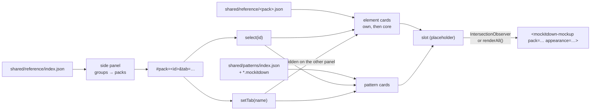

# The pack gallery

Implements **R-WEB-004** and its home page **R-WEB-006** on top of the mockup element (R-WEB-002, [The mockup element](elements.md))
and the development server (R-WEB-003, [Web development](web-dev.md)), with the element reference
of R-REPO-003. The page is plain HTML, CSS and one module script — no framework, no dependency.

## Files

| File | What |
|---|---|
| `typescript/pages/index.html` | "Gallery home" (R-WEB-006): what the gallery is for, the renderer, using the TypeScript library, the links, and last the easter-egg section `#easter-eggs` (see [Home page](#home-page)) |
| `typescript/pages/chrome.css` | the page chrome both gallery pages load before their own stylesheet: the colour tokens, light and dark (`--bg`, `--panel`, `--text`, `--muted`, `--line`, `--accent`, `--accent-bg`, `--code`, `--bar`, `color-scheme`), `box-sizing`, the body's colours and the top bar (`.bar`, `.brand`, `.brand-sub`, `.spacer`) (#86) |
| `typescript/pages/index.js`, `index.css` | the home page's appearance and easter-egg links; its stylesheet: the body font (15px/1.6), links, sections, headings, code and the call to action |
| `typescript/pages/packs.html` | "Pack gallery": top bar (menu button, appearance), side panel `#packs`, main area `#main` (the filter is built into the Elements tab) |
| `typescript/pages/packs.js` | the page logic; imports `../dist/mockitdown.js`, which defines `<mockitdown-mockup>` |
| `typescript/pages/snippet.js` | the snippet that reproduces an example (C22): `patternAttributes(entry, pack)`, `patternText(source)`, `snippet(entry, source, pack)` — pure, no DOM, shared by `packs.js` and its unit test |
| `typescript/pages/packs.css` | page chrome only, after `chrome.css` (`--stage` light and dark, `--side`, the body font 14px/1.5, `.sr-only`, the bar's fields and filter, the master-detail grid, the sticky tab list, the example index, the narrow-window menu) |
| `shared/patterns/index.json` | `{"patterns": [{"id", "title", "file"}, …]}` in display order (R-WEB-004.C8); an entry may add `packs`, `device`, `chrome`, `menubar`, `app`, `windowed` (C14) |
| `shared/patterns/*.mockitdown` | core: sign-in, list-detail, settings, dashboard, data-table, wizard, and the complex layouts mail-client, admin-console, kanban-board, chat, product-page, calendar (C19) — core vocabulary, no `import`; swiftui: `swiftui-iphone-list`, `swiftui-iphone-detail`, `swiftui-ipad`, `swiftui-mac` |
| `shared/reference/index.json`, `<pack>.json` | the side panel's groups, the hidden packs (`hidden`) and each pack's elements (generated by `python/tools/gen_reference.py`) |
| `typescript/tests/unit/patterns.test.ts`, `python/tests/test_patterns.py` | IT-15: the core patterns in every pack; IT-23: pack-specific patterns in their packs; IT-24: the twelve core patterns, both variants |
| `typescript/tests/browser/gallery-helpers.mjs` | shared by the gallery specs: `INDEX`, `PACKS`, `REFERENCES`, `PATTERNS`, `patternsFor(pack)`, `open(page, hash)` (waits for `state === "ready"`, collects page errors), `renderPack(page, id)`, `CHUNKS` (the four parallel chunks of the every-pack tests) |
| `typescript/tests/browser/gallery-packs.spec.mjs` | IT-15: the side panel, the element card, the fragment, appearance and filter, the narrow layout, TC-1 over every pack; IT-16: TC-4 geometry over every pack; IT-42: the 720 px boundary; IT-44: hidden packs |
| `typescript/tests/browser/gallery-render.spec.mjs` | IT-16 to IT-18, IT-20: presentations alone at fit, the toggle row, message bubbles, shapes, base chart marks, SwiftUI presentations and navigation containers |
| `typescript/tests/browser/gallery-chrome.spec.mjs` | IT-21, IT-22: SwiftUI chrome per form and the macOS menu bar |
| `typescript/tests/browser/gallery-examples.spec.mjs` | IT-23: pack-specific examples; IT-24: the tabs and the examples' geometry; IT-25: Show source |
| `typescript/tests/unit/snippet.test.ts` | IT-25: the snippet builder without a browser |
| `typescript/tests/browser/gallery-home.spec.mjs` | IT-45: the home page's text, code block and links, the easter-egg links, appearance, and the failure fallbacks |

## Data flow



`init()` loads the reference index and the patterns (their sources fetched once), builds the side
panel, listens to `hashchange` and selects the pack named by the fragment. Pack names in the side
panel arrive as each reference file is fetched (the ids stand in meanwhile); the files are cached
per URL, so opening a pack later costs nothing.

`select(id)` falls back to the first pack for an unknown or missing id (C12), writes
`#pack=<id>&tab=<tab>` — `history.replaceState` when the page had no fragment, an unknown pack or the
same pack, a new history entry otherwise, so Back returns to the previous pack — and builds the main
area: the pack's facts (id, version, import modules, default device and chrome, group) above the tab
list and two panels (C16): `#tab-elements` (the filter, the own elements, the core vocabulary) and
`#tab-examples` (the example index, then the patterns).
Selecting the pack already shown returns the same promise; a selection overtaken by a newer one
stops before touching the page.

An **element card** shows name, role, an `own` mark, positional arguments, defaults as
`key: literal`, variants as `.name`, the `doc` line, a stage with the sample
(`device="fit" caption="false"`) and, when the reference has a `variants_sample`, a second stage with
it (C2, C9). A **pattern card** renders the pattern with `pack="<id>"` and the entry's `device`, `chrome`, … when
it names them, else the pack's default device and chrome: SwiftUI and Android show the simple
patterns on a phone, the web packs a browser window, the retro packs their window frames (C9).

## Tabs

The tab list (`role="tablist"`, buttons `#tabbtn-elements` and `#tabbtn-examples` with their counts)
sits under the pack's facts and sticks under the top bar while a panel scrolls. Exactly one panel is
shown; the other carries `hidden` (C16). The selected tab lives in the module (`selectedTab`, read as
`packGallery.selectedTab`) and survives a pack change: `showPack` builds both panels and `applyTab`
hides the unselected one (C17).

| Path | What happens |
|---|---|
| page load | `tabFromHash()` reads `tab=`; missing or unknown → `elements` (C17); `select()` writes the normalised fragment with `replaceState` |
| a click on a tab, arrow keys, Home, End | `setTab(name)`: panels and `aria-selected` updated, the fragment rewritten with `replaceState` (a tab change is not a history entry), the side panel's links re-pointed at `#pack=<id>&tab=<tab>` so a pack click keeps the tab; coming from deep in the other tab, the page scrolls to the panel's start |
| `hashchange` (Back, a typed fragment) | `setTab(tabFromHash(), false)` then `select(packFromHash())`; nothing is written back |
| `packGallery.tab(name)` | `setTab(name)`, awaits the pack being built, then one animation frame; resolves with the tab shown (C18) |

The **example index** (`#example-index`, C20) is an ordered list of links, one per shown pattern, in
`index.json` order and numbered by a CSS counter. A link's `href` is the pack's Examples fragment (so
opening it in a new tab lands on the tab); a click is intercepted and scrolls the example's section
(`#example-<id>`, `scroll-margin-top` clears the sticky bar and tab list) into view and focuses its
heading, leaving the fragment unchanged.

The name filter is created once in `init()` and moved into each pack's Elements panel; its value
and `gallery.filter` survive pack changes. The element count is in the Elements tab button
(`#element-count`, `shown of total` while filtering).

## Lazy rendering

Each stage holds a `.slot` placeholder that carries the code and attributes. An
`IntersectionObserver` (root margin 600 px) replaces a slot by its `<mockitdown-mockup>` when it
approaches the viewport (C10). The hidden panel's slots are observed too; they intersect only once
their panel is shown, so a tab is rendered when it is opened. The code is set with the `code` property before the element is
connected, so it renders once. A pack switch disconnects the old observer. The mockups share one
constructed stylesheet per pack set (A-WEB-2.K4), so a pack of 250 elements opens at once and
renders as it scrolls. IT-42 checks that a freshly opened Elements tab holds fewer mockups than
element cards and more once scrolled to its end (R-WEB-004.TC-11).

## Test hooks

`window.packGallery` (C11):

| Member | Meaning |
|---|---|
| `state` | `loading`, `ready` (side panel and first pack shown) or `failed` |
| `pack`, `selectedTab`, `groups`, `patterns`, `appearance`, `filter` | the current state |
| `select(id)` | select a pack; resolves when its cards are in the page |
| `tab(name)` | select a tab (unknown → `elements`); resolves when it is shown (C18) |
| `renderAll()` | create every mockup of the pack in both tabs, await every `rendered`, resolve with `{pack, elements, patterns, mockups, empty, errors}` |
| `source(id)` | awaits the selection in progress, then the snippet of example `id` in that pack, or `null` when the pack does not show it or no example has that id (C26) |

`empty` lists the mockups whose shadow root has no rendered figure content, or which are visible (not
inside a `hidden` panel) but zero-sized (the check that caught a collapsed stage layout); `errors` lists every diagnostic of
severity `error` as `<label>: <diagnostic>`.

## Variants seen whole

Element samples and variants render at `device="fit"` (C9) and keep their natural size (C13,
R-DEV-008.C1): the mockup is as wide as the stage, the figure cell inside its shadow root scrolls
sideways when the frame is wider. TC-4 (C15) measures this after `renderAll()` with
`inspectMockups` from `tests/browser/geometry.mjs`: each fit frame's `scrollWidth` within its
`clientWidth`, a wider-than-card mockup scrolling, no intersecting children in any row (stacks,
toolbars, labelled rows, toggles; R-REND-013), presentation surfaces at least 200 × 80 and inside
the frame, toasts holding their text, sheets 240 tall with a grabber and 48 points of backdrop, and
tooltip bubbles unclipped with the arrow towards the anchor. The same rows are checked again with
every sample mounted in a 320-point phone frame (`mountMockups`).

## Appearance, filter, narrow windows

- The appearance select sets `data-appearance` on `<html>` (page colours) and the `appearance`
  attribute of every mockup; new mockups take it on creation. The choice is kept in
  `localStorage` (`mockitdown.gallery.appearance`); the first visit follows `prefers-color-scheme` (C6).
- The filter (in the Elements tab) hides element cards whose name does not contain the text
  (case-insensitive) and shows `shown of total` in the Elements tab button; patterns are never filtered (C6).
- Under 720 CSS pixels (`@media (max-width: 719.98px)`) the side panel is hidden and the `☰ Packs`
  button opens it as an overlay; choosing a pack closes it, and widening the window resets it (C7). IT-42 tests the boundary: shown at 720, behind the button at 719.

## The design patterns

Written in the core vocabulary only (base pack elements and modifiers) and without an `import`, so
every shipped pack can render them; each pack maps the core roles to its own look. Both variants
check this: `patterns.test.ts` renders each pattern in every pack of the registry (hidden packs
included), light and dark, and `test_patterns.py` does the same in Python. The patterns are not
part of the conformance corpus; their HTML is not compared between the variants.

To add a pattern: write `shared/patterns/<id>.mockitdown`, add it to `index.json`, run both test
suites (the browser suite checks its geometry in every pack, IT-24).

### The complex layouts

Six dense desktop layouts (C19) follow the six simple patterns. Their entries name
`device: "desktop"`, so the phone-first packs (`swiftui`, `android`) show them as a Mac window or an
Android desktop window instead of squeezing three panes onto a phone; every other pack's default
device is already `desktop`.

| Pattern | Built from |
|---|---|
| `mail-client` | three-column `NavigationSplitView`: mailbox and folder sections with badges; a searchable message list of `Row`s with avatars and a `New` badge; a reading pane with reply/forward actions, sender header, body, an attachment row |
| `admin-console` | a navigation column of `NavItem`s (one selected, one with a badge) beside a header (title, `Breadcrumb`, `SearchField`, a bell `IconButton` with a badge, `Avatar`), four `Stat`s with trends, an area `Chart` and a donut `Chart` in `Card`s, a `Table` of orders |
| `kanban-board` | a header with filter, assignee picker and action, filter chips and a sprint `ProgressView`, a `Board` of four `BoardColumn`s of `KanbanCard`s (tags, assignees, due dates, comments, attachments, priorities) |
| `chat` | a conversation list (`SearchField`, `Row`s with unread badges) beside a conversation: header with call actions, `MessageBubble`s from both sides with reactions and read receipts, a composer `TextField` with attach, voice and send |
| `product-page` | `Breadcrumb`, an image gallery with thumbnails, badge and tag, title, `Rating`, price, colour `SegmentedControl`, size `Picker`, quantity `Stepper`, purchase buttons, stock and returns labels; reviews summary (`LabeledContent` per star band) and `Comment`s |
| `calendar` | a toolbar (today, previous/next, the range, a Day/Week/Month `SegmentedControl`, search, new event), a side panel (graphical `DatePicker`, calendar toggles, upcoming `TimelineItem`s) and a five-day `Schedule` with twelve events, today's column and the current-time line |

They avoid elements whose pack versions mean something else: `admin-console` builds its navigation
from `NavItem`s, not `Sidebar`, because PrimeVue's `Sidebar` (the `prime` pack) is an overlay drawer.
On the 640-pixel retro screens (`win31`, `win95`, …) the wide layouts are clipped at the window's
right edge, as a real application at that resolution would be.

## Pack-specific examples

An entry with `packs` (R-WEB-004.C14) is an example application for those packs only: it may
`import` their module and use their own elements. `packs.js` keeps it out of every other pack
(`patternShown`) and copies its `device`, `chrome`, `menubar`, `app` and `windowed` onto the
`<mockitdown-mockup>` as attributes of the same name (`patternAttributes` in `snippet.js`); its card heading carries
the device. The unit tests render each one in its packs with those options and require no
diagnostic at all, warnings included, so a showcase never shows an unknown icon or modifier.

| Entry | Device and options | Shows |
|---|---|---|
| `swiftui-iphone-list` | `phone` | iOS 26: TabView with the glass tab bar (a badge), NavigationStack with large title, search field, glass toolbar buttons, segmented picker, rows with tinted icons, a linear gauge, a footer |
| `swiftui-iphone-detail` | `phone` | the pushed detail: glass back button, inline title, map, glass and prominent glass buttons, ShareLink, stat group boxes, an elevation area chart, a toolbar menu |
| `swiftui-ipad` | `tablet` | iPadOS 26: three-column NavigationSplitView, the floating glass sidebar with badges, a plain content list with a selected row, a detail with toolbar capsule, stepper, switches, a donut chart |
| `swiftui-mac` | `desktop`, `menubar: Transaction`, `app: Ledger` | macOS 26: floating sidebar, unified toolbar (segmented picker, ControlGroup, search), group boxes, line and bar charts, a striped Table with a selected row, the menu bar with `.commands` (CommandGroup after New, CommandMenu open with shortcuts, a submenu, checkmarks, a disabled row) |

The examples use no images: the gallery serves no example assets.

## Show source

Each pattern card (C21–C25) is a header (`.pattern-head`: the `h3` and a `.show-source` button), the
stage with the mockup, and a source block `#source-<id>` built with the card and `hidden`:

```
section.pattern#example-<id>
  div.pattern-head    h3 · button.show-source[aria-expanded][aria-controls=source-<id>]
  div.stage           slot → mockitdown-mockup
  div.source#source-<id>[hidden]
    div.source-tools  "Source" · span.copy-status[role=status][aria-live=polite] · button.copy
    pre[tabindex=0] > code   the snippet (textContent)
```

`snippet.js` writes the snippet: `<mockitdown-mockup` with `pack` and the entry's `device`, `chrome`,
`menubar`, `app`, `windowed` in that order (`PATTERN_ATTRIBUTES`; values `&`, `"`, `<` escaped), then
`<script type="text/mockitdown">`, a line break, the pattern file's text with one final line break
removed (`patternText`), a line break and the closing tags. The text starts at column 0 on the line
after the script tag, so the element's `scriptCode` (R-WEB-002.C2) gives the file back unchanged. The
card's mockup takes its attributes from the same `patternAttributes`, plus the gallery-only `caption`
and `label` and the page's `appearance`, so the snippet and the shown example cannot drift apart.

- **Toggle** (a delegated click on `#main`): `toggleSource` flips the block's `hidden`, the button's
  `aria-expanded` and its label (Show source / Hide source). Nothing else is touched, so the mockup is
  neither re-created nor re-rendered, and the block, below the stage, cannot move or resize it (C25).
- **Copy**: `copySource` calls `navigator.clipboard.writeText`; on success the live region reads
  Copied for two seconds. With no clipboard, or a refused write (no permission, an insecure origin),
  it selects the `code` element's contents instead (C24, clarified as built in R-WEB-004.CR-8).
- **Style** (C23): the block uses the page's `--code` and `--text` variables, so it follows the
  appearance; the `pre` is monospaced, `white-space: pre`, `overflow: auto` and at most 32 rem tall.
  `.patterns` is a `minmax(0, 1fr)` grid so a long line scrolls inside the block instead of widening
  the card or the page.

## Hidden packs

The easter-egg packs (`lcars`, `phosphor`, `hologram`; R-PACK-010) are listed under `hidden` in
`shared/reference/index.json`, outside every group, and have a `<pack>.json` like any pack, with
`group: null` (R-PACK-010.C2, C4). `init()` keeps the list as `gallery.hidden`; `knownPack(id)` accepts
a side-panel pack or a hidden one, so `#pack=lcars`, `packGallery.select("lcars")` and `renderAll()`
treat it as any pack (R-WEB-004.C32). `buildNav()` reads only `groups`, so the side panel has no entry
for a hidden pack, and `showPack()` sets `aria-current` only on a matching side-panel link, so none is
marked while a hidden pack is shown. The facts line leaves out `group` when it is null. An unknown id
still falls back to the first side-panel pack (C12). The links to each hidden pack are on the
gallery's [home page](#home-page).

## Home page

`pages/index.html` (R-WEB-006) is the gallery's front door: `/gallery/` redirects to it, and the
development server lists it as "Gallery home". It is static text in five sections, `main > section`:

| Section | Says (clause) |
|---|---|
| `#about` | what the pack gallery is for (review by eye, the TypeScript variant's end-to-end test page) and the prominent "Open the pack gallery" link to `packs.html` (C2, C6) |
| `#renderer` | every mockup is rendered in the browser by the TypeScript renderer through `mockitdown-mockup`; Markdown sites use `pip install mockitdown` (C3) |
| `#usage` | the release archive (link to `https://github.com/bbogovich/mockitdown/releases`), `loadAssetsFromUrl`, a 13-line `pre > code` with a module script and a `<mockitdown-mockup pack="fluent" device="fit">` holding its `<script type="text/mockitdown">`, and the link to `typescript/README.md` on GitHub (C4, C5) |
| `#more` | the pack gallery, the documentation site `../../definition/`, the example site `../../demos/` and the releases (C6) |
| `#easter-eggs` | last: one link per hidden pack (C7) |

The release link names the repository's releases page; the archive the usage note describes is the one
R-WEB-007 (#63) attaches to each release.

`index.js` (a plain module, no import):

- **Appearance** (C8): `data-appearance` on `<html>` from `localStorage` `mockitdown.gallery.appearance`
  (the key `packs.js` writes), else `prefers-color-scheme`; it follows a system change while no choice is
  stored, and a `storage` event from a gallery tab. Both pages take the light and dark
  variables, `color-scheme` included, from `chrome.css`.
- **Easter eggs** (C7): fetches `../shared/reference/index.json`, then each hidden pack's
  `<id>.json` for its `name`, and fills `#egg-links` with `packs.html#pack=<id>` links in the order of
  `hidden`. A reference file that fails leaves the id as the label (C10); an empty or missing `hidden`
  gives "None at the moment." (C11); an `index.json` that fails gives "The easter-egg packs could not
  be loaded." and the rest of the page is untouched (C9).
- `data-state` on `<html>` goes from `loading` to `ready` once the section is filled either way; the
  browser test waits for it.

The gallery's brand link (`mockitdown` in its top bar) now goes to `index.html`, the home page; before
#62 it went to `../`.

## Published

The Pages workflow publishes the gallery at `https://bbogovich.github.io/mockitdown/gallery/`
(R-WEB-004.C27–C31): `scripts/assemble-gallery.mjs` copies `pages/`, `dist/` and the `reference/` and
`patterns/` folders of `shared/` into the development server's layout under `public/gallery/` and adds
an `index.html` redirecting to `pages/index.html`, the home page (C29). The page needs no change to work there, because
every URL it fetches is relative. Before the upload, IT-26 serves the assembled site statically and
checks the gallery in Chromium. See [Build and publish](../build-publish.md#the-published-pack-gallery).

## Debugging

- `cd typescript && npm run serve`, open `http://127.0.0.1:8173/pages/packs.html#pack=carbon`
  (the home page: `/pages/index.html`; without easter-egg links, check `../shared/reference/index.json`
  in the network panel).
- Published: a failed or out-of-`/gallery/` request in the Pages run's *Test the published site* step
  names the URL; reproduce it with the local check in [Build and publish](../build-publish.md#the-published-pack-gallery).
- In the console: `await packGallery.renderAll()` shows the summary for the open pack;
  `document.querySelector('[data-label="Button"]').diagnostics` one mockup's diagnostics.
- A blank stage: check the mockup's box (`getBoundingClientRect()`); a figure needs a width from
  its container.
- A reference file out of date with the packs: `python/tools/gen_reference.py --check`.
- A card whose sample says nothing about the element: declare a `sample` for it in the pack's
  `pack.json` (R-PACK-013, [Pack authoring guide](../pack-authoring.md)) and regenerate.

## Revision history

| Version | Date | Change |
|---|---|---|
| 0.3.8 | 2026-11-25 | Page written: pack gallery, design patterns, IT-15 (#7) |
| 0.3.9 | 2026-11-25 | Variants seen whole: natural fit width, horizontal scroll, TC-4 geometry tests (#8) |
| 0.3.11 | 2026-11-25 | Samples declared in `pack.json`; variants 24 points apart; base chart marks test (#10) |
| 0.3.16 | 2026-11-25 | Pack-specific examples (`packs` and the mockup options in `index.json`), the SwiftUI iPhone, iPad and Mac apps, IT-23 (#15) |
| 0.3.17 | 2026-11-25 | Elements and Examples tabs, `#pack=<id>&tab=…`, `packGallery.tab()`, the example index; six complex layouts; IT-24 (#16) |
| 0.3.18 | 2026-11-27 | Show source on every example: `snippet.js`, the source block with Copy, `packGallery.source()`; IT-25 (#17) |
| 0.3.19 | 2026-11-27 | Published at /gallery/ (assemble-gallery.mjs, IT-26); the brand link goes to `../` (#19) |
| 0.3.22 | 2026-11-27 | The gallery browser tests split into four topic specs and `gallery-helpers.mjs` (#50) |
| 0.3.29 | 2026-11-27 | IT-42: the 720 px boundary, `fit` element samples and index-entry devices, lazy cards (#60) |
| 0.3.32 | 2026-11-27 | Hidden packs: `gallery.hidden` from `index.json`, selectable by `#pack=`, never listed; IT-44 (#61) |
| 0.3.33 | 2026-11-27 | Home page `pages/index.html` (R-WEB-006): the sections, the easter-egg links from `hidden`, appearance; `/gallery/` redirects to it; brand link to the home page; IT-45 (#62) |
| 0.3.63 | 2026-11-28 | `chrome.css`: the tokens, dark tokens and top bar shared by `index.css` and `packs.css` (#86) |
