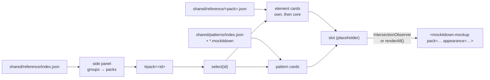

# The pack gallery

Implements **R-WEB-004** on top of the mockup element (R-WEB-002, [The mockup element](elements.md))
and the development server (R-WEB-003, [Web development](web-dev.md)), with the element reference
of R-REPO-003. The page is plain HTML, CSS and one module script — no framework, no dependency.

## Files

| File | What |
|---|---|
| `typescript/pages/packs.html` | "Pack gallery": top bar (menu button, filter, appearance), side panel `#packs`, main area `#main` |
| `typescript/pages/packs.js` | the page logic; imports `../dist/mockitdown.js`, which defines `<mockitdown-mockup>` |
| `typescript/pages/packs.css` | page chrome only (light and dark variables, the master-detail grid, the narrow-window menu) |
| `shared/patterns/index.json` | `{"patterns": [{"id", "title", "file"}, …]}` in display order (R-WEB-004.C8); an entry may add `packs`, `device`, `chrome`, `menubar`, `app`, `windowed` (C14) |
| `shared/patterns/*.mockitdown` | core: sign-in, list-detail, settings, dashboard, data-table, wizard — core vocabulary, no `import`; swiftui: `swiftui-iphone-list`, `swiftui-iphone-detail`, `swiftui-ipad`, `swiftui-mac` |
| `shared/reference/index.json`, `<pack>.json` | the side panel's groups and each pack's elements (generated by `python/tools/gen_reference.py`) |
| `typescript/tests/unit/patterns.test.ts`, `python/tests/test_patterns.py` | IT-15: the core patterns in every pack; IT-23: pack-specific patterns in their packs, both variants |
| `typescript/tests/browser/gallery.spec.mjs` | IT-15: the page in Chromium |

## Data flow

`init()` loads the reference index and the patterns (their sources fetched once), builds the side
panel, listens to `hashchange` and selects the pack named by the fragment. Pack names in the side
panel arrive as each reference file is fetched (the ids stand in meanwhile); the files are cached
per URL, so opening a pack later costs nothing.

`select(id)` falls back to the first pack for an unknown or missing id (C12), writes `#pack=<id>` —
`history.replaceState` when the page had no fragment, a new history entry otherwise, so Back returns
to the previous pack — and builds the main area: the pack's facts (id, version, import modules,
default device and chrome, group), the own elements, the core vocabulary, then the patterns.
Selecting the pack already shown returns the same promise; a selection overtaken by a newer one
stops before touching the page.

An **element card** shows name, role, an `own` mark, positional arguments, defaults as
`key: literal`, variants as `.name`, the `doc` line, a stage with the sample
(`device="fit" caption="false"`) and, when the reference has a `variants_sample`, a second stage with
it (C2, C9). A **pattern card** renders the pattern with `pack="<id>"` and no device, so the pack's
default device and chrome apply: SwiftUI and Android show a phone, the web packs a browser window,
the retro packs their window frames (C9).

## Lazy rendering

Each stage holds a `.slot` placeholder that carries the code and attributes. An
`IntersectionObserver` (root margin 600 px) replaces a slot by its `<mockitdown-mockup>` when it
approaches the viewport (C10): the code is set with the `code` property before the element is
connected, so it renders once. A pack switch disconnects the old observer. The mockups share one
constructed stylesheet per pack set (A-WEB-2.K4), so a pack of 250 elements opens at once and
renders as it scrolls.

## Test hooks

`window.packGallery` (C11):

| Member | Meaning |
|---|---|
| `state` | `loading`, `ready` (side panel and first pack shown) or `failed` |
| `pack`, `groups`, `patterns`, `appearance`, `filter` | the current state |
| `select(id)` | select a pack; resolves when its cards are in the page |
| `renderAll()` | create every mockup of the pack, await every `rendered`, resolve with `{pack, elements, patterns, mockups, empty, errors}` |

`empty` lists the mockups whose shadow root has no rendered figure content, or which are visible but
zero-sized (the check that caught a collapsed stage layout); `errors` lists every diagnostic of
severity `error` as `<label>: <diagnostic>`.

## Variants seen whole

Element samples and variants render at `device="fit"` (C9) and keep their natural size (C13,
R-DEV-008.C1): the mockup is as wide as the stage, the figure cell inside its shadow root scrolls
sideways when the frame is wider. TC-4 (C15) measures this after `renderAll()` with
`inspectMockups` from `tests/browser/geometry.mjs`: each fit frame's `scrollWidth` within its
`clientWidth`, a wider-than-card mockup scrolling, no intersecting children in any row (stacks,
toolbars, labelled rows, toggles; R-REND-013), presentation surfaces at least 200 × 80 and inside
the frame, toasts holding their text, sheets 240 tall with a grabber and 48 points of backdrop, and
tooltip bubbles unclipped with the arrow towards the anchor. The same rows are checked again with
every sample mounted in a 320-point phone frame (`mountMockups`).

## Appearance, filter, narrow windows

- The appearance select sets `data-appearance` on `<html>` (page colours) and the `appearance`
  attribute of every mockup; new mockups take it on creation. The choice is kept in
  `localStorage` (`mockitdown.gallery.appearance`); the first visit follows `prefers-color-scheme` (C6).
- The filter hides element cards whose name does not contain the text (case-insensitive) and shows
  `shown of total` beside the heading; patterns are never filtered (C6).
- Under 720 CSS pixels (`@media (max-width: 719.98px)`) the side panel is hidden and the `☰ Packs`
  button opens it as an overlay; choosing a pack closes it, and widening the window resets it (C7).

## The design patterns

Written in the core vocabulary only (base pack elements and modifiers) and without an `import`, so
every shipped pack can render them; each pack maps the core roles to its own look. Both variants
check this: `patterns.test.ts` renders each pattern in every pack of the registry (hidden packs
included), light and dark, and `test_patterns.py` does the same in Python. The patterns are not
part of the conformance corpus; their HTML is not compared between the variants.

To add a pattern: write `shared/patterns/<id>.mockitdown`, add it to `index.json`, run both test
suites.

## Pack-specific examples

An entry with `packs` (R-WEB-004.C14) is an example application for those packs only: it may
`import` their module and use their own elements. `packs.js` keeps it out of every other pack
(`patternShown`) and copies its `device`, `chrome`, `menubar`, `app` and `windowed` onto the
`<mockitdown-mockup>` as attributes of the same name (`PATTERN_ATTRIBUTES`); its card heading carries
the device. The unit tests render each one in its packs with those options and require no
diagnostic at all, warnings included, so a showcase never shows an unknown icon or modifier.

| Entry | Device and options | Shows |
|---|---|---|
| `swiftui-iphone-list` | `phone` | iOS 26: TabView with the glass tab bar (a badge), NavigationStack with large title, search field, glass toolbar buttons, segmented picker, rows with tinted icons, a linear gauge, a footer |
| `swiftui-iphone-detail` | `phone` | the pushed detail: glass back button, inline title, map, glass and prominent glass buttons, ShareLink, stat group boxes, an elevation area chart, a toolbar menu |
| `swiftui-ipad` | `tablet` | iPadOS 26: three-column NavigationSplitView, the floating glass sidebar with badges, a plain content list with a selected row, a detail with toolbar capsule, stepper, switches, a donut chart |
| `swiftui-mac` | `desktop`, `menubar: Transaction`, `app: Ledger` | macOS 26: floating sidebar, unified toolbar (segmented picker, ControlGroup, search), group boxes, line and bar charts, a striped Table with a selected row, the menu bar with `.commands` (CommandGroup after New, CommandMenu open with shortcuts, a submenu, checkmarks, a disabled row) |

The examples use no images: the gallery serves no example assets.

## Debugging

- `cd typescript && npm run serve`, open `http://127.0.0.1:8173/pages/packs.html#pack=carbon`.
- In the console: `await packGallery.renderAll()` shows the summary for the open pack;
  `document.querySelector('[data-label="Button"]').diagnostics` one mockup's diagnostics.
- A blank stage: check the mockup's box (`getBoundingClientRect()`); a figure needs a width from
  its container.
- A reference file out of date with the packs: `python/tools/gen_reference.py --check`.
- A card whose sample says nothing about the element: declare a `sample` for it in the pack's
  `pack.json` (R-PACK-013, [Pack authoring guide](../pack-authoring.md)) and regenerate.

## Revision history

| Version | Date | Change |
|---|---|---|
| 0.3.8 | 2026-11-25 | Page written: pack gallery, design patterns, IT-15 (#7) |
| 0.3.9 | 2026-11-25 | Variants seen whole: natural fit width, horizontal scroll, TC-4 geometry tests (#8) |
| 0.3.11 | 2026-11-25 | Samples declared in `pack.json`; variants 24 points apart; base chart marks test (#10) |
| 0.3.16 | 2026-11-25 | Pack-specific examples (`packs` and the mockup options in `index.json`), the SwiftUI iPhone, iPad and Mac apps, IT-23 (#15) |
