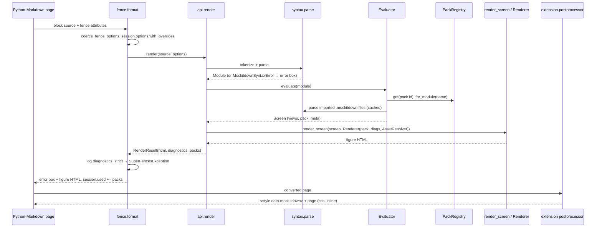

# Architecture overview

mockitdown is a pipeline of pure functions over plain data: **source → tokens → module → screen →
HTML**, with CSS assembled separately per page. Every stage reports problems to one `Diagnostics`
collector instead of raising (A-DIAG-1); only a syntax error stops the pipeline.

## Package layout

```text
src/mockitdown/
  __init__.py      public API re-exports, makeExtension            A-API-1
  api.py           render, check, evaluate, stylesheet, error box  A-API-1
  options.py       RenderOptions, DEVICES, FENCE_OPTIONS            A-OPT-1
  diagnostics.py   Severity, Location, Diagnostic, Diagnostics     A-DIAG-1
  syntax/
    lexer.py       tokens, strings, interpolation                  A-SYN-1
    parser.py      recursive descent → Module                      A-SYN-2
    ast.py         syntax-tree node types                           A-SYN-2
  evaluate.py      Evaluator: packs, imports, structs, values      A-EVAL-1
  vocabulary.py    RENDERED / IGNORED modifiers, neutral modules   A-EVAL-1
  model.py         View, Modifier, Screen, value types             (M-VIEW-*)
  packs/
    __init__.py    PackRegistry, Pack, ElementDef                  A-PACK-1
    <id>/pack.json, pack.css                                       A-PACK-2
  render/
    __init__.py    render_screen: figure, frames, Elements table   A-REND-2
    chrome.py      device chrome markup                            A-REND-2
    html.py        Renderer: one r_<role> method per role          A-REND-1
    style.py       StyleBuilder: modifiers → CSS, colours, fonts   A-REND-3
  styles.py        stylesheet assembly, px scaling, token rules    A-STYLE-1
  page.css         figure, frame unit, isolation, error box        A-STYLE-1
  assets.py        AssetResolver                                    A-ASSET-1
  icons.py         glyphs, aliases, resolution, SVG                A-ASSET-2
  extension.py     Python-Markdown extension, CSS postprocessor    A-MDX-1
  fence.py         superfences format/validate                      A-MDX-2
  cli.py           argparse CLI                                     A-CLI-1
```

## Data flow of one block



## Design rules visible in the code

- **No framework knowledge in code.** The evaluator and renderer never branch on a pack id;
  framework differences are `pack.json` data and `pack.css` rules (ADR-4, A-REND-1.K2).
- **One markup contract.** `Renderer.r_<role>` methods are the role catalogue; the pack contract
  test derives the role set from them.
- **Lenient reading, strict writing.** Roles accept many argument names, but everything written to
  HTML is escaped or allow-listed (R-REND-006).
- **Caches keyed by file state.** Imported component files (path + mtime), pack CSS (directory +
  mtime) and registries (`lru_cache` on the extra directories) are cached per process, which keeps
  `zensical serve` rebuilds fast and correct.

## Known debt and deviations

| # | Where | Deviation from the specification | Requirement |
|---|---|---|---|
| 4 | `fence.py` | A fenced block has no `source_path`, so its relative imports and images resolve only through `import_paths` / `asset_paths`. This is inherent to Python-Markdown (ADR-3.C3) and documented, not a defect. | R-IMP-002, R-ASSET-002 |

Fixed in 0.1.1 (commit "Fix spec-recorded deviations…" and "Emit the page stylesheet once…" on `main`):
#1 `default_device` now sits below `@Screen(device:)` (R-DEV-002.C1); #2 behaviour-only modifiers'
closures are no longer evaluated (R-EVAL-011.C5); #3 `t.0` parses (R-LANG-006.C8); #5 the inline
stylesheet: Zensical runs nested `convert()` calls (headings) mid-page and reuses the Markdown
instance without `reset()`, so the postprocessor now emits the CSS only in the conversion whose
output holds the figures and consumes the collected packs (R-MDX-004). Each fix has a test.

## Revision history

| Version | Date | Change |
|---|---|---|
| 0.1.0 | 2026-11-24 | Page written |
| 0.1.1 | 2026-11-24 | Deviations #1–#3 and #5 fixed |
