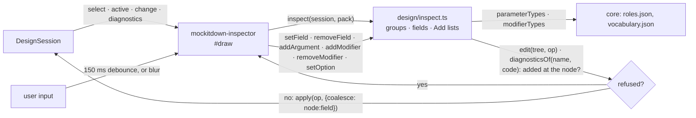

# The inspector element

Realizes **A-WEB-5** (P1 for `mockitdown-inspector`, K1, K2) over **A-WEB-4** (the session) and
implements **R-TOOL-007** C1 to C10 and C12 to C16 (#35) and **R-EDIT-007** C5 for the inspector (the
coalescing key `<node>:<field>`). C11, Edit in code, comes with the code view (R-TOOL-008); renaming a
mockup from the Mockup tab with the canvas frames (R-TOOL-012).

## Data flow



## Files

| File | What it holds |
|---|---|
| `typescript/src/design/inspect.ts` | the model: `inspect`, `fieldCode`, `setField`, `removeField`, `addArgument`, `addModifier`, `removeModifier`, `setOption`, `iconSuggestions`, `INSPECTOR_DEBOUNCE_MS` (150), `NOT_UNDERSTOOD`, `STATE_LABELS` and the types `Inspection`, `InspectorField`, `InspectorModifier`, `FieldTarget`, `FieldResult` |
| `typescript/src/design/session.ts` | `diagnosticsOf(name, code)`: a mockup's diagnostics for other code, nothing changed |
| `typescript/src/design/index.ts` | exports the model from `mockitdown/design` |
| `typescript/src/elements/inspector.ts` | `InspectorElement` (`INSPECTOR_TAG`): joins a session, draws the model, debounces inputs, keeps refused text and the focus across redraws |
| `typescript/src/elements/designer.ts` | the properties panel's default content is `<mockitdown-inspector part="inspector">` (the placeholder is gone) |
| `typescript/src/core/icons.ts` | `iconNames()`: the glyph names an icon field suggests |
| `shared/language/vocabulary.json` | `.frame`'s eight size arguments get `{"type": "number", "min": 0}` (C16) |

## How it works

- **The model** (C15) reads the active mockup's last valid tree and the selection. One node: its
  element's `ElementDef` (`params`, `variants`) and `parameterTypes(pack, name)`, its call's arguments
  and its modifier chain (`ViewNode.modifiers`, each with its occurrence index). The pack is the one
  the element passes: the mockup's evaluation selects it (`evaluate(code, options).screen.pack`), else
  the document pack.
- **Variant and state** (C4): `variant` when the element declares variants, then each of `selected`,
  `disabled`, `checked`, `value` its types name. A field remembers where it is written (`FieldTarget`):
  a labelled argument, a modifier of the same name (for `variant` also a pack modifier whose `attr` is
  `variant`, such as `.buttonStyle`), or nowhere, then it is added as the pack's modifier of that name
  when `pack.modifiers` has one (`.variant("outlined")`, `.disabled(true)`), else as an argument.
- **Arguments** (C2, C7): one field per positional parameter (`params`, the type from the types or
  `text`), skipping an unwritten parameter that is written with its label, then each labelled argument
  except the state ones. A label is "not understood" when the session's diagnostics hold an `argument`
  warning at the label's line and column (R-EVAL-004.C7). Add argument lists the remaining type labels,
  sorted, and adds the type's default (`""`, the `min` or 0, `true`, the first enum value, `.blue`,
  `"star"`, `[]`).
- **Modifiers** (C5, C13): grouped by `modifierTypes()[name].group` (`other` for pack modifiers). Written
  arguments are matched to the vocabulary's: labelled by label, positional in order to the next
  positional argument whose type reads them (so `.padding(8)` is the number, `.padding(.horizontal, 8)`
  both). A modifier with an argument that matches nothing is one code field. Changing one argument
  rewrites the parentheses' content from the written arguments in order (`label: value`), a new
  positional one placed before the first argument the vocabulary lists after it.
- **Values** (C3, C13, C14): `readValue` shows a string or interpolation-free string literal (`text`,
  `icon`), a number literal or its negation, a `true`/`false`, an enum case or string among the
  values, a colour name (enum case or string) or `#hex`, an array literal of readable items; anything
  else is a `code` field holding the source. `valueCode` writes the input back: string literals, numbers
  checked against `min`/`max`, `.case` for enum values written as cases (and new modifier arguments),
  string literals otherwise, colour names as `.name` unless written as a string, `#hex` as a string.
- **Checking and applying** (C8, C9): `setField` makes the edit operation (`setArgument`,
  `setModifier`, `rename`, `setRefs`, `setComment`), runs `edit(tree, op)`, then compares the
  diagnostics of the edited code located in the node's span (`diagnosticsOf`) with the current ones by
  severity, code and message; an added one refuses with its message. Otherwise `session.apply(op,
  {coalesce: "<node>:<field>"})`. The Mockup tab's `setOption` writes the mockup's own `options`
  (`""` removes the key) through `setOptions(name, options, {coalesce: "mockup:<name>:<key>"})`.
- **The element**: every input stores the raw value under the field key and restarts a 150 ms timer;
  the timer, Enter or blur commits it against a fresh `inspect` (dropped if another node is now shown).
  A refusal keeps the raw value and the reason, drawn with `aria-invalid="true"` and an `error` part. A
  redraw (every `select`, `active`, and the active mockup's `change` and `diagnostics`) rebuilds the
  panel with `createElement`/`textContent` and gives the focus and caret back to the same field of the
  same node. Icon suggestions are one shadow `<datalist id="mkd-icons">`.

## Use

```js
import { inspect, setField, setOption } from "mockitdown/design";
const view = inspect(designer.session);                  // view: node | multiple | mockup | empty
const v = view.state.find((f) => f.label === "variant");
setField(designer.session, v, "outlined");               // {ok: true}, one step
setField(designer.session, widthField, "-10");           // {ok: false, error: "Must be at least 0", diagnostics: []}
setOption(designer.session, "device", "tablet");         // one options step
inspector.session = editor.session;                      // the element outside a designer
```

## Tests

IT-63: `typescript/tests/unit/inspect.test.ts` (TC-2, TC-3's Mockup tab, R-EDIT-007.C5 with a fake
clock) and `typescript/tests/browser/inspector.spec.mjs` (TC-1 on the page's sample, TC-2 and the Mockup
tab on the hand-written `tests/browser/fixtures/inspector-sample.mkdesign`). See [Testing](../testing.md).

## Debugging

- A field shows as code although its value looks typed: `readValue` did not accept the node (an
  interpolated string, a value outside the enum, `Color.red` instead of `.red`).
- A value is refused with a diagnostic's text: the edited code holds a new diagnostic inside the node's
  span; `session.diagnosticsOf(mockup, code)` gives what the check saw.
- Typing forms several undo steps: the edits must reach the session within 1000 ms of each other with
  the same node and field; a redraw that moves the focus to another field ends the burst.

## Revision history

| Version | Date | Change |
|---|---|---|
| 0.3.51 | 2026-11-28 | Page written: the inspector's model in `mockitdown/design`, `mockitdown-inspector`, the designer's properties panel, IT-63 (#35) |
| 0.3.55 | 2026-11-28 | Edit in code (R-TOOL-007.C11): `Inspection.editInCode` (the span of an `if`, a `ForEach`, a struct's call or a node with a code field), the `edit-in-code` button dispatching `mockitdown-edit-in-code`; see [Two-way editing](two-way-editing.md) (#39) |
| 0.3.65 | 2026-11-28 | The session found and subscribed to through the shared `SessionLink` (`session-link.ts`); `leaving` flushes pending values (#89) |
