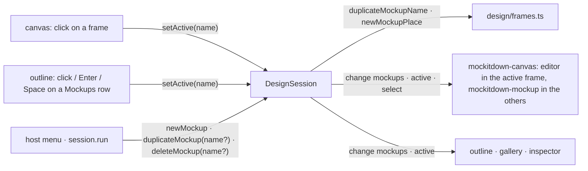

# The active mockup and the mockup commands

Implements **R-TOOL-013** C1 to C8 (#43) on **A-WEB-4** (the session holds the commands and their
rules) and **A-WEB-5** (the canvas and the outline forward clicks, K2), and extends **R-EDIT-009.C8**
(the command list): one mockup is active and the outline, the gallery and the inspector follow it; the
canvas shows it as the editor and the others as read-only previews; `newMockup`, `duplicateMockup` and
`deleteMockup` are session commands for a host's Mockup menu, each one step of the
[undo history](undo.md).

## Data flow



## Files

| File | What it holds |
|---|---|
| `typescript/src/design/session.ts` | `duplicateMockup(name?)`, `deleteMockup(name?)`, `newMockup` through the shared `addMockup` and `box`; the commands `newMockup`, `duplicateMockup`, `deleteMockup` in `COMMANDS`, `commands` and `run` (`CommandArgs.mockup`) |
| `typescript/src/design/frames.ts` | `duplicateMockupName(names, name)` |
| `typescript/src/elements/outline.ts` | the Mockups rows' `data-mockup` and `tabindex`, `#activateRow` (click, Enter, Space) |
| `typescript/src/elements/canvas.ts` | `#onFrameClick` (from #41): a click on an inactive frame activates it |
| `typescript/src/elements/inspector.ts`, `editor.ts`, `outline.ts` | redraw on a `change` of kind `mockups` when no mockup is left active |

## How it works

- **Activation** (C1): the canvas's frame click and the outline's Mockups row (click, Enter, Space)
  call `session.setActive`, which notifies `active` and clears the selection and the hover (`select`,
  `hover`). The outline keeps the focus on the activated row after its list is redrawn.
- **Following** (C2, C3): the outline rebuilds its rows, the inspector redraws its Mockup tab or node
  fields, the gallery its cards, and the canvas redraws its frames on `active`: the active frame
  (`data-active`, outlined) holds the slot with the designer's `mockitdown-editor`, the others a
  read-only `mockitdown-mockup` with the mockup's options ([The canvas](canvas.md)).
- **duplicateMockup** (C5): a `structuredClone` of the mockup (code, options and every key the tools do
  not know), named by `duplicateMockupName` (`<name>-copy`, else `<name>-copy-<n>`, the smallest free
  `n` from 2, case-sensitive; the designer renames it afterwards), which calls `copyName` in
  `design/frames.ts`, the rule element copies' identifiers share ([Commands](commands.md)) and placed by `newMockupPlace` with the copied mockup's box as the
  reference (the active one by default, so exactly as a new mockup), the boxes measured as for
  `newMockup` ([Mockup frames](frames.md)). `addMockup` appends it, records one step of kind
  `mockups` (snapshots with the list before and after), notifies `change` and makes it active.
- **deleteMockup** (C6): one step of kind `mockups` with the list before and after the removal. When
  the deleted mockup was active, the next one in document order becomes active, else the one before
  it, else none; `activeName` changes before `change` is notified, so a listener never reads the
  removed mockup, then `active` (unless none is left), `select` and `hover` follow. With none left no
  `active` is notified (the notification names a mockup); the outline, inspector and an editor without
  a `mockup` attribute redraw on the `change` instead. Undo restores the list, so the mockup is back
  at its index, and the active mockup and selection from before the step.
- **Refusals** (C7): an unknown name, or no name and no active mockup, returns `{error}` with nothing
  changed or notified and no step.
- **The command list** (C4): `newMockup` ("New Mockup"), `duplicateMockup` ("Duplicate Mockup") and
  `deleteMockup` ("Delete Mockup") stand before undo and redo, with no shortcut; `newMockup` is always
  enabled, the other two whenever there is an active mockup, whatever the code's state.
  `run("duplicateMockup", {mockup})` and `run("deleteMockup", {mockup})` pass the name; `run("newMockup")`
  adds a `VStack`.

## Use

```js
session.run("duplicateMockup");                  // {mockup: "Inbox-copy"}, now active
session.duplicateMockup("Sign in");              // {mockup: "Sign in-copy"} beside Sign in
session.deleteMockup();                          // the active one; its neighbour becomes active
session.commands.filter((c) => c.name.endsWith("Mockup"));
import { duplicateMockupName } from "mockitdown/design";
duplicateMockupName(["Inbox", "Inbox-copy"], "Inbox");   // "Inbox-copy-2"
```

## Tests

IT-71: `typescript/tests/unit/mockup-commands.test.ts` (R-TOOL-013.TC-2, hand-computed names, places
and notification orders) and `typescript/tests/browser/mockups.spec.mjs` (TC-1 and the commands in the
designer on `pages/designer.html`). See [Testing](../testing.md).

## Debugging

- A Mockups row click does nothing: the outline has no session (none of its own mockups) or the row is
  already the active mockup.
- After deleting the last mockup `session.active` is null and no `active` arrives: listen to the
  `change` of kind `mockups`.
- A copy lands far away: the copy is placed beside the mockup it copies, which need not be the one on
  screen when a name is given.

## Revision history

| Version | Date | Change |
|---|---|---|
| 0.3.59 | 2026-11-28 | Page written: activation from frames and the Mockups list, `duplicateMockup`, `deleteMockup`, the mockup commands in `session.commands`, IT-71 (#43) |
| 0.3.68 | 2026-11-28 | Copies named `<name>-copy`, then `<name>-copy-<n>`, through `copyName` (R-TOOL-013.C5; #88) |
