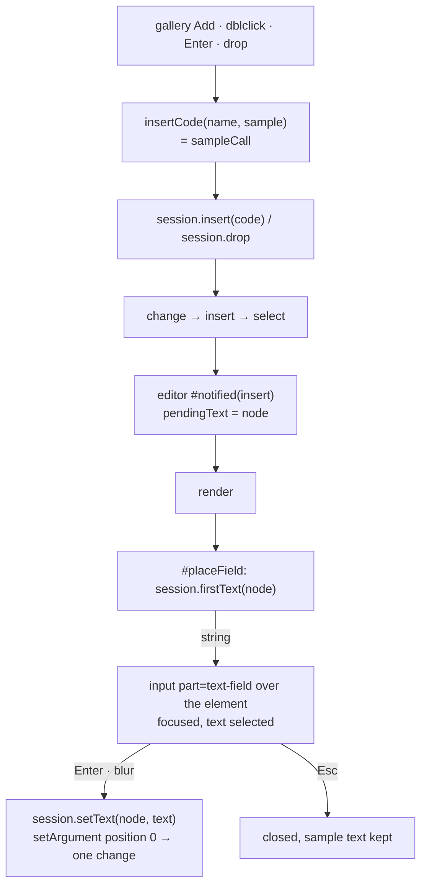

# New elements

Realizes **A-WEB-5** (K2) and implements **R-TOOL-006** (#31): an element added from the gallery arrives
with its sample's arguments, and its first text opens for editing at once. It changes what
[the gallery element](gallery-element.md) (R-TOOL-004.C8) and [drag and drop](drag-drop.md)
(R-TOOL-005.C5) insert, and adds an inline field to [the editor element](editor.md). The rules are in
the core and the session ([Editing core](editing.md), [Design documents and the design session](design.md));
the components only call them.

## Files

| File (`typescript/`) | What |
|---|---|
| `src/core/syntax/sample.ts` | `sampleCall(name, sample)` (C1, C6): the sample's single top-level call of the element, without its trailing closures, else `<Name>()`; `firstText(node)` (C2): a node's first positional argument when it is a plain string literal |
| `src/core/syntax/edit.ts` | `stringLiteral(text)`: the escaped literal the edit operations write (exported `quote`) |
| `src/core/index.ts`, `src/core/syntax/index.ts` | `sampleCall`, `firstText`, `stringLiteral` exported |
| `src/design/session.ts` | `DesignSession.firstText(node)`, `DesignSession.setText(node, text)` (C4) |
| `src/elements/gallery.ts` | `insertCode(name, sample?)` is `sampleCall`; Add, `add(name)` and a card's drag source use the shown pack's sample (kept for hidden elements too) |
| `src/elements/editor.ts` | the field: `#placeField`, `#openField`, `#positionField`, `#closeField` (C2, C3, C5) |
| `tests/unit/sample.test.ts` | IT-59: R-TOOL-006 TC-2 |
| `tests/browser/new-element.spec.mjs`, `tests/browser/fixtures/new-element-sample.mkdesign` | IT-59: R-TOOL-006 TC-1 (Playwright) |

## Use

```js
import { sampleCall } from "mockitdown";
sampleCall("List", 'List() { Text("First item") }');      // "List()"
sampleCall("Tab", 'TabView { Tab("Inbox") { … } }');      // "Tab()": not a call of Tab
session.firstText(nodeId);                                 // "Label" for Button("Label"), else null
session.setText(nodeId, "Save");                           // Button("Save"), one change; same text: no edits
```

## How it works



- **The code** (C1, C6): `sampleCall` parses the sample with `parseTree`. Only a module of exactly one
  statement, with no struct, import or directive, whose single view node is a call named as the element,
  is used; anything else gives `<Name>()`. The call's text runs from its first token to the end of its
  chain; with trailing closures, the text from the first closure's start to the last closure's end is
  cut (the labels of later closures with it) and the spaces before it trimmed; a call written without
  parentheses gets `()`. Closures passed as arguments (`actions: { … }`) and modifiers are kept.
  Across the 38 packs' reference data, 5407 elements get arguments, 86 keep an argument closure and
  2150 are `<Name>()` (no parameters, or shown inside another element such as tabs in a `TabView`).
- **The sample** comes from the reference data the gallery already loads (`dist/shared/reference/<pack>.json`);
  the gallery keeps a name → sample map of the shown pack, so `add(name)` of an element hidden by the
  selection still uses its sample. A struct has no sample: `<Name>()`.
- **The field** (C2): on an `insert` notification for the mockup it shows (and the session's active
  one), the editor remembers the node; after the render that follows, if `session.firstText(node)` is a
  string and the node has a rendered element, it appends an `<input class="mkd-editor__field"
  part="text-field">` to its shadow root, positioned over the node's first element (at least 64 × 20 px,
  with that element's computed font), focuses it and selects its text.
- **Keys and commit** (C3): the field stops its keys from reaching the editor and the designer (no Esc
  climb, no Delete of the selection while typing). Enter commits and returns the focus to the editor;
  `blur` commits; Esc closes without committing. Committing removes the field, then calls
  `session.setText`, which writes `setArgument` with label null, position 0 and `stringLiteral(text)`:
  a `change` of its own after the insertion's; the same text makes no edit and no notification.
- **Renders while open** (C5): a render replaces the shadow root; a flag keeps the field's `blur` from
  committing then, and the field is appended again, repositioned and refocused with its selection
  kept. If its node has no first text any more (deleted, replaced as text), it closes without
  committing. An insertion arriving while it is open commits it in a microtask (not inside the
  session's notification) and opens the new node's field.
- **Undo**: there is no history yet (R-EDIT-007); the commit's own `change` is the step the history
  will record.

## Debugging

- `npm run serve`, `http://127.0.0.1:8173/pages/designer.html`: select a stack, Add `Button`; the field
  shows `Label`. In the console `mockitdown.sampleCall("List", sample)` shows what a sample gives.
- An element inserted as `<Name>()` although its card has a preview: its sample is not one call of the
  element (look at `gallery.state.cards[…].sample`).
- No field: the first positional argument is not a plain string (a variable, an interpolation, a
  label), or the node rendered no element (`data-mkd-node`) to place it over.

## Revision history

| Version | Date | Change |
|---|---|---|
| 0.3.47 | 2026-11-28 | Page written: `sampleCall`, `firstText`, `session.setText`, the editor's inline field, IT-59 (#31) |
