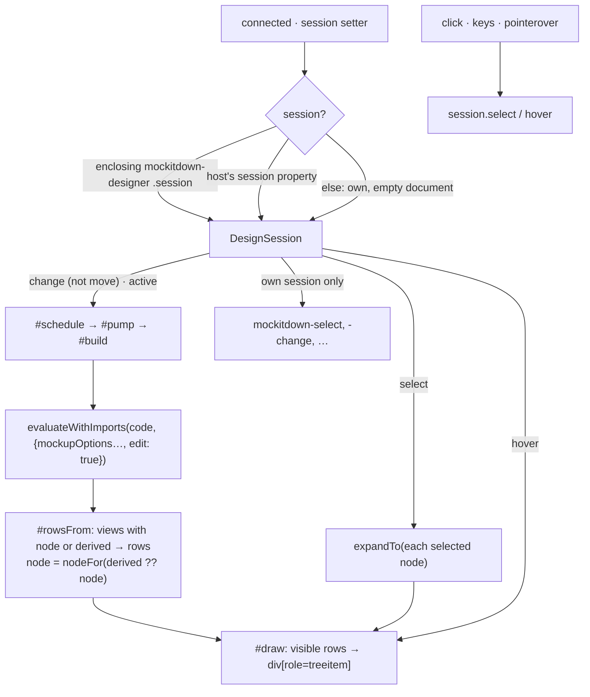

# The outline element

Realizes **A-WEB-5** (P1 for `mockitdown-outline`, K1, K2) and implements **R-TOOL-002** (#26):
`<mockitdown-outline>`, the element tree of a design session's active mockup, with the Mockups tab. It
evaluates the mockup through the TypeScript core with the `edit` option (R-EDIT-004, see
[TypeScript core](typescript.md)), resolves imports with the helpers of
[the mockup element](elements.md), and selects and hovers through the `DesignSession`
([Design documents and the design session](design.md)). On `pages/editor.html` it shares the session of
[the editor element](editor.md). It also does the outline's part of R-EDIT-006 C7, C8 and C11.

## Files

| File (`typescript/`) | What |
|---|---|
| `src/elements/outline.ts` | `OutlineElement`, `OUTLINE_TAG`, `OUTLINE_ATTRIBUTES` (`import-base`), `OUTLINE_INDENT` (14), the `OutlineRow` type |
| `src/elements/mockup.ts` | `evaluateWithImports(code, options, importBase, stale)`, beside `renderWithImports`; both run the same import loop (`withImports`) over the shared import cache |
| `src/elements/define.ts` | `ELEMENT_TAGS` and `defineElements()` now include `mockitdown-outline` |
| `pages/editor.html` | "Editor and outline elements": the outline beside the editor, `outline.session = editor.session`; the sample's button carries `.id("open")` |
| `tests/browser/outline.spec.mjs` | IT-54 (Playwright) |

## Use

```html
<mockitdown-outline id="outline"></mockitdown-outline>
<mockitdown-editor id="editor" pack="base" device="fit">
  <script type="text/mockitdown">List { Card { Button("Open") {}.id("open") } }</script>
</mockitdown-editor>
<script type="module">
  await customElements.whenDefined("mockitdown-outline");
  outline.session = editor.session;
  await outline.rendered;
  outline.rows.map((r) => `${r.level} ${r.name} ${r.label} ${r.id}`);
  outline.expandTo(outline.rows.at(-1).node);
</script>
```

## How it works



- **Session** (R-EDIT-006.C11, R-TOOL-002.C13): `#attach()` as in the editor — the nearest
  `mockitdown-designer`'s `session`, else the host's, else `new DesignSession(newDesign("mockitdown-outline"))`
  (no mockups: the tree says "No mockup"). Only an own session's notifications are dispatched as DOM events.
- **Rows** (C2-C4, C14): `#build` evaluates the active mockup with `mockupOptions` plus `edit: true` and
  imports against `import-base`. `#rowsFrom` walks the views in `walk` order (content, slots, modifier
  content, view-list attributes): a view with `node` or `derived` becomes a row, any other view is
  skipped and its children are visited at the same level. A row's node is
  `nodeFor(mockup, derived || node)`, so a `ForEach` item, an `if` branch, a struct's or an imported
  component's view stands for its construct, as the editor maps a click. The label is the evaluated
  value of the first argument when the call's first argument is positional (the element's first
  parameter, through `attrFor` and the pack's `attrs`, else `extra_args[0]`) and a string; the chip is
  `.id(…)`'s argument. A syntax error or an exception keeps the previous rows.
- **Expansion** (C10): a map from row key to open/closed; a row not in it is open at level 1 only. The
  key is `ownId/derivedId#k` (the node ids survive edits; `k` counts repeats such as a `ForEach`'s items).
- **Drawing** (C1, C3, C12): only the visible rows are in the DOM, as a flat ARIA tree (`aria-level`,
  `aria-expanded` for rows with children, `aria-selected` for every row of a selected node), indented by
  `padding-inline-start: (level − 1) × 14px`. The triangle is CSS content (`::before`), the quotes of the
  label too, so the row's text is just name, label and chip. The tree element keeps the focus
  (`tabindex="0"`) and points at the current row with `aria-activedescendant`.
- **Selection** (C5, C6, C11): the current row is separate from the selection, because the three rows of
  a `ForEach` share one node. A click, Up, Down, Home, End, Left (to the parent), Right (to the first
  child) and typeahead make a row current and `session.select([row.node])`. A `select` notification
  moves the current row to the first row of the selection unless the current row already belongs to it,
  calls `expandTo` for each selected node and scrolls the first row into view (`block: "nearest"`).
  Typeahead keeps a buffer for 600 ms; a one-character search starts after the current row, a longer one
  at it, over the visible rows, wrapping.
- **Hover** (C7): `pointerover` on a row calls `session.hover(row.node)` (only for the active mockup's
  rows), leaving the tree hovers null; a `hover` notification redraws, marking rows of the hovered node
  `mkd-outline__row--hover`. The editor outlines the node hovered here.
- **Tabs** (C8): two `role="tab"` buttons over two `role="tabpanel"`s; Left and Right move between tabs.
  The Mockups list is redrawn after `active`, `rename` and a `change` of kind `mockups`.

## Debugging

- `npm run serve`, open `http://127.0.0.1:8173/pages/editor.html`. In the console:
  `outline.rows`, `outline.session.selection`, `outline.shadowRoot.querySelectorAll('[role=treeitem]')`.
- No rows: the session has no active mockup, the outline joined its own empty session (set `session`),
  or the mockup never evaluated (look at `session.diagnostics(session.active)`).
- A row that selects nothing: `nodeFor` found no node for its ordinal — the code changed and the last
  valid tree is older than the rows.
- Expansion lost after an edit: the edit replaced the nodes (new ids), so the keys changed.

## Revision history

| Version | Date | Change |
|---|---|---|
| 0.3.42 | 2026-11-28 | Page written: `mockitdown-outline`, rows from the edit-mode evaluation, keys, hover, tabs, `evaluateWithImports`, IT-54 (#26) |
