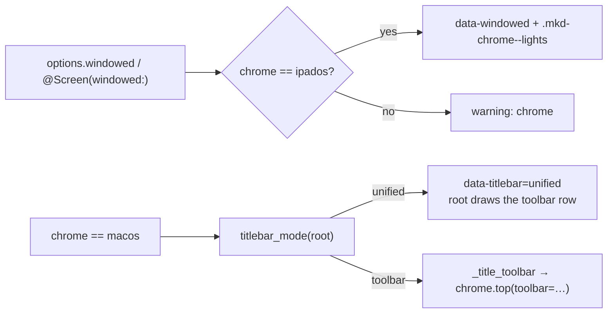
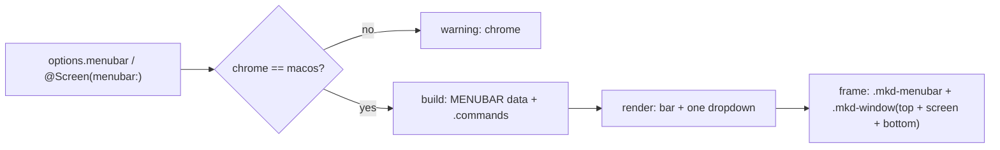

# Rendering

Realizes **A-REND-1** (HTML renderer), **A-REND-2** (figure assembly and chrome) and **A-REND-3**
(style builder); requirements R-REND-001 – R-REND-010, R-APP-001, R-APP-003, R-DEV-001, R-DEV-002,
R-DEV-005, R-DEV-008, R-DEV-009, R-DEV-010, R-REND-012, R-REND-013, R-REND-014, R-ASSET-004.

## Figure assembly — `render/__init__.py`, `render/chrome.py`

`render_screen(screen, renderer, options, diagnostics, source)`:

1. `_resolve_device` — option `device` → `@Screen(device:)` → pack default; `fit`; `width`/`height`
   overrides; pack `sizes` then `options.DEVICES`.
2. Appearance (option → `@Screen` → `default_appearance`), chrome (option unless `auto` →
   `@Screen` → `pack.chrome_for(device)`), title, id, url.
3. `anchor_prefix(pack.id, source)` sets the figure's CSS anchor prefix: the first six hex digits of
   the SHA-1 of `"<pack id>\n<source>"` (R-ANN-003.C5). It used to hash `repr(screen.views)`, which
   no other variant can reproduce and which carried file paths through import locations.
   `renderer.views(screen.views)` renders the body once; `renderer.overlays` collects the
   presentation layers; `chrome.top`/`chrome.bottom` wrap the screen.
4. One `mkd-cell`/`mkd-frame` per appearance (`both` → light and dark from the same HTML), the
   caption and `elements_table` (walks `model.walk` for `.id()` modifiers).

`chrome.CHROME_KINDS` lists the kinds; each kind is a fixed markup snippet with built-in icons.

### Platform chrome (R-DEV-010)

- `windowed` (option → `@Screen(windowed:)` via `parse_bool`, default off): with `ipados` chrome the
  frame carries `data-windowed="true"` and `chrome.top` adds `.mkd-chrome--lights` (the app window's
  traffic lights) after the status bar; with any other chrome it is ignored with the warning
  "windowed needs iPadOS chrome; ignored" (code `chrome`, C10).
- `titlebar_mode(views, renderer)` (only with `macos` chrome) puts `data-titlebar` on the frame:
  `unified` when the first top-level view is a `NavigationSplitView`, a `.sidebarAdaptable` `TabView`
  or a `NavigationStack` whose content has `.navigationTitle`/`.toolbar` (found as `r_navstack` finds
  them, `_find_mod`), so the content draws the toolbar row and CSS floats the lights over it (C7);
  `toolbar` when another root carries `.navigationTitle`/`.toolbar` — `_title_toolbar` renders the
  title and the leading and trailing items (`_toolbar_items`) **before** the body, in document order,
  and `chrome.top(..., toolbar=…)` draws them in the title bar (C13); otherwise nothing (a centred
  window title).
- `chrome.bottom("ipados")` draws the home indicator (C1).

### The macOS menu bar — `render/menubar.py` (R-DEV-009)

- `menubar.option(value)` reads the option (`RenderOptions.menubar`, else `@Screen(menubar:)`):
  `True`/`"true"`/`""` → the bar, no menu open; `False`/`"false"` → none; any other text → the bar
  with that menu open. With chrome other than `macos` it is ignored with the warning
  "menubar needs macOS chrome" (code `chrome`, C2).
- When shown, the frame carries `data-menubar="true"` and `frame_inner` becomes
  `div.mkd-menubar` + `div.mkd-window[data-titlebar]`, the window wrapping the top chrome, the screen
  and the bottom chrome (C9). The bar is rendered **first** (document order: anchors number alike in
  both variants), then the title bar's toolbar, then the body. Without the option the markup is
  unchanged, so no other conformance case moved.
- The app name (C4): `RenderOptions.app` → `@Screen(app:)` → the title → `App`.
- `build` merges the menus: the standard menus are data — `vocabulary.MENUBAR`, the `menubar` key of
  `shared/language/vocabulary.json` (menus → entries: `"-"` separators and groups of items, each group
  at a SwiftUI placement or fixed); `.commands` is found with `_find_mod` on the root (through
  `WindowGroup`/`Group`), its `CommandGroup(replacing:|before:|after:)` edit the group at that placement
  (last `replacing` wins; `before`/`after` accumulate), `CommandMenu` (and a bare `Menu`) are inserted
  before the menu with `id: "window"`. Separators are tidied (none first, last or doubled). An unknown
  or missing placement warns and is skipped (C11).
- `view_rows` maps views to rows: `divider` → separator, `button`/`menuitem`/`link` → item (label,
  `.keyboardShortcut` → `shortcut()`: ⌃⌥⇧⌘ in that order then the key, ⌘ by default, `KEY_GLYPHS` for
  `KeyEquivalent` members, none for `.defaultAction`/`.cancelAction`; `systemImage` icon; `.disabled`),
  `toggle` → checkmark item, `menu` → submenu (chevron), `section` → header + rows, `group` → its rows.
  `keyboardShortcut` moved from the vocabulary's `ignored` list to `rendered`, and `commands` joined it,
  so both reach the renderer as modifiers.
- One menu opens (C8): the first in bar order that the title names, that carries
  `.open()`/`isPresented:`, or that holds an open submenu; it is drawn inside its
  `.mkd-menubar__menu` as `.mkd-menubar__dropdown`, so CSS places it under its title without
  measuring. An open submenu cascades (`.mkd-menubar__dropdown--sub`). A title naming no menu warns
  (C10).
- Status items, in macOS's order: battery, Wi-Fi, Control Center (`switch.2`), then the fixed clock
  from the data (`Mon Nov 23  9:41 AM`, `white-space: pre`).

Debugging: render with `mockitdown render x.mockitdown --device desktop --menubar File --standalone`;
a dropdown that does not blur the window under it means an ancestor has `backdrop-filter` (it becomes
the backdrop root) — the bar deliberately has none.

## Renderer — `render/html.py`, `render/roles/`, `render/_util.py`

`Renderer(pack, diagnostics, assets)` dispatches `view(v)` to `r_<role>` (`getattr`), falling back
to `r_unknown` with a `role` error. `html.py` holds the dispatch and the infrastructure every role
family uses; the `r_<role>` methods are in one mixin class per role family, which `Renderer`
inherits, so a change to one family's markup stays in one file:

| Module | Mixin | Roles, and the helpers only that family uses |
|---|---|---|
| `roles/layout.py` | `LayoutRoles` | stacks, scroll, grid, spacer, divider, shape, colour; `_stack` |
| `roles/content.py` | `ContentRoles` | text, label, image, icon, avatar, badge, chip, link, progress, rating, placeholder, chart; `GAUGE_ARC` |
| `roles/controls.py` | `ControlRoles` | button, fab, toggle, checkbox, radio, segmented, text field, select, radio group, slider, stepper, date picker, calendar, drop zone; `_options`, `_option_tags`, `_selected_index`, `_field`, `_wheel`, `_date_style`, `_calendar`, the picker and date constants, `_parse_date`, `_parse_time`, `_format_date` |
| `roles/navigation.py` | `NavigationRoles` | navigation stack, split, tabs, tab, app bar, sidebar, nav item, breadcrumb, pagination, steps; `_find_mod`, `_toolbar_items`, `_PLACEMENT` |
| `roles/containers.py` | `ContainerRoles` | card, section, list, form, list item, labeled, table, toolbar, accordion, dialog, menu, menu item, tooltip, toast, alert; `_rows`, `_tr`, `_cell`, `TOOLTIP_PLACEHOLDER`, `ACTION_DIALOGS` |
| `roles/components.py` | `ComponentRoles` | spreadsheet, sticky note, board, kanban card, code, message, tree, timeline, gantt, schedule, kbd, skeleton, swatches, canvas, media, empty state, stat, map; the cell-range, hour, code-highlighting and map helpers |
| `roles/annotations.py` | `AnnotationRoles` | callout, pointer, marquee |

Shared helpers:

| Helper | Purpose |
|---|---|
| `open(v, role, tag, cls=, data=, style=, attrs=)` | the root tag: `mkd-<role>` class, `data-el`, `data-component`, `PASSTHROUGH` attributes (allow-listed by `_SAFE_TOKEN`), `data-state`, `data-selected`, modifier style/data/classes, `title` from `.help` |
| `text_html`, `esc` (`_util.py`, re-exported by `html.py`) | escaping and the inline Markdown subset (`_INLINE_MD`) |
| `_fmt`, `_num`, `_name`, `_bool`, `initials`, `PH`, `_cursor_svg` (`_util.py`) | value coercion and markup used by several families and by `html.py` |
| `content`, `slot`, `text_or_slot`, `has` | read text-or-views attributes and slots |
| `icon`, `leading_visual`, `avatar_html`, `badge_html` | shared visuals |
| `_decorations`, `_wrap_overlays`, `_collect_presentations` | decoration modifiers; `.overlay`/`.background` content; alert, sheet, … layers |

A module-level helper lives with the one family that uses it; one that several modules use goes to
`_util.py`, which imports nothing from `html.py` or `roles/`, so the mixins never import `html.py`.
The TypeScript renderer has the same families under `typescript/src/core/render/roles/`, one
`<family>.ts` per Python `<family>.py` ([TypeScript core](typescript.md#rendering)).

The 66 `r_<role>` methods are the [role catalogue](../../specification/rendering/roles.md). A role
method reads attributes leniently (several framework spellings) and emits fixed markup.

`Renderer` state is per mockup: `overlays`, `row_wrap` (rows inside lists/forms), `in_menu`,
`chart_seq` (deterministic chart ids).

## Fit frames, presentations and rows — `shared/css/page.css`, `shared/packs/base/pack.css`

R-DEV-008 and R-REND-013 are almost entirely CSS; the renderer's part is the tooltip markup.

- **Natural width (R-DEV-008.C1).** `.mkd-frame[data-fit="true"]` is `width: max-content` with no
  `max-width`; its `.mkd-cell` keeps `max-width: 100%`, scrolls (`overflow-x: auto`) and centres with
  `align-items: safe center`, so the frame's start stays reachable when it is wider than the page.
- **Presentations in flow (C2, C8, C9).** At `fit`, a screen holding a `.mkd-layer` becomes a
  one-column grid of eight `auto` rows: its first seven children take rows 1–7 (`:nth-child`), every
  layer spans `1 / -1`. The layer is `position: static`, so its `.mkd-scrim` (absolute, inset 0) is
  sized by the screen. Dialog surfaces get `min-width: 240px; min-height: 80px`; a sheet layer has
  48 px of padding above (the dimmed band, C4), its surface `min-width: 320px; min-height: 240px`,
  and bleeds over the screen's padding with negative margins of `--mkd-fit-padding` (16 px; nls,
  lisa, mac-classic, phosphor, hologram and lcars set it instead of `padding`).
- **Sheet grabber (C3, C4).** A `Dialog`/`Sheet` element with variant `sheet` draws the grabber as
  `.mkd-dialog::before` (zero specificity: `:where`); `android` and `angular-material` replace it
  with their own `::before`.
- **Tooltips (C5).** `r_tooltip` wraps the content in `.mkd-tooltip__anchor` (or
  `TOOLTIP_PLACEHOLDER`, a placeholder button, when there is none) and starts the bubble with
  `.mkd-tooltip__arrow`, a rotated square with the bubble's background on the anchor's side. At `fit`
  the tooltip is an inline grid: bubble above (`top`), below (`bottom`) or after (`trailing`) the
  anchor, `position: relative; z-index: 1`. Packs that draw their own arrow as `::after` (antd,
  carbon, bootstrap, macos9, prime, shadcn; fluent's TeachingTip, vista's and winxp's Balloon) hide
  the element.
- **Toasts (C6, C10).** The base toast has no `min-width`; packs keep their framework widths.
- **Open menus (C7).** At `fit`, `:where(.mkd-screen, .mkd-vstack) > :is(.mkd-menu, .mkd-select)`
  lays its popup out `position: static`.
- **Rows (R-REND-013.C1–C3).** `:is(.mkd-hstack, .mkd-toolbar, .mkd-labeled) > :not(.mkd-text,
  .mkd-spacer, [data-fill~="x"])` keeps `min-width: min-content` (specificity 0,3,0, above a pack's
  `min-width: 0` on a control); `.mkd-text` and control labels are `overflow-wrap: break-word`.
  Rails (`.mkd-sidebar` `rail`/`compact`) and the lisa/mac-classic tool palettes clip their cells.
- **Message bubbles (C4).** `.mkd-message__bubble` wraps (`overflow-wrap: break-word`); at `fit`
  `.mkd-message` is at least 300 px wide, so its 75 % stack has room for a short text.

Debugging: in the gallery, `inspectMockups` of `typescript/tests/browser/geometry.mjs` can be pasted
into the console (it is self-contained) and returns the geometry problems of the open pack.

## Shapes — `r_shape`, `shared/packs/base/pack.css`

R-REND-014. `r_shape` emits one `.mkd-shape` with `data-shape` (`rectangle`, `rounded`, `circle`,
`ellipse`, `capsule`); `.frame()` sizes that element, so the frame is laid out at w × h (C1).

- **Circle (C1, C3).** `.mkd-shape[data-shape="circle"]` is a size container (`container-type: size`,
  `display: grid; place-items: center`, no background, `aspect-ratio: 1` when nothing sizes it). Its
  `::before` is the circle: `min(100cqw, 100cqh)` square, `border-radius: 50%`, background
  `--mkd-shape-fill`, border `--mkd-shape-stroke`.
- **Stroke and shadow on a circle (C5).** `_m_stroke` sets `--mkd-shape-stroke` instead of `border`,
  and `_m_shadow` sets `filter: drop-shadow(…)` instead of `box-shadow`, when the view is a circle
  (`_is_circle`); the drop shadow follows the painted disc because the frame is transparent.
- **Ellipse and capsule (C2, C6).** Ellipse `border-radius: 50%`; capsule `9999px` (the browser
  scales overlapping radii down to half the shorter side). `_shape_radius` / `_enum_radius` give
  `.background(_, in: Ellipse())` and `.clipShape(Ellipse())` 50 %.
- **Packs (C4).** No pack sets geometry on circle, ellipse or capsule. Sketch keeps its pencil look by
  setting `--mkd-shape-stroke` and hatching the circle's `::before`.

Debugging: `inspectShapes` in `typescript/tests/browser/geometry.mjs` reads the `::before` size of
each circle (`getComputedStyle(shape, "::before")`) and the radii of the other shapes.

## Charts — `render/charts.py`

R-REND-012. `r_chart` collects a `ChartSpec` (series, labels, points, matrix, options) and
`charts.render(spec)` dispatches on the kind. Derivation from `values:` (C6, C8) is in the helpers
the kinds share:

| Helper | Gives |
|---|---|
| `_value_points` | `points:`, else `[index, value, value, series]` for every value of every series (scatter, bubble) |
| `_value_matrix` | `matrix:`, else one row per non-empty series (heatmap) |
| `_value_candles` | `points:` rows of four, else `[prev, max + 10 % range, min − 10 % range, value]` per value after the first, labels shifted by one |
| `has_data` | whether marks can be drawn (C7, C9): a gauge always; pie, donut and treemap need a positive value |
| `_empty` | a chart without data: the axes, the pie/donut outline circles, the sparkline baseline or the heatmap/funnel/treemap frame |
| `_bar_group` | one category's bars for `_bars` in either orientation: the value axis along x (horizontal) or y, grouped bars side by side across the band, stacked bars in one slot (`barGroup` in `charts.ts`) |

`render` calls `_empty` for the kinds whose drawing needs data (scatter, bubble, candlestick,
heatmap, pie, donut, treemap, sparkline, funnel); bar, line, area, combo and radar already draw their
axes or grid with no data. `r_chart` warns `"<Element> has no data"` with code `chart` when
`has_data` is false. A bubble's radius is `17 * sqrt(size / max size)`, so areas are proportional
(C10). Candle bodies carry `class="mkd-chart__candle"`.

## SwiftUI control markup — `r_select`, `r_datepicker`, `r_progress`, `r_toolbar`, `r_list` (R-PACK-014)

Both renderers (`render/roles/*.py`, `typescript/src/core/render/roles/*.ts`) add markup keyed on the
SwiftUI style names, which no other pack uses:

- `r_select`: options come from children of the option roles or any child with a `tag`
  (`_options`, `_option_tags`); a selection matching a tag selects it; without a selection the
  one-value styles (`PICKER_FIRST`) show the first option. `.segmented`/`.palette` go to
  `r_segmented`, `.inline`/`.radioGroup` to `r_radiogroup`, `.wheel` to a `wheel` role root built by
  `_wheel`; an option style without options falls back to the menu field (label, empty value,
  up-down chevron).
- `r_datepicker`: the styles of `DATE_STYLES` go to `_date_style` — default 23 Nov 2026 9:41 AM,
  `_parse_time` for `T14:05`, `displayedComponents` for the parts; capsules (`data-kind="compact"`),
  wheel columns, the numeric field (`data-kind="field"`) with a stepper; `.graphical` to
  `_calendar(v, date)` so the default date is selected (`r_calendar` keeps its own `selection`).
- `r_progress`: `minimumValueLabel`/`maximumValueLabel` as `__min`/`__max`; `.accessoryCircular`
  an open arc path (`GAUGE_ARC`, `pathLength="100"`, dash = value × 100); `.accessoryLinear` a
  `__marker` at the value; `.accessoryCircularCapacity` the closed ring.
- `r_toolbar`: `.compactMenu`/`.menu` render one `.mkd-toolbar__menu` instead of the children.
- `r_list`: `selection:` is kept in `list_selection` while the rows render; `_rows` marks the wrapper
  whose child's tag or text equals it.
- `r_textfield`: the root carries `role="textbox"` like every other control's ARIA role (R-REND-007.C1);
  a filled field whose placeholder is its only title carries it as `aria-label`.

## Presentations and navigation markup — `r_dialog`, `r_split`, `r_tab` (R-PACK-015)

Both renderers, for every pack:

- `r_dialog`: a dialog of a variant in `ACTION_DIALOGS` (`alert`, `action-sheet`) without an
  `actions:`/`buttons:` slot renders its `Button` children as `.mkd-dialog__actions` and the others in
  the body (C9). A `popover` dialog draws `.mkd-dialog__arrow` first in the surface and, when written on
  its own, a `.mkd-popover__anchor` holding the tooltip placeholder button before it in the layer
  (C10); `base` `pack.css` lays such a layer out as a column and hides the arrow.
- `_collect_presentations`: a `.popover` presentation draws `.mkd-presented__arrow`.
- `r_split`: unlabelled children are sidebar (first), detail (last), content (a middle second); a
  column that is not a `NavigationStack` gets `.mkd-split__header` with its `.navigationTitle`
  (`.mkd-split__title`) and its `.toolbar` items (`.mkd-split__toolbar`, R-DEV-010.C12) (`_find_mod`).
  The split view ends with `.mkd-split__toggle` (the `sidebar.left` icon, role button): base hides it,
  the SwiftUI pack shows it with `macos` and `ipados` chrome (R-DEV-010.C3, C6).
- `r_tab` (a `Tab` outside a `TabView`): a `tabs` root with `data-standalone="true"`, the placement of
  the pack's `TabView` default (`bottom` in base and SwiftUI), and one selected `.mkd-tabs__tab`.

## Style builder — `render/style.py`

`StyleBuilder.build(view)` runs one `_m_<modifier>` handler per recorded modifier and returns
`(style, data, classes)`. `u(n)` produces `calc(N * var(--u))`; `css_color` validates colours
(named → `--mkd-color-*`, semantic → tokens, hex, `rgb()/hsl()`, `Color(...)`, opacity via
`color-mix`); `FONT_STYLES` and `FONT_ALIASES` canonicalise fonts after the pack's own `fonts` map.

## Adding a role

1. Add `r_<role>` to the mixin of its family in `render/roles/`, and the role function to the record of
   the same family in `typescript/src/core/render/roles/` (and BEM parts) — R-REND-002.
2. Style its structure in `packs/base/pack.css`.
3. Add it to the role catalogue in the specification (REF.2, a specification change), then regenerate
   `python/tests/fixtures/role-catalogue.json` with `python tools/gen_role_catalogue.py` (from `python/`;
   it reads REF.2 from the docs worktree, else from the `docs` branch). `test_markup.py` fails on a role,
   part or data attribute the catalogue does not list (R-REND-002.TC-1, R-REND-003.TC-1);
   `test_role_catalogue.py` and the CI step `gen_role_catalogue.py --check` fail on a stale fixture (IT-43).
4. Map elements onto it in packs; `test_every_element_renders` covers it.

## Revision history

| Version | Date | Change |
|---|---|---|
| 0.1.0 | 2026-11-24 | Page written |
| 0.3.3 | 2026-11-25 | Portable anchor prefix from pack id and source (#2) |
| 0.3.9 | 2026-11-25 | Fit frames at natural width, presentations in flow, tooltip anchor/arrow, rows without overlap, message bubbles (#8) |
| 0.3.10 | 2026-11-25 | Shapes (circle inside its frame, true ellipse) and charts drawn from values, no-data warning (#9) |
| 0.3.12 | 2026-11-25 | SwiftUI control markup: pickers, date pickers, gauges, control group menus, list selection (#11) |
| 0.3.13 | 2026-11-25 | Presentations and navigation: alert actions from Button children, popover anchor and arrow, split view columns and titles, lone tabs (#12) |
| 0.3.14 | 2026-11-25 | Platform chrome: `windowed`, the macOS title bar modes, the iPadOS home indicator, the split view toggle and column toolbars (#13) |
| 0.3.15 | 2026-11-25 | The macOS menu bar: `render/menubar.py`, `.mkd-window` under the bar (#14) |
| 0.3.20 | 2026-11-27 | `render/html.py` split into role-family mixins under `render/roles/` and shared helpers in `render/_util.py`, no change in output (#48) |
| 0.3.21 | 2026-11-27 | The TypeScript role families under `typescript/src/core/render/roles/` (#49) |
| 0.3.28 | 2026-11-27 | `r_textfield` gives the root `role="textbox"` in both renderers (found by R-REND-007.TC-1); the role catalogue (REF.2) checked against the renderer by `tests/test_markup.py` and its fixture `tests/fixtures/role-catalogue.json`; IT-40, IT-41 (#59) |
| 0.3.30 | 2026-11-27 | `_bar_group` / `barGroup`: one orientation-aware helper draws the bars of horizontal and vertical bar charts, no change in output; a horizontal chart whose only series is the line series no longer raises in Python (#82) |
| 0.3.31 | 2026-11-27 | Adding a role: the role catalogue fixture is generated from REF.2 by `tools/gen_role_catalogue.py`, no longer kept by hand (#83) |
