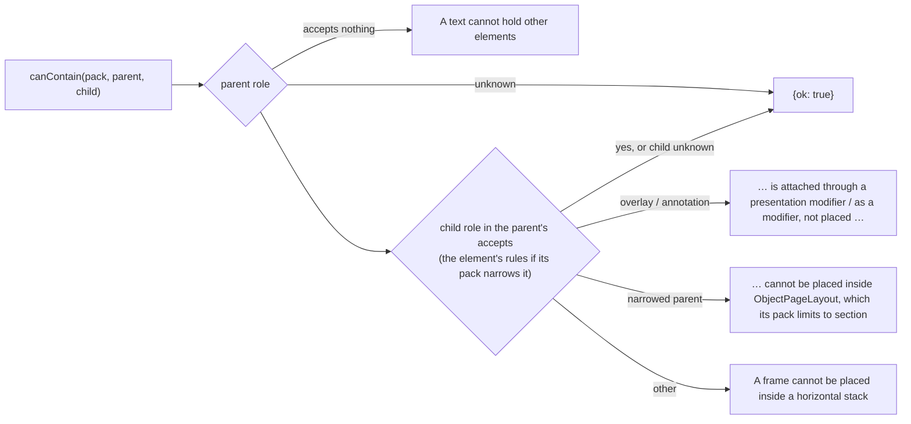

# Role rules

Realizes **A-REPO-1** (P1: `language/roles.json`) with **M-PACK-3** and **M-PACK-2** (F7 `rules`), and
implements **R-PACK-016** and **R-REPO-002.C8** (#28): the role rule table that says which elements may
go where, decided by render role so that a pack element inherits it, and the TypeScript queries the
design tools use (`canContain`, `allowedChildren`). Rendering reads none of it in either variant.
The `reads` lists (R-EVAL-004.C8, #32) are the evaluators' only use of the table: the labels each role
reads, against which a labelled argument nothing understands is warned ([Evaluation](evaluate.md)).


`holdsChildren(pack, name)` (R-PACK-016.C16, #30) tells whether an element holds any child; the editor's drop target takes such elements as containers ([Drag and drop](drag-drop.md)).

## Files

| File | What |
|---|---|
| `shared/language/roles.json` | the table: the common `reads`, `root.accepts`, and per role `title`, `category`, `accepts`, `attach`, `reads`; one line per rule |
| `python/src/mockitdown/roles.py` | `COMMON_READS`, `ROLE_READS`, `reads(role)` from the packaged copy (R-EVAL-004.C8) |
| `shared/packs/sapui5/pack.json` | `ObjectPageLayout` narrows its role (`vstack`) with `rules: {"accepts": ["section"]}` |
| `typescript/src/core/roles.ts` | `setRoles`, `rolesLoaded`, `roleRule`, `roleReads`, `expandAccepts`, `canContain`, `allowedChildren`, `ROLE_CATEGORIES` |
| `typescript/src/core/packs/registry.ts` | `ElementDef.rules`: an element's `{accepts}` from `pack.json`, or `null` |
| `typescript/src/core/assets.ts` | `SharedAssets.roles`: `loadAssets` hands the table to `setRoles` |
| `typescript/src/node.ts`, `src/elements/assets.ts` | both loaders read or fetch `roles.json` when the manifest lists it |
| `typescript/src/core/render/html.ts` | `RENDER_ROLES`, the keys of the renderer's role table (exported for the tests) |
| `typescript/scripts/copy-shared.mjs`, `python/tools/sync_shared.py` | copy `language/roles.json` to `dist/shared/roles.json` and `mockitdown/roles.json` |

## The table

```text
roles.json
  reads  [color, density, design, direction, disabled, elevation, emphasis, error, kind, …]   (24: every role)
  root   {"accepts": [@frame, @layout, @content, @overlay, appbar, toolbar, sidebar, list, table, tree, …]}
  roles  <role> → {"title": "horizontal stack", "category": "layout", "accepts": [...], "attach": "child",
                   "reads": ["align", "alignment", "gap", "spacing", "wrap"]}
```

The `reads` lists were produced from the Python renderer (#32): every label a role's view is asked for
while the conformance corpus, the reference samples, the patterns and the example site render (a
recording `attrs` dict), together with the labels each `r_<role>` method names in `v.attr`, `slot`,
`has` and `text_or_slot`; the 24 labels every role reads through `Renderer.open` and the style builder
went to the top level. The TypeScript renderer looks up the same names (compared over the sources).
`test_the_renderer_reads_nothing_the_table_omits` repeats the recording over the corpus, so a role that
starts reading a new label fails until the table lists it. `tablecolumn` renders nothing itself; the
table reads its `title`, `label` and `alignment`.

| Category | Roles | Accepts |
|---|---|---|
| frame | `navstack`, `split`, `tabs` | layouts, content, collections and bars; a split view also `navstack` and `tabs` (its columns), a tab view `tab` and `navstack` |
| bar | `appbar`, `toolbar`, `toolbaritem`, `sidebar` | toolbar: `toolbaritem`, `button`, `select`, `textfield`; the others their controls and items |
| layout | `vstack`, `hstack`, `zstack`, `group`, `scroll`, `grid`, `gridrow`, `form`, `section`, `card`, `accordion`, `labeled`, `canvas` | `@layout`, `@content` and the collections by name (`list`, `table`, `tree`, `timeline`, `board`, `menu`, `steps`, `radiogroup`); `vstack`, `hstack` and `group` also the bars; `section` also `listitem`; `grid` only `gridrow`; `labeled` only content |
| collection | `list`, `table`, `tree`, `timeline`, `board`, `menu`, `steps`, `radiogroup` and their items `listitem`, `tablecolumn`, `tablerow`, `treeitem`, `timelineitem`, `boardcolumn`, `kanbancard`, `menuitem`, `tab`, `navitem` | their item roles (List → `listitem`, `section`; Table → `tablecolumn`, `tablerow`, `group`; Board → `boardcolumn` → `kanbancard`, …) |
| content | the other 46, `button`, `link` and `unknown` among them | nothing, except `button` and `link` (their label: text, label, icon, image, stacks, badge, avatar, kbd, spacer) and `unknown` (everything) |
| overlay | `dialog`, `toast`, `tooltip` | attach `presentation`; their body |
| annotation | `callout`, `pointer`, `marquee` | attach `modifier`; nothing |

Item roles are in the collection category so that a layout, which names the collections it holds one
by one rather than `@collection`, never accepts a tree item or a menu item directly. The bars are also
accepted by `vstack`, `hstack` and `group`, standing in for "the root stack", which a role cannot tell
from any other stack. The root accepts the overlays, so that a dialog can be drawn on its own.

## `canContain` and `allowedChildren`



- `pack` is a pack id or a loaded `Pack`; element names resolve through `pack.element(name)`, so pack
  elements inherit their role's rule. A name the pack does not define (a struct, a typo) and a role
  without a rule are `unknown`.
- The child is named by its category when the parent accepts nothing of that category ("A frame …",
  "A content element …"), and by its title otherwise ("A tree item cannot be placed inside a vertical
  stack"). Titles come from the table, with "a"/"an" by the first letter.
- `allowedChildren(pack, parent)` asks `canContain` for every element of `pack.elements` (inherited
  first, in `pack.json` order) and returns `{allowed: names, refused: [{reason, elements}]}`, one group per
  reason in first-seen order.
- `@category` lists are expanded once per `accepts` array (a `WeakMap`).
- Both throw `MockitdownError` before `loadAssets` has installed the rules, and for an unknown pack.

Python packages the table and the `rules` key and reads only the `reads` lists (`roles.py`, for the
evaluator's unknown-label warning): the pack registry ignores `rules`, so no diagnostic comes from the
role rules (R-PACK-016.C10). A Python warning for a misplaced role is out of scope (Q9).

## Tests

- IT-56: `python/tests/test_roles.py` and `typescript/tests/unit/roles.test.ts` (R-PACK-016 TC-1, TC-2),
  with the copy checks in `test_shared.py`, `test_layout.py` and `package.test.ts` (R-REPO-002 TC-3).
- The expected answers and reason sentences in both test files were written by hand from SRC-12#s6.3
  and the clauses before the code ran.

## Debugging

- `canContain` throws "no role rules are loaded": the host called the core before `loadAssets` (or an
  older `dist/shared/` without `roles.json` in its manifest).
- A new render role fails `test_every_render_role_has_exactly_one_rule` and the TypeScript TC-1: add its
  rule to `roles.json` (and a title); a new pack `rules` entry that names a role its role does not
  accept fails "a pack's rules only narrow its role's".

## Revision history

| Version | Date | Change |
|---|---|---|
| 0.3.44 | 2026-11-28 | Page written: `roles.json`, the sapui5 narrowing, `canContain`, `allowedChildren`, IT-56 (#28) |
| 0.3.46 | 2026-11-28 | `holdsChildren` (#30) |
| 0.3.48 | 2026-11-28 | The `reads` lists, `roles.py`, `roleReads`, how the lists were produced (#32) |
