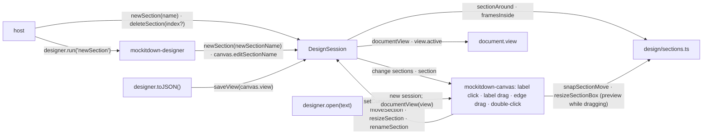

# Sections and the saved view

Implements **R-TOOL-014** C1 to C10 (#44) and C11 to C17 (New Section, Delete Section and the current
section, #90) on **A-WEB-4** (the session holds the section commands, their
undo steps and the view it writes; `mockitdown/design` the rules) and **A-WEB-5** (the canvas draws the
sections and forwards drags and renames, K2), with **M-EDIT-1.F6** and **F8** (the document's `sections`
and `view`) and **R-EDIT-005** (written back key for key), and extends **R-EDIT-006.C4** and **C5** (the
`change` kind `sections`, the notification `section`) and **R-EDIT-009.C8** (New Section and Delete
Section in `commands`). A section is a named rectangle behind a group of frames; the canvas's zoom, position
and active mockup are saved in the document so that a designer reopens it where it was left.

## Data flow



## Files

| File | What it holds |
|---|---|
| `typescript/src/design/sections.ts` | the rules, no DOM: `SECTION_MARGIN` (40), `SECTION_MIN` (40), `SECTION_EDGES`, `EMPTY_SECTION_NAME`, `newSectionName`, `sectionAround`, `liesInside`, `framesInside`, `snapSectionMove`, `resizeSectionBox`, `sectionNameRefusal`, `documentView` |
| `typescript/src/design/session.ts` | `sections`, `currentSection`, `setCurrentSection(index)`, `newSection(name)`, `deleteSection(index?)`, `moveSection(index, x, y)`, `resizeSection(index, box)`, `renameSection(index, name)`, `saveView(view?)`; the history's `SectionStep` (`SectionsSnapshot`: the list, each section's values, every frame's position) and `restoreSections`; `newSection` and `deleteSection` in `COMMANDS` and `run` |
| `typescript/src/elements/canvas.ts` | the sections layer (part `sections`) first in the world, one `section` per section with its `section-label` and eight `section-handle`s, the drag state `#sectionDrag` (a release without a move is a click that makes the section current), `data-current` outside Preview mode, the shared inline rename field and `editSectionName(index)`; the view from `documentView` |
| `typescript/src/elements/designer.ts` | `toJSON()` calls `session.saveView(canvas.view)`; `run(command, args)`, New Section without a name named in the canvas's field |

## Design

- **Behind the frames** (C1): the sections layer is the world's first child, so the frames, appended
  after it, paint over it. Sections take no pointer events except their label and handles, so clicks on
  a section's area reach the canvas as before. Labels and handles are sized by `1 / zoom`, like the
  frames' labels; the handles are hidden in Preview mode, where nothing is dragged.
- **Addressed by index**: section names need not be unique (C9), so the canvas and the session name a
  section by its index in `document.sections` (`data-section`).
- **One step** (C3, C8): a section change is a `SectionStep` of the history, not a mockup's step: it
  holds the list (or its absence: undoing the first `newSection` removes the key again), each section
  object with its values (objects, so the key order read with them is kept) and every mockup's position.
  It notifies one `change` of kind `sections` with an empty `mockup` and `code`, which the editor, the
  outline and the inspector ignore and the canvas redraws on. Section steps never coalesce.
- **Frames inside** (C3): `moveSection` takes the frames wholly inside the section before the move, by
  the frame sizes the canvas lends as `session.measure`; the canvas previews the same set during the drag
  and calls the session once, on release.
- **Snapping** (C7): the moved corner is rounded to the 8-unit grid (`snapSectionMove`), the dragged
  edges of a resize too (`resizeSectionBox`, the opposite edges fixed, at least 40 × 40); Alt places
  freely. There is no edge snapping between sections and frames.
- **The current section** (C11, C16, C17): the session holds it as the section object, so that its index
  follows when an undo or another deletion shifts the list, and an undo or redo that removes it leaves
  none current. `setCurrentSection` notifies `section` (no DOM event, like `active`) and is no step;
  `newSection` and `deleteSection` change it before their one `change` of kind `sections`, which the
  canvas redraws from, so they notify no `section`. The canvas marks it with `data-current` (a stronger
  border, `--mkd-canvas-section-current-border`) except in Preview mode.
- **Delete Section** (C12, C15): `deleteSection(index)`, the current section by default, removes the
  section object from the list and leaves every frame where it is, as one `SectionStep`. When it removes
  the last section of a document that opened without `sections`, the key goes too, so a section added and
  deleted writes the document back byte for byte (F-20.AC8); a document opened with `"sections": []`
  keeps the empty list.
- **New Section from a menu** (C13, C14): `session.run("newSection", {name})` refuses a missing name;
  `designer.run("newSection")` adds `Section <n>` (`newSectionName`, one more than the sections before it)
  and calls `canvas.editSectionName(index)`, which opens the inline field with `keepEmpty`: Enter renames
  through `renameSection`, while an empty name, Esc or leaving the field keeps `Section <n>`.
- **The saved view** (C4 to C6): the canvas never writes the document. `designer.toJSON()` passes the
  canvas's view to `session.saveView`, which compares it and the active mockup with what the document
  opens with (`documentView`: zoom clamped, 1 and 0 for absent values; `view.active` when a mockup holds
  it, else the first mockup) and writes `zoom`, `x`, `y`, `active` only when something differs, keeping
  the view's other keys after them. That is why a document opened and written back without an edit is
  the same text, even one without a `view`. `open` restores the view because the canvas reads
  `documentView(document.view)` when it joins the new session, and the session picks `view.active`.

## API

```js
session.newSection("Onboarding");                 // {section: 1}: the active frame grown by 40
session.moveSection(1, 400, 0);                   // the frames wholly inside move with it
session.resizeSection(1, { x: 400, y: 0, w: 900, h: 700 });
session.renameSection(1, "Onboarding flow");      // "" → {error: "A section's name must not be empty"}
session.setCurrentSection(0);                      // what a click on its label does; session.currentSection → 0
session.deleteSection();                           // the current one; {error: "no section is current"} without
designer.run("newSection");                        // "Section <n>", named in the canvas's inline field
session.saveView({ zoom: 0.75, x: 120, y: 40 });  // what designer.toJSON() does with the canvas's view
import { sectionAround, framesInside, snapSectionMove, resizeSectionBox, documentView } from "mockitdown/design";
```

## Tests

IT-72: `typescript/tests/unit/sections.test.ts` (R-TOOL-014.TC-1, TC-2 and TC-3, the rules and the session's
section commands and `saveView` with hand-computed boxes) and `typescript/tests/browser/sections.spec.mjs`
(TC-1, the round trip through a fresh designer and the sample; TC-2, drawing, `newSection`, label and
corner drags and the rename on `pages/designer.html`; TC-3, the current section, New Section named in the
inline field and Delete Section). See [Testing](../testing.md).

## Debugging

- A dragged section leaves a frame behind: the frame is only partly inside (its measured height
  counts; a phone is 852 high), or the canvas has not measured it yet (`canvas.rendered`).
- `toJSON()` changes an untouched document: the canvas's view moved (a `fit()`, `reveal` or wheel), or
  the active mockup is not the one `view.active` names; both count as edits of the view.
- Delete Section is disabled: no section is current; a click on a label that moved past the drag
  threshold is a move, not a click.
- No section appears: the document's `sections` is empty, or the canvas has another session than the
  designer's.

## Revision history

| Version | Date | Change |
|---|---|---|
| 0.3.60 | 2026-11-28 | Page written: sections on the canvas, the section commands and their undo step, the view saved by `toJSON()`, IT-72 (#44) |
| 0.3.69 | 2026-11-28 | New Section, Delete Section and the current section, `designer.run`, `canvas.editSectionName`, IT-72 TC-3 (R-TOOL-014 C11-C17, #90) |
