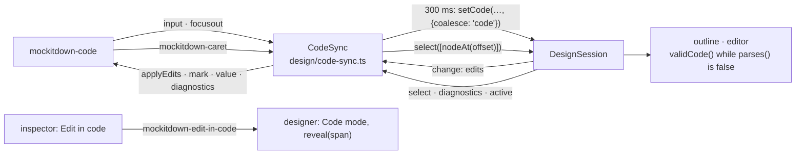

# Two-way editing

Realizes **A-WEB-4** (the session holds the rules, no DOM) and **A-WEB-5** (K2: the components hold no
editing rule), and implements **R-TOOL-009** C1 to C11 (#39): the code view and the visual tools edit the
same mockup, Code mode is editable, and Design mode can dock the code below the view. It adds
`applyEdits`, `mark` and `mockitdown-caret` to [the code view](code-view.md) (R-TOOL-008 C14 to C16), Edit in
code to [the inspector](inspector.md) (R-TOOL-007.C11), and makes [the designer](designer.md)'s Code mode
editable (R-TOOL-003.C15).

## Data flow



## Files

| File | What it holds |
|---|---|
| `typescript/src/design/code-sync.ts` | `CodeSync` (`flush`, `dispose`, `mockup`, `pending`), `CODE_SYNC_MS` (300), `CODE_COALESCE` (`code`), `CARET_EVENT`, `READ_ONLY_NOTE`, the `CodeViewLike` and `CodeSpan` types, `applyTo(text, edits)` |
| `typescript/src/design/session.ts` | `parses(name)`, `validCode(name)`, `nodeAt(name, offset)`, `selectionSpan()`; `checkDrop` refuses while the code does not parse |
| `typescript/src/elements/code.ts` | `applyEdits(edits)`, `mark(range)` and `marked`, the `mockitdown-caret` event (`CODE_CARET_EVENT`), the `mark` layer and its `span` part |
| `typescript/src/elements/designer.ts` | the editable code view (`codeView`), one `CodeSync` per session, `docked` and the Dock code toggle, Edit in code, the status bar's first error (part `status-message`) |
| `typescript/src/elements/editor.ts`, `outline.ts` | render `session.validCode(name)`; the `readonly` note, `aria-readonly`/`data-readonly` while the code does not parse |
| `typescript/src/design/inspect.ts`, `elements/inspector.ts` | `Inspection.editInCode`; the `edit-in-code` button and `EDIT_IN_CODE_EVENT` |

## How it works

- **Typing** (C1): each `input` event restarts a 300 ms timer; `focusout` flushes at once (so a click
  on a visual tool never races the pause). The flush calls `session.setCode(mockup, text, {coalesce:
  "code"})`; the session's own diff makes the one prefix/suffix edit, and a burst within the coalescing
  window is one undo step. Typing back to the session's code clears the pending state without a change.
- **Parsing** (C2, C3) stays in the session: `setCode` re-parses from the last valid tree (ids kept);
  code that does not parse keeps that tree, so `parses(name)` (tree source equals code) turns false,
  `applyOp` already refuses every edit and command, and `checkDrop` now refuses drops with "The code
  does not parse: fix it in the code view first". The editor and the outline render
  `validCode(name)` (the tree's source) and show `READ_ONLY_NOTE`; the designer's status bar adds
  `Line n: <message>` of the first error.
- **The caret** (C4): the code view dispatches `mockitdown-caret` on `mouseup` and on the release of a
  navigation key only. `CodeSync` then, if nothing is pending, the view's text is the session's and it
  parses, selects `[nodeAt(offset)]` (or `[]` outside every node). Typing never selects, which is what
  keeps a selection through a missing brace.
- **Other changes** (C5): `CodeSync` keeps `#base`, the session code the view was last in step with. A
  `change` whose code is the view's text is its own; otherwise, with nothing pending, the edits are
  applied by `applyEdits` (checked against `#base`, else the value is set). With typed text pending, the
  typed edit is `diff(#base, view.value)`; edits wholly before or after it are moved past it and applied,
  an overlapping one makes the view take the session's code and drops the pending text.
- **`applyEdits`** (R-TOOL-008.C14): maps the selection (an offset inside an edited range goes to its
  start), adds the line-count change of the edits above the first visible line to `scrollTop`, and
  re-renders without an `input` event.
- **The selection** (C6): on `select` (and after applying edits) `CodeSync` marks
  `session.selectionSpan()` — nothing while text is pending or the code does not parse. `mark` draws a
  transparent copy of the text up to the range's end, the range in a `span` part, in a layer behind the
  coloured text, and scrolls it into view only while the text area does not have the focus.
- **The active mockup**: on `active`, pending text is flushed to the previous mockup, then the new one is
  shown.
- **Designer** (C7, C8, C11): the code view is no longer `readonly`. `#subscribe` disposes the old
  `CodeSync` and makes one for the new session; the shadow root's code view is upgraded first
  (`customElements.upgrade`), because its shadow content is upgraded only when the designer connects.
  The centre is a flex column: the view and the preview scroll on their own, and with `docked` in Design
  mode the code view takes 40 % below the view (class `mkd-designer__code--docked`). The gallery inserts
  into the selection, which in Code mode is the caret's node.
- **Edit in code** (R-TOOL-007.C11): `inspect()` sets `editInCode` to the node's span for an `if`, a
  `ForEach`, a struct's call, or a node with a `code` field; the inspector's button dispatches
  `mockitdown-edit-in-code`, and the designer sets `mode = "code"` and calls `codeView.reveal(range)`.

## Use

```js
import { CodeSync } from "mockitdown/design";
const sync = new CodeSync(session, document.querySelector("mockitdown-code"));
// …
sync.flush();     // apply typed text now
sync.dispose();   // leave the session
designer.docked = true;            // Design mode: the code below the view
designer.codeView.reveal({ start, end });
```

## Tests

IT-67: `typescript/tests/unit/code-sync.test.ts` (a stand-in view with fake timers: the pause, the one
edit, the coalesced step, broken code read-only, the caret, edits past pending text, the marked spans,
the active mockup, `editInCode`) and `typescript/tests/browser/sync.spec.mjs` (TC-1 and TC-2 on
`pages/designer.html`, R-TOOL-007.TC-3). See [Testing](../testing.md).

## Debugging

- Typing seems lost when clicking elsewhere: `focusout` must reach the code view's host (it is composed);
  `CodeSync.pending` says whether text waits.
- The selection jumps while typing: something dispatches `mockitdown-caret` on input; only `mouseup` and
  navigation keys may.
- The code view shows stale text after `open`: the old `CodeSync` was not disposed, or the code view was
  not upgraded when the session was made (`codeView.mark` must be a function).
- A visual edit while typing replaced the typing: the edit overlapped the typed range, by design.

## Revision history

| Version | Date | Change |
|---|---|---|
| 0.3.55 | 2026-11-28 | Page written: `CodeSync`, the session's `parses`, `validCode`, `nodeAt`, `selectionSpan`, the editable Code mode and the dock, Edit in code, IT-67 (#39) |
