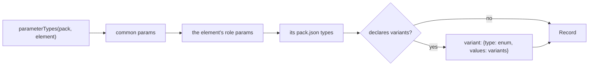

# Parameter and modifier types

Realizes **A-REPO-1** (P1: `language/roles.json`, `language/vocabulary.json`) with **M-PACK-3** (F5
`params`) and **M-PACK-2** (F8 `types`), and implements **R-PACK-017** (#33): what kind of value each
labelled argument and each modifier argument takes, so that the inspector can choose a control
(R-TOOL-007). Rendering reads none of it in either variant; the evaluators take only the labels, the keys
of the `params` maps, for the unknown-label warning ([Evaluation](evaluate.md), R-EVAL-004.C8).

## Files

| File | What |
|---|---|
| `shared/language/roles.json` | the top-level `params` (the 24 labels every role reads) and each rule's `params` (the others it reads), label → type; one line per rule. They replace the `reads` lists of #32 |
| `shared/language/vocabulary.json` | `modifiers`: every rendered modifier → `{"group", "args": [{"label", "type"}]}`, after `rendered` |
| `typescript/src/core/paramtypes.ts` | `PARAM_TYPES`, `TypeSpec`, `normalizeType` (a type's object form, or `null`), `typeMap` |
| `typescript/src/core/roles.ts` | `setRoles` keeps each role's labels (`roleReads`) and types; `parameterTypes(pack, element)` |
| `typescript/src/core/vocabulary.ts` | `MODIFIER_GROUPS`, `ModifierType`, `modifierTypes()` |
| `typescript/src/core/packs/registry.ts` | `ElementDef.types`: the element's `types` from `pack.json`, normalized (empty map when none) |
| `typescript/src/core/evaluate.ts`, `python/src/mockitdown/evaluate.py` | a label the element's `types` names is understood (`el.types`, `ElementDef.typed`) |
| `python/src/mockitdown/roles.py`, `vocabulary.py` | `COMMON_READS`/`ROLE_READS` from the `params` keys; `MODIFIERS` (loaded, unused by rendering) |

## The data

```text
roles.json
  params  {"color": "color", "disabled": "bool", "level": "number", "orientation": {"type": "enum", "values": ["horizontal", "vertical"]}, "size": "text", …}
  roles   toggle → {…, "params": {"isOn": "bool", "label": "text", "onText": "text", "value": "bool", …}}
          slider → {…, "params": {"value": "number", "range": {"type": "array", "items": "number"}, "step": "number", …}}
vocabulary.json
  modifiers  padding → {"group": "layout", "args": [{"label": null, "type": {"type": "enum", "values": ["all", "horizontal", …]}}, {"label": null, "type": "number"}]}
             opacity → {"group": "colour", "args": [{"label": null, "type": {"type": "number", "min": 0, "max": 1}}]}
```

The types were produced once (#33) from the labels each role reads, by name (`is…`/`show…`/`has…` and
the flags → `bool`; sizes, counts, limits → `number`; `color`, `background`, `fill` → `color`;
`systemImage`, `icon`, `…Icon` → `icon`; the list-valued labels → `array`), then per role where one name
means different things (`value` a number for a slider, progress, rating, stepper or chart, a Boolean for a
toggle, checkbox or radio, text elsewhere; `rows` a number for a text field and a skeleton; `columns` a
number for a grid; `current`, `active` and `selection` numbers for steps and pagination). The renderer's
uses and the values seen while the conformance corpus, the reference samples and the patterns render were
the check. An `enum` names values only where the renderer has a fixed set; the common markup's `size`,
`state`, `severity`, … are `text`.

The modifier groups follow the sections of the Python style builder (`render/style.py`) and the
renderer's decoration and presentation lists: `layout`, `typography`, `colour` (colour and shape),
`presentation` (`PRESENTATIONS` and `.overlay`), `annotations` (`DECORATIONS`) and `other`. Each
argument is the one its handler reads: positional (`label: null`) or labelled, in the handler's order.

## Lookups



- `pack` is a pack id or a loaded `Pack`; an element the pack does not define gets the common types
  alone. Later entries override earlier ones; the keys keep that order.
- Every type is returned in its object form (`{type: "bool"}`), frozen. An invalid entry in the data
  (an unknown type, an `enum` without values, an `array` without items) is left out of the lookups;
  the shared tests fail on it first.
- `parameterTypes` throws `MockitdownError` before `loadAssets` has installed the rules, and for an
  unknown pack (R-PACK-017.C9).
- `modifierTypes()` gives the vocabulary's `modifiers`, each argument type in object form; it is empty
  before the vocabulary is loaded.

## Tests

- IT-61: `python/tests/test_types.py` and `typescript/tests/unit/types.test.ts` (R-PACK-017 TC-1,
  TC-2). The data checks run in both; the Python file also runs them on hand-written bad data with a
  hand-written list of the errors expected; the TypeScript file checks the lookups, an application
  pack whose `types` override and add to its role's, and the `dist/shared/` copies.
- The conformance suites run with the types loaded and pass unchanged (C7); `test_unknown_labels.py`
  keeps the `params` keys complete against what the Python renderer looks up.

## Debugging

- A role that starts reading a new label fails `test_the_renderer_reads_nothing_the_table_omits`: add
  the label to the role's `params` with its type.
- A new rendered modifier fails "every rendered modifier has a group and typed arguments" in both
  suites: add its entry to `modifiers`.

## Revision history

| Version | Date | Change |
|---|---|---|
| 0.3.49 | 2026-11-28 | Page written: typed `params`, typed `modifiers`, `types`, `parameterTypes`, `modifierTypes`, IT-61 (#33) |
