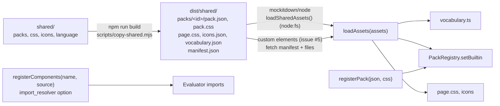

# TypeScript core

Realizes **A-WEB-1** under ADR-18 and ADR-20; implements R-WEB-001 (part 1 of 2: the package,
language, evaluation, packs, diagnostics, options and stylesheet; the renderer follows in issue #4).

`typescript/` is the npm package `mockitdown` (MIT, ES modules, no runtime dependencies,
development dependencies `typescript` and `@playwright/test` only). It ports the Python core
module for module, held to the Python output by the conformance corpus.

## Modules

| TypeScript (`typescript/src/`) | Python (`python/src/mockitdown/`) | What |
|---|---|---|
| `core/values.ts` | (Python itself) | the Python value model: `int`/`float`/`tuple`/`dict`, `repr`, `str`, `==`, ordering, arithmetic |
| `core/json.ts` | `json.loads` | JSON → Python values (ints and floats kept apart, key order kept) |
| `core/diagnostics.ts` | `diagnostics.py` | `Location`, `Diagnostic`, `Diagnostics`, `MockitdownError`, `MockitdownSyntaxError` |
| `core/options.ts` | `options.py` | `RenderOptions` (Python field names), `DEVICES`, `FENCE_OPTIONS`, `coerceFenceOptions` |
| `core/syntax/lexer.ts`, `parser.ts`, `ast.ts` | `syntax/` | tokens, recursive-descent parser, syntax tree (plain objects with `kind`) |
| `core/model.ts` | `model.py` | `View`, `Modifier`, `EnumValue`, `CallValue`, `Thunk`, `ViewList`, `Screen`, `walk` |
| `core/evaluate.ts` | `evaluate.py` | `Evaluator`, `Env`, `formatValue`, `truthy` |
| `core/components.ts` | `ImportContext`, `ImportCache` | component files as data: `registerComponents`, candidate paths, parse cache |
| `core/packs/registry.ts` | `packs/__init__.py` | `PackRegistry`, `Pack`, `ElementDef`, `registerPack` |
| `core/vocabulary.ts` | `vocabulary.py` | `RENDERED`, `IGNORED`, `NEUTRAL_MODULES` (filled from `vocabulary.json`) |
| `core/styles.ts` | `styles.py` | `scalePx`, `tokenCss`, `packCss`, `minifyCss`, `buildStylesheet` |
| `core/assets.ts` | — | `loadAssets`: the shared assets handed to the core as data |
| `core/api.ts` | `api.py` | `evaluate`, `stylesheet` (`render`, `check` in issue #4) |
| `mockitdown.ts` | `__init__.py` | the package entry (re-exports the core; will define the custom elements) |
| `node.ts` | — | `mockitdown/node`: `loadSharedAssets()`, `registerComponentFiles(dir)` from the file system |

## How the shared assets reach the core

The core reads no files and fetches nothing (A-WEB-1.K1; `tests/unit/core.test.ts` checks the
sources). The build copies the assets; a host hands them over once.

`manifest.json` is `{"packs": [ids, sorted], "files": [paths under dist/shared/]}` (R-WEB-001.C13).
`scripts/copy-shared.mjs --check` reports a stale copy, as `python/tools/sync_shared.py --check` does.

## Python semantics, kept

The evaluator computes with Python values, because the Python variant is the reference (ADR-18):

- **int and float stay apart.** An `int` is a JS `number`, a `float` a `PyFloat`. `7 / 2` is `3`,
  `7.0 / 2` is `3.5`, `0...3` is four ints and `0.0...1.0` a pair of float bounds; text shows `1.0`
  as `1` and `0.5` as `0.5` (`formatValue`), and `repr` shows `1.0` (`floatRepr`, Python's
  shortest-repr rules). Pack JSON is parsed by `core/json.ts` so that `"opacity": 1.0` stays a
  float.
- **tuples and dicts.** A tuple is a frozen array marked by `tuple()`; a dict is a `PyDict`,
  insertion-ordered, with `1`, `1.0` and `true` the same key. `repr` of either matches Python's,
  as messages and interpolated text show them.
- **strings by code point.** The lexer scans code points, so columns match Python's for any text
  (`🚀` is one column); `count`, subscripts and ordering are by code point; `capitalized` is
  Python's `str.title()`.
- **messages.** Names in messages are quoted with Python's `repr` (`strRepr`), so every diagnostic
  is worded byte for byte as in the Python variant.

## Imports

`Evaluator.loadImports` tries the Python candidates as POSIX paths: the importing file's directory
(`source_path`'s for the block, the component's for a nested import), then each `import_paths`
entry, each as written and then with `.mockitdown`. A candidate's text comes from the registered
components (`registerComponents`), else from the `import_resolver` option. With no source path and
no search paths the path is tried as written (R-WEB-001.C10). A component's diagnostics carry its
normalised path as source (C11). Parses are cached by path and text.

## Pack registry

`PackRegistry` is fed instead of searching directories: `setBuiltin(map)` from `loadAssets`, and
`register(json, css)` for an application's packs, which take precedence over a built-in pack of the
same id (as `pack_paths` do in Python). `ids()` lists the registered packs, then the built-in ones,
each sorted; registering clears the cache and the module index. Inheritance, merging (`elements`,
`modifiers`, `chrome`, `sizes`, `icons`, `attrs`, per-mode `tokens`), the module index and the error
messages are those of the Python registry; a cycle of `extends` is refused instead of recursing.

## Key symbols

| Symbol | Where | Notes |
|---|---|---|
| `evaluate(source, options)` | `core/api.ts` | `{screen, diagnostics}`; `screen` null on a syntax error |
| `stylesheet(packIds?, {minify})` | `core/api.ts` | byte-equal to Python's `stylesheet()` |
| `loadAssets({vocabulary, packs, pageCss, icons})` | `core/assets.ts` | must run before `evaluate` |
| `registerPack(json, css)` | `core/packs/registry.ts` | returns the pack id |
| `registerComponents(name, source)` | `core/components.ts` | name is a path, e.g. `components/pill.mockitdown` |
| `renderOptions(...overrides)` | `core/options.ts` | defaults + overrides, ignoring unknown keys and null |
| `values.*` | `core/values.ts` | `PyFloat`, `PyDict`, `tuple`, `pyRepr`, `pyStr`, `pyEq`, `formatG`, `floatRepr` |

## Not yet ported (issue #4)

`render/` (`html.py`, `style.py`, `charts.py`, `chrome.py`, `render/__init__.py`), `icons.py`,
`assets.py` (asset base URL instead of embedding, R-WEB-001.C7), the error box (`error_html`), and
`render`/`check`. The figure's anchor prefix is the first six hex digits of
`sha1("<pack id>\n<source>")` (R-ANN-003.C5): the core needs a synchronous SHA-1, since
`crypto.subtle` is asynchronous and the core must not depend on Node's `crypto`.

## Debugging

- `node -e 'const m = await import("./dist/node.js"); m.loadSharedAssets(); console.log(m.evaluate(src).diagnostics.items.map(String))'`
  from `typescript/` shows a source's evaluation diagnostics.
- To compare with Python, dump both evaluations of a source (views, attributes as tagged values,
  diagnostics) and diff them; during issue #3 all 572 corpus cases and the full stylesheet were
  identical.

## Revision history

| Version | Date | Change |
|---|---|---|
| 0.3.4 | 2026-11-25 | Page written: package, core modules, assets as data, imports, registry (#3) |
