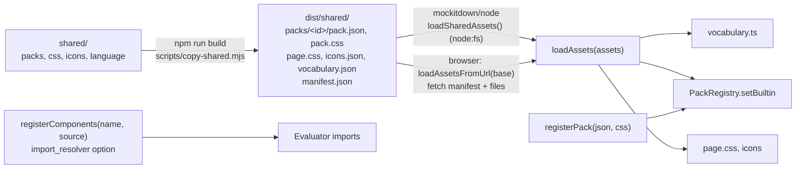
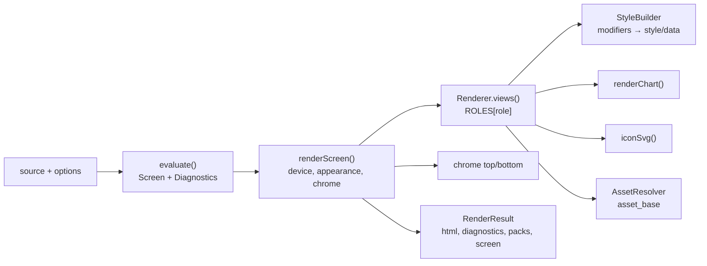

# TypeScript core

Realizes **A-WEB-1** under ADR-18 and ADR-20; implements R-WEB-001: the package, language,
evaluation, packs, diagnostics, options, stylesheet (#3) and the renderer with `render` and `check`
(#4). Every case of the conformance corpus renders byte for byte as in Python (R-WEB-001.C8).

`typescript/` is the npm package `mockitdown` (MIT, ES modules, no runtime dependencies,
development dependencies `typescript` and `@playwright/test` only). It ports the Python core
module for module, held to the Python output by the conformance corpus.

## Modules

| TypeScript (`typescript/src/`) | Python (`python/src/mockitdown/`) | What |
|---|---|---|
| `core/values.ts` | (Python itself) | the Python value model: `int`/`float`/`tuple`/`dict`, `repr`, `str`, `==`, ordering, arithmetic |
| `core/json.ts` | `json.loads` | JSON → Python values (ints and floats kept apart, key order kept) |
| `core/diagnostics.ts` | `diagnostics.py` | `Location`, `Diagnostic`, `Diagnostics`, `MockitdownError`, `MockitdownSyntaxError` |
| `core/options.ts` | `options.py` | `RenderOptions` (Python field names), `DEVICES`, `FENCE_OPTIONS`, `coerceFenceOptions` |
| `core/syntax/lexer.ts`, `parser.ts`, `ast.ts` | `syntax/` | tokens, recursive-descent parser, syntax tree (plain objects with `kind`) |
| `core/model.ts` | `model.py` | `View`, `Modifier`, `EnumValue`, `CallValue`, `Thunk`, `ViewList`, `Screen`, `walk` |
| `core/evaluate.ts` | `evaluate.py` | `Evaluator`, `Env`, `formatValue`, `truthy` |
| `core/components.ts` | `ImportContext`, `ImportCache` | component files as data: `registerComponents`, candidate paths, parse cache |
| `core/packs/registry.ts` | `packs/__init__.py` | `PackRegistry`, `Pack`, `ElementDef`, `registerPack` |
| `core/vocabulary.ts` | `vocabulary.py` | `RENDERED`, `IGNORED`, `NEUTRAL_MODULES` (filled from `vocabulary.json`) |
| `core/styles.ts` | `styles.py` | `scalePx`, `tokenCss`, `packCss`, `minifyCss`, `buildStylesheet` |
| `core/assets.ts` | — | `loadAssets`: the shared assets handed to the core as data |
| `core/render/html.ts` | `render/html.py` | `Renderer`: one function per role in `ROLES`, decorations, overlays, presentations |
| `core/render/util.ts` | `render/html.py` (module functions) | `esc`, `textHtml`, `fmt`/`num`/`name`/`bool`, dates and `calendar`, code highlighting, cursors, map art |
| `core/render/style.ts` | `render/style.py` | `StyleBuilder` (modifiers → style, data, classes), `cssColor`, `u`, `fontStyle` |
| `core/render/charts.ts` | `render/charts.py` | `ChartSpec`, `renderChart`, `niceTicks` |
| `core/render/chrome.ts` | `render/chrome.py` | `CHROME_KINDS`, `top`, `bottom` |
| `core/render/index.ts` | `render/__init__.py` | `renderScreen`, `anchorPrefix`, `elementsTable` |
| `core/icons.ts` | `icons.py` | `normalize`, `resolveIcon`, `iconSvg` over the shared `icons.json` |
| `core/asset-resolver.ts` | `assets.py` | `AssetResolver`: images by `asset_base` URL, never embedded (R-WEB-001.C7, C14, C15) |
| `core/pyformat.ts` | (Python itself) | `pyFixed` (`%.Nf`), `pyFormatG` (`%g`), `pyRound`, `pyRoundTo`, `parsePyFloat`, `pyMod`, `pyMin`/`pyMax` |
| `core/sha1.ts` | `hashlib.sha1` | synchronous SHA-1 of UTF-8 text, for the anchor prefix |
| `core/api.ts` | `api.py` | `render`, `check`, `RenderResult`, `errorHtml`, `evaluate`, `stylesheet` |
| `elements/assets.ts` | — | `loadAssetsFromUrl(base)`: the browser asset loader (A-WEB-2.P2), see [Web development](web-dev.md) |
| `mockitdown.ts` | `__init__.py` | the package entry (re-exports the core and `loadAssetsFromUrl`; will define the custom elements) |
| `node.ts` | — | `mockitdown/node`: `loadSharedAssets()`, `registerComponentFiles(dir)` from the file system |

## How the shared assets reach the core

The core reads no files and fetches nothing (A-WEB-1.K1; `tests/unit/core.test.ts` checks the
sources). The build copies the assets; a host hands them over once.

`manifest.json` is `{"packs": [ids, sorted], "files": [paths under dist/shared/]}` (R-WEB-001.C13).
`scripts/copy-shared.mjs --check` reports a stale copy, as `python/tools/sync_shared.py --check` does.

## Python semantics, kept

The evaluator computes with Python values, because the Python variant is the reference (ADR-18):

- **int and float stay apart.** An `int` is a JS `number`, a `float` a `PyFloat`. `7 / 2` is `3`,
  `7.0 / 2` is `3.5`, `0...3` is four ints and `0.0...1.0` a pair of float bounds; text shows `1.0`
  as `1` and `0.5` as `0.5` (`formatValue`), and `repr` shows `1.0` (`floatRepr`, Python's
  shortest-repr rules). Pack JSON is parsed by `core/json.ts` so that `"opacity": 1.0` stays a
  float.
- **tuples and dicts.** A tuple is a frozen array marked by `tuple()`; a dict is a `PyDict`,
  insertion-ordered, with `1`, `1.0` and `true` the same key. `repr` of either matches Python's,
  as messages and interpolated text show them.
- **strings by code point.** The lexer scans code points, so columns match Python's for any text
  (`🚀` is one column); `count`, subscripts and ordering are by code point; `capitalized` is
  Python's `str.title()`.
- **messages.** Names in messages are quoted with Python's `repr` (`strRepr`), so every diagnostic
  is worded byte for byte as in the Python variant.
- **number formatting.** Python rounds the exact binary value of a float, ties to even
  (`f"{0.125:.2f}"` is `0.12`, `round(2.675, 2)` is `2.67`); `toFixed` and `toExponential` round
  ties away from zero. `pyformat.ts` expands a double to its exact decimal digits (BigInt) and
  rounds those, for `%.Nf`, `%g` and `round`; a differential run over 3,000 values matched Python.
- **truthiness and `or`.** The renderer's `x or y`, `x in (None, False, "")` and `if x:` follow
  Python (`pyBool`, `isIn`, `or`, `or0`): `0` is in `(False,)`, an empty dict is false, `NaN` is true.
- **regular expressions.** Python's `\w`, `\s`, `\d` and `.` are Unicode-aware and `.` excludes only
  `\n`; the ported patterns spell them out (`PY_W`, `PY_WS`, `\p{Nd}`, `[^\n]`).

## Imports

`Evaluator.loadImports` tries the Python candidates as POSIX paths: the importing file's directory
(`source_path`'s for the block, the component's for a nested import), then each `import_paths`
entry, each as written and then with `.mockitdown`. A candidate's text comes from the registered
components (`registerComponents`), else from the `import_resolver` option. With no source path and
no search paths the path is tried as written (R-WEB-001.C10). A component's diagnostics carry its
normalised path as source (C11). Parses are cached by path and text.

## Rendering

`render(source, options)` evaluates, then `renderScreen` assembles the figure exactly as the Python
`render_screen`: device and size, appearance, chrome, title and caption, the anchor prefix, the views
through `Renderer`, overlays, the Elements table and the error box in front (`errorHtml`).

A role is looked up in `ROLES` by name (`-` → `_`), as Python's `getattr(self, "r_" + role)`; an
unknown role reports `role` and renders `mkd-unknown`. Images: remote and `data:image/…` pass
through, other schemes and data URIs are refused, a local path is joined to `asset_base`, and without
one is reported as not found with the Python wording (R-WEB-001.C14, C15).

## Pack registry

`PackRegistry` is fed instead of searching directories: `setBuiltin(map)` from `loadAssets`, and
`register(json, css)` for an application's packs, which take precedence over a built-in pack of the
same id (as `pack_paths` do in Python). `ids()` lists the registered packs, then the built-in ones,
each sorted; registering clears the cache and the module index. Inheritance, merging (`elements`,
`modifiers`, `chrome`, `sizes`, `icons`, `attrs`, per-mode `tokens`), the module index and the error
messages are those of the Python registry; a cycle of `extends` is refused instead of recursing.

## Key symbols

| Symbol | Where | Notes |
|---|---|---|
| `render(source, options)` | `core/api.ts` | `RenderResult` `{html, diagnostics, packs, screen, errors, ok}` |
| `check(source, options)` | `core/api.ts` | the diagnostics of `render` |
| `evaluate(source, options)` | `core/api.ts` | `{screen, diagnostics}`; `screen` null on a syntax error |
| `stylesheet(packIds?, {minify})` | `core/api.ts` | byte-equal to Python's `stylesheet()` |
| `loadAssets({vocabulary, packs, pageCss, icons})` | `core/assets.ts` | must run before `evaluate` |
| `loadAssetsFromUrl(base?, {fetch})` | `elements/assets.ts` | fetches `dist/shared/` (default: beside the module) and calls `loadAssets`; resolves to the manifest |
| `registerPack(json, css)` | `core/packs/registry.ts` | returns the pack id |
| `registerComponents(name, source)` | `core/components.ts` | name is a path, e.g. `components/pill.mockitdown` |
| `renderOptions(...overrides)` | `core/options.ts` | defaults + overrides, ignoring unknown keys and null |
| `values.*` | `core/values.ts` | `PyFloat`, `PyDict`, `tuple`, `pyRepr`, `pyStr`, `pyEq`, `formatG`, `floatRepr` |

## Debugging

- `node -e 'const m = await import("./dist/node.js"); m.loadSharedAssets(); console.log(m.evaluate(src).diagnostics.items.map(String))'`
  from `typescript/` shows a source's evaluation diagnostics.
- To compare with Python, dump both evaluations of a source (views, attributes as tagged values,
  diagnostics) and diff them; during issue #3 all 572 corpus cases and the full stylesheet were
  identical.
- A failing conformance case: render it in both variants and print the first differing offset with
  some context on each side; differences have come from number formatting, `or` on numbers and
  Unicode classes in regular expressions.
- `render(src, {device: "fit", show_warnings: true}).html` shows icon and asset warnings in the box.

## Revision history

| Version | Date | Change |
|---|---|---|
| 0.3.4 | 2026-11-25 | Page written: package, core modules, assets as data, imports, registry (#3) |
| 0.3.5 | 2026-11-25 | Renderer, styles, charts, chrome, icons, assets by base URL, number formatting; `render`, `check` (#4) |
| 0.3.6 | 2026-11-25 | `elements/assets.ts`: `loadAssetsFromUrl`, the browser asset loader (#5) |
