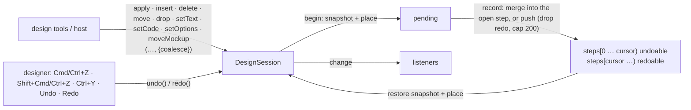

# Undo and redo history

Realizes the history of **A-WEB-4** (P1 "`DesignSession` with its history", K2: a mockup's code
changes only through operations, commands and code changes the session records) and implements
**R-EDIT-007** C1 to C4 and C6 to C13 (#34), with the designer's keys and toolbar buttons (C10). C5,
the coalescing keys: the inspector passes `<node>:<field>` (and `mockup:<name>:<option>` on its Mockup
tab) since #35 ([The inspector element](inspector.md)); the code view's `code` comes with R-TOOL-009.

## Data flow



## Files

| File | What it holds |
|---|---|
| `typescript/src/design/session.ts` | `HistoryOptions`, `COALESCE_MS` (1000), `HISTORY_LIMIT` (200), the session options `now` and `historyLimit`, `canUndo`, `canRedo`, `undo()`, `redo()`, and the private `Snapshot`, `Place`, `Step`, `Pending`, `begin`, `record`, `settle`, `restore` |
| `typescript/src/design/index.ts` | exports `COALESCE_MS`, `HISTORY_LIMIT`, `HistoryOptions` |
| `typescript/src/elements/designer.ts` | the toolbar group `History` with the parts `undo` and `redo`, `#history`, `#drawHistory`, the keys in `#onKey` |

## How it works

- **A step** (`Step`) holds the mockup's name, the change kind (`code`, `options`, `move`), a
  `Snapshot` before and after (code, the last valid `SyntaxTree`, a `structuredClone` of the options,
  `x`, `y`), the forward text edits and their inverse (`diff(after.code, before.code)`, one edit), a
  `Place` before and after (the active mockup and the selection), the coalescing key and the time of
  its last change.
- **Recording.** Every changing request calls `begin` before it changes anything (snapshot and
  place), `record` after the document and the mockup state are changed but before the `change` is
  notified (so a listener reading `canUndo` sees the new step), and `settle` after its follow-up
  notifications, which stores the selection after it (the inserted node, the delete's next
  selection, the moved nodes). Requests that change nothing never reach `begin`.
- **Coalescing** (C4, C11 to C13). `record` merges into the latest step when it is still `open` (no
  undo or redo since), the cursor is at the end, and key, mockup and kind match within `COALESCE_MS` of
  its last change by the session's `now`; the step's `after`, time and edits are replaced, and its
  `before` and place before kept. A merged step back at its `before` is popped.
- **Limits** (C6, C9). A new step truncates the redoable steps, then drops the oldest beyond
  `historyLimit` (at least 200).
- **Undo and redo** (C3, C7) move the cursor and `restore` the step's mockup from a snapshot: the code,
  the tree (so the very nodes, with their ids, come back: the shared id counter of derived trees means
  no id is reused), the options and the position. If the place's active mockup is another one it is
  made active (`active`), then one `change` of the step's kind (`code`: the inverse for undo, the edits
  for redo; otherwise no edits), then `select` with the place's nodes when the selection changed or the
  mockup switched, `hover` cleared when its node is gone, and `diagnostics` as they changed.
- **The designer** (C10). The keys are read on the designer element, so they act while the focus is in
  it (its shadow parts and slotted panels): Cmd or Ctrl with Z undoes, with Shift redoes, Ctrl+Y redoes;
  not when the composed path starts in an `input`, `textarea`, `select` or editable content (the
  gallery's search, the editor's inline text field), and not in Preview mode, where the buttons are
  disabled too. `#drawHistory` runs with every `#drawState` (every `change`, `select`, `active`, …) and
  mode change. A new `open` makes a new session, so a new, empty history.

## Use

```js
const s = designer.session;
s.delete();                                   // one step
s.undo();                                     // the node back, with its id, selected
s.redo();
s.setCode("Inbox", text, { coalesce: "code" });   // keystrokes within 1 s of each other: one step
s.canUndo; s.canRedo;
new DesignSession(doc, { now: () => clock, historyLimit: 500 });
```

## Tests

IT-62: `typescript/tests/unit/undo.test.ts` (R-EDIT-007 TC-1, TC-2 with a fake clock) and
`typescript/tests/browser/undo.spec.mjs` (TC-2 on `pages/designer.html`). See [Testing](../testing.md).

## Debugging

- An undo that does not restore the selection: compare the step's `placeBefore` with the ids of the
  restored tree; a node selected by an id the tree before the step did not have means the selection
  was set outside `select` (the session's own `selected`).
- A burst that forms several steps: the requests must pass the same `coalesce` key and target the same
  mockup and kind; an undo, a redo or a pause over 1000 ms starts a new step.
- The keys do nothing: the focus is outside the designer, in a text field, or the mode is Preview.

## Revision history

| Version | Date | Change |
|---|---|---|
| 0.3.50 | 2026-11-28 | Page written: the session's undo history, coalescing, the designer's Undo and Redo, IT-62 (#34) |
| 0.3.51 | 2026-11-28 | C5 for the inspector: its key `<node>:<field>` (#35) |
