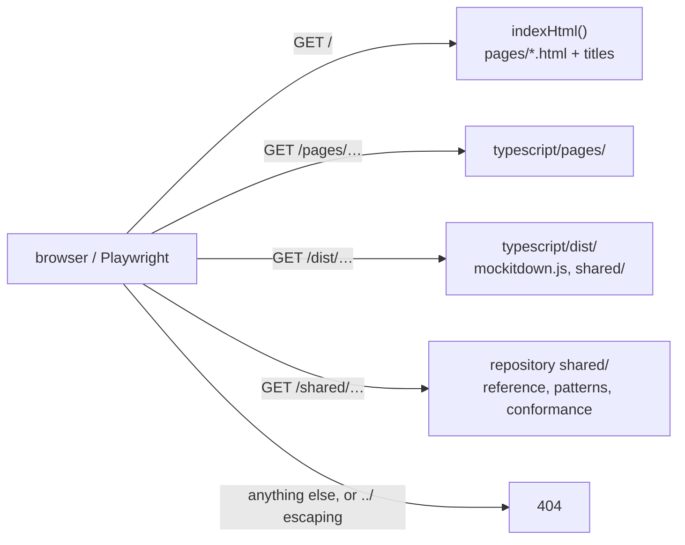

# Web development server, test pages and browser tests

Implements **R-WEB-003** (development server) and **R-WEB-005** (web test suites), and the browser
asset loader of **A-WEB-2** (P2, K2), under ADR-20: `node:http` and `node:fs` for the server,
`node:test` for unit tests, Playwright for browser tests — no other package.

## Files

| File (`typescript/`) | What |
|---|---|
| `scripts/serve.mjs` | the static server; `startServer({port, host})`, `resolveRequest(path)`, `indexHtml()`, `ROOTS`, `TYPES` |
| `pages/*.html` | the test pages; each is linked from the index by its `<title>` |
| `pages/core.html` | "Core render": the core API in a page, without custom elements — the smoke test's page |
| `pages/mockup.html` | "Mockup element": `<mockitdown-mockup>` demo and test page (see [The mockup element](elements.md)) |
| `pages/packs.html`, `packs.js`, `packs.css` | "Pack gallery": every pack's elements and the design patterns (see [The pack gallery](gallery.md)) |
| `scripts/assemble-gallery.mjs` | `assembleGallery(dest)`: the gallery as static files for `/gallery/` (see [Build and publish](../build-publish.md#the-published-pack-gallery)) |
| `playwright.published.config.mjs` | no `webServer`; needs `GALLERY_URL`; runs `tests/browser/published.spec.mjs` (IT-26) |
| `src/elements/assets.ts` | `loadAssetsFromUrl(base, {fetch})`, exported by `dist/mockitdown.js` |
| `playwright.config.mjs` | `webServer` starts `scripts/serve.mjs`; projects `chromium`, `firefox`, `webkit` |
| `tests/unit/serve.test.ts` | IT-12: the server on a free port, and `loadAssetsFromUrl` over HTTP |
| `tests/browser/*.spec.mjs` | IT-13, IT-14, IT-15: Playwright tests (plain JavaScript: no type declarations needed) |
| `../.github/workflows/ci.yml` | both suites on every push and pull request |

## The server



`npm run serve` builds, then runs `node scripts/serve.mjs` on `127.0.0.1:8173` (`PORT` overrides).
The URL layout mirrors the folders' relative positions, so a page imports `../dist/mockitdown.js`
and fetches `../dist/shared/` and `../shared/…` (R-WEB-003.C5). A request path is decoded, must
start with `/pages/`, `/dist/` or `/shared/`, is resolved against that folder and refused unless it
stays inside it and names a regular file (C3); a backslash, a NUL or malformed percent-encoding is
refused too. `.mockitdown` is `text/plain; charset=utf-8` (C7), other types by extension (C2);
methods other than `GET`/`HEAD` get 405 (C8); every response is `Cache-Control: no-store`.

## Loading assets in a browser

`loadAssetsFromUrl(base)` resolves `base` against the page (`location.href`), fetches
`manifest.json`, then `vocabulary.json`, `page.css`, `icons.json` and every pack's `pack.json` and
listed `pack.css` in parallel, and calls `loadAssets` once. Calls with the same base share one
promise; a failed load is dropped from the cache so a later call retries; an error names the URL
and HTTP status. With no argument it loads the `shared/` folder beside the module, i.e. the
package's own `dist/shared/`. A `fetch` option replaces the global one (and bypasses the cache).

```js
import { loadAssetsFromUrl, render, stylesheet } from "../dist/mockitdown.js";
await loadAssetsFromUrl("../dist/shared/");
const result = render(source, {});
style.textContent = stylesheet(result.packs);
host.innerHTML = result.html;
```

## Tests

`npm test` = `build` → `build:tests` → `test:unit` (`node --test test-build/unit/*.test.js`) →
`test:browser` (`playwright test --project=chromium`, R-WEB-005.C4). Playwright starts the server
itself (`reuseExistingServer` outside CI, so a running `npm run serve` is reused); Firefox and
WebKit run with `npx playwright test --project=firefox|webkit` after installing those browsers.
See [Testing](../testing.md) for IT-12 to IT-15.

## CI

`.github/workflows/ci.yml` has two jobs. `python`: Python 3.12, `pip install -e "python[markdown]"`
and the example site's `requirements.txt`, then the suite from `python/` with `ZENSICAL` set, so the
real Zensical build (IT-5) runs. `typescript`: Node 22, `npm ci`,
`npx playwright install --with-deps chromium`, `npm test`; on failure it uploads the Playwright
report. It publishes nothing; `pages.yml` and `release.yml` keep their own Python test steps.

## Debugging

- `npm run serve`, then open `http://127.0.0.1:8173/pages/core.html`: edit the source and press
  Render; the status line shows the pack lineage and the number of diagnostics.
- `npx playwright test --headed` or `--debug` from `typescript/`; `npx playwright show-report`
  after a failure.
- A 404 for a file that exists: check the URL starts with `/pages/`, `/dist/` or `/shared/`, and for
  `dist/` that `npm run build` has run.

## Revision history

| Version | Date | Change |
|---|---|---|
| 0.3.6 | 2026-11-25 | Page written: server, `loadAssetsFromUrl`, core render page, Playwright, CI (#5) |
| 0.3.7 | 2026-11-25 | Mockup element page and tests listed (#6) |
| 0.3.8 | 2026-11-25 | The pack gallery page and its files; IT-15 (#7) |
| 0.3.20 | 2026-11-26 | Audit: assemble-gallery.mjs and the published Playwright config listed |
