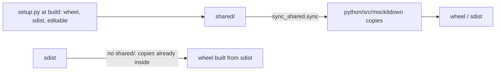
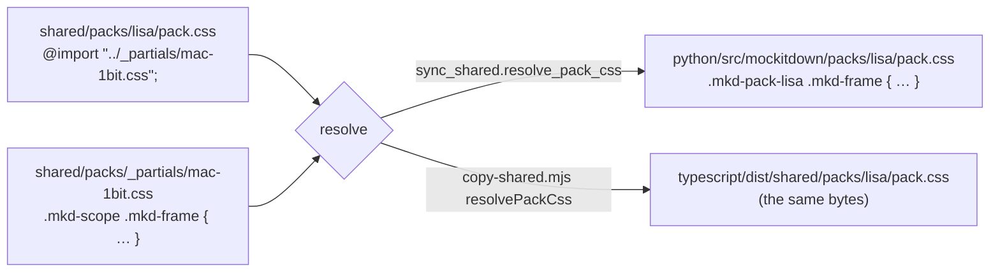

# Repository layout and shared assets

Realizes A-REPO-1 and A-PACK-2 under ADR-17; implements R-REPO-001, R-REPO-002, R-REPO-003 and the
build side of R-PACK-018 (stylesheet partials).

## Layout

```text
mockitdown/                    (main branch)
  python/                      the Python variant (PyPI `mockitdown`)
    pyproject.toml, setup.py   package metadata; setup.py is the build hook below
    src/mockitdown/            the library (packs/, page.css, icons.json, vocabulary.json are copies)
    tests/                     unittest suite (IT-1 … IT-8); tests/fixtures/partials/ is the R-PACK-018 fixture both suites read
    tools/                     gen_reference.py, gen_catalogue.py, sync_shared.py, snapshot.py
    examples/site/             the example site (Zensical), also the end-to-end fixture
  typescript/                  the TypeScript variant (npm `mockitdown`), see TypeScript core
    package.json, package-lock.json, tsconfig.json, tsconfig.test.json
    src/core/                  the core: syntax/, evaluate, packs/, diagnostics, options, styles …
    src/mockitdown.ts          package entry; src/node.ts the Node loader (mockitdown/node)
    src/elements/              the mockitdown-mockup element and the browser asset loader
    scripts/copy-shared.mjs    copies shared/ into dist/shared/ (+ manifest.json) and the LICENSE
    scripts/serve.mjs          the development server (R-WEB-003)
    scripts/assemble-gallery.mjs  lays the gallery out as static files for /gallery/ (R-WEB-004.C27)
    pages/                     test pages and the pack gallery (packs.html, packs.js, snippet.js, packs.css)
    playwright.config.mjs, playwright.published.config.mjs   browser tests; the second checks the assembled site
    tests/unit/, tests/browser/  node:test suites (IT-9, IT-10 …) compiled to test-build/; Playwright specs
    dist/, test-build/, node_modules/, LICENSE   build output and copies, ignored by git
  shared/                      the single source of what both variants publish
    packs/<id>/pack.json, pack.css
    packs/_partials/<name>.css stylesheet partials a pack.css includes (R-PACK-018); no pack.json, never copied
    css/page.css
    icons/icons.json           {"glyphs": {name: svg-inner}, "aliases": {name: glyph}}
    language/vocabulary.json   {"rendered": [...], "ignored": [...], "neutral_modules": [...]}
    reference/<pack>.json      element reference, generated by gen_reference.py
    reference/index.json       Reference menu groups
    patterns/                  the pack gallery's design patterns (index.json + *.mockitdown; core vocabulary, or pack-specific with `packs`)
  README.md, LICENSE, CLAUDE.md, HANDOFF.md, .github/, .specitout/, .claude/, .gitignore
```

The virtual environment stays at the repository root (`.venv`, ignored by git): build with
`.venv/bin/python -m pip install -e 'python[markdown]'`, test from `python/` with
`../.venv/bin/python -m unittest discover -s tests -t .`.

## How the Python package gets the shared assets



- `python/tools/sync_shared.py` maps each shared file to its package path (`pairs()`), copies the
  ones that differ (`sync()`), removes package pack folders with no counterpart, and reports
  differences (`stale()`, `--check`). It also copies the root `LICENSE` beside `pyproject.toml`.
- `python/setup.py` runs `sync()` whenever `tools/sync_shared.py` and `../shared/` exist, i.e. at
  every build from a checkout. In an unpacked sdist neither exists and the copies it carries are
  used. Nothing in `shared/` is executed: JSON and CSS are read as data (R-REPO-002.C7).
- The copies are listed in `.gitignore`; `tests/test_layout.py` fails if a `pack.json` or `pack.css`
  is tracked outside `shared/packs`, and `tests/test_shared.py` fails while a copy is stale
  (R-REPO-002.C6). After editing `shared/`, reinstall or run `../.venv/bin/python tools/sync_shared.py`.
- A `pack.css` that includes partials is not copied byte for byte: `copy_bytes(src)` returns its
  resolved text (next section), and `stale()` compares the copy with that (R-REPO-002.C6).
- `icons.py` and `vocabulary.py` load `icons.json` and `vocabulary.json` from beside themselves;
  `packs.BUILTIN_DIR` and `styles._PAGE_CSS` are unchanged.

A wheel built after the move holds the same files as the published 0.3.0 wheel, byte for byte, plus
`icons.json` and `vocabulary.json` (and changed `icons.py`, `vocabulary.py` and README paths); a
rendering compared between the two in fresh environments is identical.

## Stylesheet partials (R-PACK-018)

A rule several packs share is written once, in `shared/packs/_partials/<name>.css`, with the
placeholder scope `.mkd-scope` at the start of every selector. A built-in pack includes it with a line
`@import "../_partials/<name>.css";` among the comments and blank lines at the top of its `pack.css`.
Both builds replace each such line by the partial's text, scoped to the including pack:



The two implementations are the same steps, written twice so that neither build depends on the other
(C5); the fixture `python/tests/fixtures/partials/` with its `expected/<id>.pack.css` is asserted byte
for byte by both suites, and every real pack's stylesheet, turned into a partial, resolves identically
in both.

| Step | Python (`python/tools/sync_shared.py`) | TypeScript (`typescript/scripts/copy-shared.mjs`) |
|---|---|---|
| copy of a shared file: bytes, or a `pack.css` with `@import` resolved | `copy_bytes(src)` | `copyBytes(src)`, `copyText(src)` |
| a pack's resolved stylesheet from a packs folder | `resolve_pack_css(packs, id)` | `resolvePackCss(packs, id)` |
| the include lines of one stylesheet (C2, C6) | `resolve_css(css, id, partials)` | `resolveCss(css, id, partials)` |
| a partial checked (C3) and scoped (C4) | `scope_partial(css, id, where)` | `scopePartial(css, id, where)` |
| the selectors of a stylesheet, with offsets | `selector_starts(css)` | `selectorStarts(css)` |
| the error a build stops with (C6) | `PartialError` (a `ValueError`) | `PartialError` |
| the pack list of a packs folder (C1) | the registry's `ids()` | `packIds(packs)` |

- **Include lines.** The stylesheet is read line by line (lines end at `\n`), tracking `/* … */`
  comments across lines. A line that is exactly `@import "<path>";` (white space around it allowed) is
  an include while only comments and blank lines precede it; the first other non-blank text is the first
  rule. A stylesheet without the text `@import` is returned unchanged.
- **Scoping.** `selector_starts` walks the CSS skipping comments and strings, takes every rule prelude
  before a `{` that is not an at-rule (`@media … {` is entered, `@keyframes` blocks are skipped
  whole), splits it at commas outside brackets and records where each selector starts. Each must be
  `.mkd-scope` alone or followed by white space; those ten characters are replaced by
  `.mkd-pack-<id>`, from the end so the offsets stay valid. `.mkd-scope` in a comment, a string or
  inside `:not(…)` is left alone. White space is the CSS set (space, tab, LF, CR, FF) in both builds.
- **Errors** (the build stops; `sync_shared.py` and `copy-shared.mjs` print `error: …` and exit 1;
  `setup.py` lets the exception fail the build):

  | Cause | Message |
  |---|---|
  | include after the first rule | `pack 'one': line 4: @import "../_partials/demo.css" after the first rule` |
  | include sharing its line, or another `@import` form | `pack 'one': line 2: @import not on a line of its own: …` |
  | path not `../_partials/<name>.css` | `pack 'one': line 2: @import "../two/pack.css" names a path outside ../_partials/` |
  | partial missing | `pack 'one': line 2: @import "../_partials/missing.css": no such partial` |
  | partial with `@import`, `data-appearance` or `prefers-color-scheme` | `pack 'one': partial "../_partials/demo.css": a partial must not contain prefers-color-scheme` |
  | partial selector not starting with `.mkd-scope` | `pack 'one': partial "../_partials/demo.css": selector ".mkd-button" does not start with .mkd-scope` |

- **Not copied (C7).** Both builds copy only `<id>/pack.json` and `<id>/pack.css` of folders holding a
  `pack.json`, so `_partials/` reaches neither package; the resolved copies keep R-PACK-007.C1 true and
  the contract tests (`test_css_is_scoped`) read them.
- **At run time (C8)** a pack stylesheet with `@import` outside a comment is refused: in Python by
  `PackRegistry.get` for a pack found in a `pack_paths` directory (`_refuse_import`), in TypeScript by
  `registerPack` — both with `pack 'x': @import is resolved only in built-in packs`.

## Element reference JSON

`python/tools/gen_reference.py` computes each listed pack's element samples once and writes both the
example site's Reference page and `shared/reference/<pack>.json` (R-REPO-003.C5–C9):

```json
{"id": "fluent", "name": "Fluent (WinUI 3)", "framework": "…", "version": "…",
 "modules": ["WinUI", "…"], "device": "desktop", "chrome": "windows", "group": "Desktop",
 "elements": [{"name": "AppBarButton", "role": "button", "params": ["label"],
               "defaults": {"variant": "appBar"}, "variants": [], "doc": "…", "own": true,
               "sample": "AppBarButton(\"Label\")", "variants_sample": null}, …]}
```

Elements are in page order (own, then inherited core, each by name). `sample` is the element's
declared `sample` from `pack.json` (R-PACK-013), taken verbatim — a declared sample with a diagnostic
stops the generator with `error: pack '…', element '…': …` (`SampleError`) — or else the richest generic
call that renders without a diagnostic: built from the parameter names, with options and a selection
for pickers, radio groups and segmented controls, a date for date pickers, values for charts, cells for
table rows and a `TabView` around a tab-role element (`EXTRA`, `CHILDREN`, `_tab_sample`). Declared
samples travel with their element into every extending pack and are checked there too.
`variants_sample` (own elements with variants only) is an `HStack(alignment: .top, spacing: 24)` of
the sample once per variant (at most eight, `.variant("…")`), each captioned, or `null`. `index.json` is
`{"groups": [{"title": "Core", "packs": ["base"]}, {"title": "Wireframe", …}, …]}` in menu order.
`--check` compares the pages, the nav block and the JSON files.

## Debugging

- `FileNotFoundError: …/icons.json` (or `vocabulary.json`) when importing from a checkout: the copies
  were never made — run `../.venv/bin/python tools/sync_shared.py` or reinstall.
- A pack change that does not show: the package still has the old copy (`tools/sync_shared.py --check`).
- A partial change that does not show: the pack copies are resolved at build; run
  `tools/sync_shared.py` (Python) or `npm run build` (TypeScript). `--check` in either lists the stale
  copies and fails with the `PartialError` of a broken include.
- To see what a pack's copy will hold: `python -c 'import runpy; m = runpy.run_path("tools/sync_shared.py"); print(m["resolve_pack_css"]("../shared/packs", "lisa"))'` from `python/`.

## Revision history

| Version | Date | Change |
|---|---|---|
| 0.3.2 | 2026-11-25 | Page written: python/, shared/, build-time copy, reference JSON (#1) |
| 0.3.4 | 2026-11-25 | typescript/ layout: package, core, copy-shared script, tests (#3) |
| 0.3.8 | 2026-11-25 | `shared/patterns/` (#7) |
| 0.3.11 | 2026-11-25 | Declared element samples in the reference JSON (#10) |
| 0.3.16 | 2026-11-25 | pack-specific patterns in `shared/patterns/` (#15) |
| 0.3.20 | 2026-11-26 | Audit: layout lists elements/, scripts/, pages/ and the Playwright configs |
| 0.3.23 | 2026-11-27 | Stylesheet partials: `shared/packs/_partials/`, resolution in both builds, errors, run-time refusal (R-PACK-018) (#54) |
