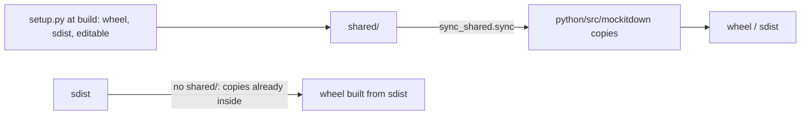

# Repository layout and shared assets

Realizes A-REPO-1 under ADR-17; implements R-REPO-001, R-REPO-002 and R-REPO-003.

## Layout

```text
mockitdown/                    (main branch)
  python/                      the Python variant (PyPI `mockitdown`)
    pyproject.toml, setup.py   package metadata; setup.py is the build hook below
    src/mockitdown/            the library (packs/, page.css, icons.json, vocabulary.json are copies)
    tests/                     unittest suite (IT-1 … IT-7)
    tools/                     gen_reference.py, gen_catalogue.py, sync_shared.py, snapshot.py
    examples/site/             the example site (Zensical), also the end-to-end fixture
  typescript/                  the TypeScript variant (npm `mockitdown`), see TypeScript core
    package.json, package-lock.json, tsconfig.json, tsconfig.test.json
    src/core/                  the core: syntax/, evaluate, packs/, diagnostics, options, styles …
    src/mockitdown.ts          package entry; src/node.ts the Node loader (mockitdown/node)
    scripts/copy-shared.mjs    copies shared/ into dist/shared/ (+ manifest.json) and the LICENSE
    tests/unit/                node:test suites (IT-9, IT-10), compiled to test-build/
    dist/, test-build/, node_modules/, LICENSE   build output and copies, ignored by git
  shared/                      the single source of what both variants publish
    packs/<id>/pack.json, pack.css
    css/page.css
    icons/icons.json           {"glyphs": {name: svg-inner}, "aliases": {name: glyph}}
    language/vocabulary.json   {"rendered": [...], "ignored": [...], "neutral_modules": [...]}
    reference/<pack>.json      element reference, generated by gen_reference.py
    reference/index.json       Reference menu groups
  README.md, LICENSE, CLAUDE.md, HANDOFF.md, .github/, .specitout/, .claude/, .gitignore
```

The virtual environment stays at the repository root (`.venv`, ignored by git): build with
`.venv/bin/python -m pip install -e 'python[markdown]'`, test from `python/` with
`../.venv/bin/python -m unittest discover -s tests -t .`.

## How the Python package gets the shared assets



- `python/tools/sync_shared.py` maps each shared file to its package path (`pairs()`), copies the
  ones that differ (`sync()`), removes package pack folders with no counterpart, and reports
  differences (`stale()`, `--check`). It also copies the root `LICENSE` beside `pyproject.toml`.
- `python/setup.py` runs `sync()` whenever `tools/sync_shared.py` and `../shared/` exist, i.e. at
  every build from a checkout. In an unpacked sdist neither exists and the copies it carries are
  used. Nothing in `shared/` is executed: JSON and CSS are read as data (R-REPO-002.C7).
- The copies are listed in `.gitignore`; `tests/test_layout.py` fails if a `pack.json` or `pack.css`
  is tracked outside `shared/packs`, and `tests/test_shared.py` fails while a copy is stale
  (R-REPO-002.C6). After editing `shared/`, reinstall or run `../.venv/bin/python tools/sync_shared.py`.
- `icons.py` and `vocabulary.py` load `icons.json` and `vocabulary.json` from beside themselves;
  `packs.BUILTIN_DIR` and `styles._PAGE_CSS` are unchanged.

A wheel built after the move holds the same files as the published 0.3.0 wheel, byte for byte, plus
`icons.json` and `vocabulary.json` (and changed `icons.py`, `vocabulary.py` and README paths); a
rendering compared between the two in fresh environments is identical.

## Element reference JSON

`python/tools/gen_reference.py` computes each listed pack's element samples once and writes both the
example site's Reference page and `shared/reference/<pack>.json` (R-REPO-003.C5–C9):

```json
{"id": "fluent", "name": "Fluent (WinUI 3)", "framework": "…", "version": "…",
 "modules": ["WinUI", "…"], "device": "desktop", "chrome": "windows", "group": "Desktop",
 "elements": [{"name": "AppBarButton", "role": "button", "params": ["label"],
               "defaults": {"variant": "appBar"}, "variants": [], "doc": "…", "own": true,
               "sample": "AppBarButton(\"Label\")", "variants_sample": null}, …]}
```

Elements are in page order (own, then inherited core, each by name). `sample` is the richest call
that renders without a diagnostic; `variants_sample` (own elements with variants only) is an
`HStack` showing each variant, or `null`. `index.json` is
`{"groups": [{"title": "Core", "packs": ["base"]}, {"title": "Wireframe", …}, …]}` in menu order.
`--check` compares the pages, the nav block and the JSON files.

## Debugging

- `FileNotFoundError: …/icons.json` (or `vocabulary.json`) when importing from a checkout: the copies
  were never made — run `../.venv/bin/python tools/sync_shared.py` or reinstall.
- A pack change that does not show: the package still has the old copy (`tools/sync_shared.py --check`).

## Revision history

| Version | Date | Change |
|---|---|---|
| 0.3.2 | 2026-11-25 | Page written: python/, shared/, build-time copy, reference JSON (#1) |
| 0.3.4 | 2026-11-25 | typescript/ layout: package, core, copy-shared script, tests (#3) |
