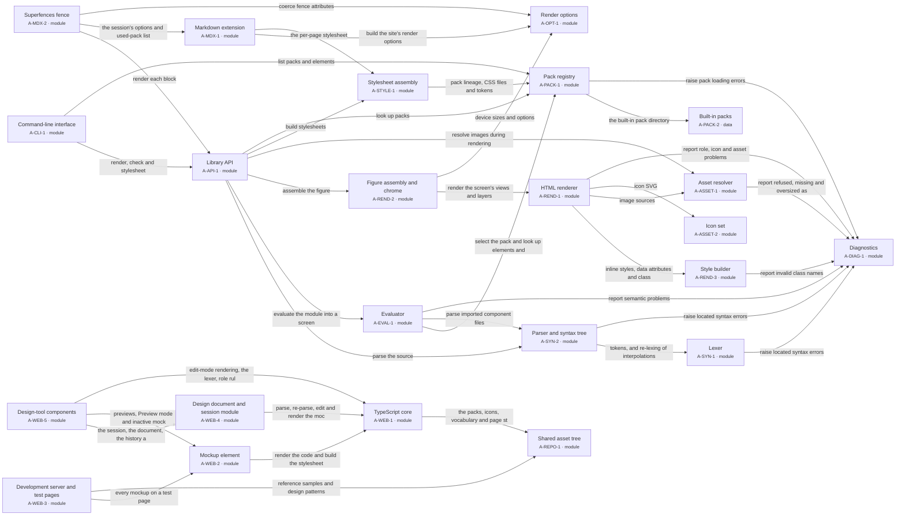

# Architecture: core modules

The modules that read, evaluate and describe a mockup, and the data they share. The diagram is generated from the elements' `uses` clauses; the data flow of one block is on the [System overview](../overview.md).

#### A-API-1 — Library API

The façade over the pipeline: parse → evaluate → render, with one diagnostics collector per call.
Realizes R-API-001 to R-API-003 and R-DIAG-004/005.

**Level.** module · **Realizes.** F-13, F-11

| | Statement |
|---|---|
| P1 | provides: `render`, `check`, `evaluate`, `stylesheet`, `RenderResult` and the error box (`mockitdown`, `mockitdown.api`) |
| P2 | provides: the `makeExtension` entry point that Python-Markdown loads for `markdown_extensions: [mockitdown]` |
| U1 | uses A-SYN-2 — parse the source |
| U2 | uses A-EVAL-1 — evaluate the module into a screen |
| U3 | uses A-REND-2 — assemble the figure |
| U4 | uses A-ASSET-1 — resolve images during rendering |
| U5 | uses A-STYLE-1 — build stylesheets |
| U6 | uses A-PACK-1 — look up packs |
| K1 | The library API MUST be the only entry point the fence, the CLI and external callers use to render. |
| K2 | The library API MUST NOT import Python-Markdown or pymdown-extensions. |

---

#### A-OPT-1 — Render options

The single description of everything that can be set for one mockup (M-OPT-1). Realizes R-MDX-003,
R-API-003 and R-DEV-001.

**Level.** module

| | Statement |
|---|---|
| P1 | provides: `RenderOptions` (immutable), the device size table `DEVICES`, the appearance list, the fence attribute table `FENCE_OPTIONS` and fence-attribute coercion (`mockitdown.options`) |
| K1 | Render options MUST be plain data with no behaviour beyond copying with overrides and coercing fence attributes. |

---

#### A-DIAG-1 — Diagnostics

Located errors and warnings (M-DIAG-1). Realizes R-DIAG-001 to R-DIAG-003.

**Level.** module

| | Statement |
|---|---|
| P1 | provides: `Severity`, `Location`, `Diagnostic`, the `Diagnostics` collector and the exceptions `MockitdownError` and `MockitdownSyntaxError` (`mockitdown.diagnostics`) |
| K1 | Diagnostics MUST be the only channel through which stages report problems. |

---

#### A-SYN-1 — Lexer

Swift's lexical layer, reduced. Realizes R-LANG-001 and R-LANG-002.

**Level.** module

| | Statement |
|---|---|
| P1 | provides: `tokenize(src, source)` → tokens with kinds, values and locations (`mockitdown.syntax.lexer`) |
| U1 | uses A-DIAG-1 — raise located syntax errors |
| K1 | The lexer MUST keep string interpolations as unparsed source with their locations. |

---

#### A-SYN-2 — Parser and syntax tree

Builds the module from tokens; the grammar is on the [Language reference](../language/reference.md).
Realizes R-LANG-002 to R-LANG-009.

**Level.** module

| | Statement |
|---|---|
| P1 | provides: `parse(src, source)` → `Module` (imports, directives, structs, statements) and the syntax-tree node types (`mockitdown.syntax.parser`, `mockitdown.syntax.ast`) |
| U1 | uses A-SYN-1 — tokens, and re-lexing of interpolations |
| U2 | uses A-DIAG-1 — raise located syntax errors |
| K1 | The parser MUST be recursive descent with no external parser generator. |
| K2 | The syntax tree MUST NOT decide whether an expression is a view or a value; that is the evaluator's job. |

---

#### A-EVAL-1 — Evaluator

Turns syntax into the resolved view tree (M-VIEW-1 … M-VIEW-3). Realizes R-EVAL-001 to R-EVAL-011,
R-PACK-005 and R-IMP-001 to R-IMP-006.

**Level.** module

| | Statement |
|---|---|
| P1 | provides: `Evaluator.evaluate(module)` → `Screen`; the modifier vocabulary (`RENDERED`, `IGNORED`, `NEUTRAL_MODULES`); the import cache (`mockitdown.evaluate`, `mockitdown.vocabulary`) |
| U1 | uses A-PACK-1 — select the pack and look up elements and modifier maps |
| U2 | uses A-SYN-2 — parse imported component files |
| U3 | uses A-DIAG-1 — report semantic problems |
| K1 | The evaluator MUST always complete and MUST NOT produce HTML. |
| K2 | The evaluator MUST NOT know any framework; framework knowledge lives in packs. |

---

#### A-PACK-1 — Pack registry

Loads and merges packs (M-PACK-1, M-PACK-2). Realizes R-PACK-001 to R-PACK-004.

**Level.** module

| | Statement |
|---|---|
| P1 | provides: `PackRegistry` (lookup by id, listing, module index), `Pack`, `ElementDef` and the cached `registry(extra_dirs)` (`mockitdown.packs`) |
| U1 | uses A-PACK-2 — the built-in pack directory |
| U2 | uses A-DIAG-1 — raise pack loading errors |
| K1 | The pack registry MUST read packs as data only; it MUST NOT execute code from a pack directory. |

---

#### A-PACK-2 — Built-in packs

The framework knowledge of mockitdown, as data. Realizes R-PACK-008 and R-PACK-009.

**At 0.11.0 (SRC-18#answers, question 1).** P1 no longer lists the first eight packs only: it provides every shipped pack.

**Level.** data

| | Statement |
|---|---|
| P1 | provides: one directory per shipped pack (R-PACK-008, R-PACK-019 to R-PACK-029), each with `pack.json` and `pack.css` (`mockitdown/packs/<id>/`), the `pack.css` copies resolved from the stylesheet partials they include (R-PACK-018) |
| K1 | Built-in packs MUST satisfy the pack contract tests (R-PACK-004, R-PACK-006, R-PACK-007). |

## Revision history

| Version | Date | Change |
|---|---|---|
| 0.11.0 | 2026-11-27 | SRC-18: provides every shipped pack, not the first eight; pack.css copies resolved from partials |
| 0.2.0 | 2026-11-24 | Page created |
| 0.2.0 | 2026-11-24 | Page created |
