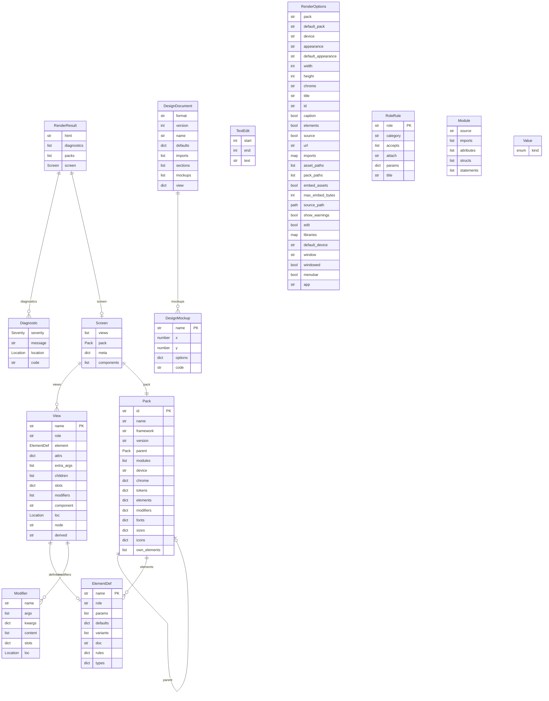

# Model

The data entities passed between the modules. The diagram is generated from the entities' fields and relations.

#### M-SYN-1 — Module

The syntax tree of one block or component file.

**Level.** entity

| | Statement |
|---|---|
| F1 | source: str · optional — the file the source came from (empty for a fenced block) |
| F2 | imports: list · ordered — `Import` nodes, each with a quoted `path` or a dotted `module` name |
| F3 | attributes: list · ordered — top-level directives (`@Screen`) |
| F4 | structs: list · ordered — `StructDecl` nodes: name, conformances, properties, optional body |
| F5 | statements: list · ordered — top-level statements, including `#Preview` contents |
| I1 | A module MUST be produced only by the parser and MUST NOT be modified by the evaluator. |

---

#### M-VIEW-1 — View

One node of the resolved view tree that the evaluator produces and the renderer consumes.

`node` and `derived` are set when the source was evaluated for an edit-mode rendering (R-EDIT-004).

**Level.** entity

| | Statement |
|---|---|
| F1 | name: str · key — the element or struct name as written (`Button`, `InfoBar`), or the unknown name |
| F2 | role: str — the render role, or `unknown` |
| F3 | element: ElementDef · optional — the pack element definition it came from |
| F4 | attrs: dict — attribute name → evaluated value, defaults first then arguments |
| F5 | extra_args: list — positional arguments beyond the element's params |
| F6 | children: list — views of the unlabelled trailing closure (or `content`) |
| F7 | slots: dict — label → views, from labelled closures and view-valued arguments |
| F8 | modifiers: list — recorded rendered modifiers, in order |
| F9 | component: str · optional — the struct whose body this view is the root of |
| F10 | loc: Location — where the view was written |
| F11 | node: str · optional — ordinal (`n<k>`) of the view node it was produced from (R-EDIT-001.C4) |
| F12 | derived: str · optional — ordinal of the innermost `ForEach` call, `if` statement or struct call that produced it (R-EDIT-004.C5) |
| R1 | definition: → M-PACK-2 (0..1) — the element definition |
| R2 | modifiers: → M-VIEW-2 (0..*) — recorded modifiers |
| I1 | A view's role MUST be a renderer role or `unknown`. |

---

#### M-VIEW-2 — Modifier

A rendered modifier kept on a view for the style builder and the renderer.

**Level.** entity

| | Statement |
|---|---|
| F1 | name: str — the modifier name (`padding`, `alert`) |
| F2 | args: list — positional argument values |
| F3 | kwargs: dict — labelled argument values |
| F4 | content: list · optional — views of the unlabelled trailing closure |
| F5 | slots: dict — label → views of labelled closures (`message:`) |
| F6 | loc: Location — where the modifier was written |
| I1 | Only rendered modifiers (R-EVAL-009.C4) MUST be recorded; pack-mapped modifiers become attributes instead. |

---

#### M-VIEW-3 — Screen

One evaluated mockup.

**Level.** entity

| | Statement |
|---|---|
| F1 | views: list — the top-level views |
| F2 | pack: Pack — the selected pack |
| F3 | meta: dict — `@Screen` metadata (title, id, device, appearance, chrome, url, pack, …) |
| F4 | components: list — names of the structs instantiated, in first-use order |
| R1 | views: → M-VIEW-1 (0..*) — top-level views |
| R2 | pack: → M-PACK-1 (1) — the selected pack |

---

#### M-VIEW-4 — Value

What an expression evaluates to.

**Level.** entity

| | Statement |
|---|---|
| F1 | kind: enum — the kinds of evaluated values |
| E1 | scalar — `str`, `int`, `float`, `bool` or `nil` |
| E2 | collection — list (arrays, ranges), tuple, dict (dictionaries, labelled tuples) |
| E3 | EnumValue — a symbolic `.name`, with optional namespace (`Color.red` → namespace `Color`), positional and labelled arguments |
| E4 | CallValue — a call of an unknown non-view callee used as a value (`GridItem(.flexible())`) |
| E5 | ViewList — views used as a value (a view call passed as an argument) |
| E6 | Thunk — an unevaluated closure with its scope; evaluated only where views are expected |
| I1 | Enum values MUST stay symbolic until a role or the style builder interprets them. |

---

#### M-PACK-1 — Pack

A loaded design pack.

**Level.** entity

| | Statement |
|---|---|
| F1 | id: str · key — the identifier used in fences and directories |
| F2 | name: str — display name |
| F3 | framework: str — the imitated framework |
| F4 | version: str — the framework version followed |
| F5 | parent: Pack · optional — the extended pack |
| F6 | modules: list — names accepted by `import <Module>` |
| F7 | device: str — default device form |
| F8 | chrome: dict — device form → chrome kind |
| F9 | tokens: dict — `light`/`dark` → token name → CSS value (merged with ancestors) |
| F10 | elements: dict — element name → definition (merged with ancestors) |
| F11 | modifiers: dict — modifier name → attribute mapping (merged) |
| F12 | fonts: dict — font alias → canonical style (own only; looked up through the lineage) |
| F13 | sizes: dict — device form → (width, height) (merged) |
| F14 | icons: dict — icon name → glyph name (merged) |
| F15 | own_elements: list — element names defined by this pack itself |
| R1 | parent: → M-PACK-1 (0..1) — inheritance |
| R2 | elements: → M-PACK-2 (0..*) — element definitions |
| I1 | The lineage MUST be acyclic and end at a pack with no parent. |

---

#### M-PACK-2 — ElementDef

One element of a pack: how a framework component maps onto a render role.

`rules` and `types` are read only by the design tools (R-PACK-016, R-PACK-017); rendering ignores them.

**Level.** entity

| | Statement |
|---|---|
| F1 | name: str · key — the element name |
| F2 | role: str — the render role |
| F3 | params: list — attribute names of positional arguments, in order |
| F4 | defaults: dict — attribute values applied before the call's arguments |
| F5 | variants: list — documented values of `variant` |
| F6 | doc: str — one line of usage |
| F7 | rules: dict · optional — `{accepts, widens}`, narrowing its role's rule for this element, widened only by the roles `widens` lists (R-PACK-016.C5) |
| F8 | types: dict · optional — parameter name → type, adding to or overriding its role's `params` (R-PACK-017.C3) |
| I1 | The role MUST be one of the renderer's roles. |

---

#### M-OPT-1 — RenderOptions

Everything that can be set for one mockup, from the site, the fence or the CLI.

`edit` is a library option (R-EDIT-004.C10); the fence and the command line do not offer it.

`default_device`, `window`, `windowed`, `menubar` and `app` were options of the library before this
list named them; they were added as built (#56). `None` for `windowed`, `menubar` and `app` means the
value comes from `@Screen` or the default.

**Level.** entity

| | Statement |
|---|---|
| F1 | pack: str · optional — forced pack (fence `pack`) |
| F2 | default_pack: str — pack when nothing selects one (default `base`) |
| F3 | device: str · optional — device form (fence `device`) |
| F4 | appearance: str · optional — light &#124; dark &#124; auto &#124; both (fence `appearance`) |
| F5 | default_appearance: str — default `light` |
| F6 | width: int · optional — frame width in points |
| F7 | height: int · optional — frame height in points |
| F8 | chrome: str — chrome kind, `auto` (default) or `none` |
| F9 | title: str · optional — caption title |
| F10 | id: str · optional — caption id |
| F11 | caption: bool — show the caption (default true) |
| F12 | elements: bool — append the Elements table (default false) |
| F13 | source: bool — append the source disclosure (default false) |
| F14 | url: str · optional — browser chrome address |
| F15 | imports: map — import map, key → path, URL or list of them (R-IMP-002.C7, C8) |
| F16 | asset_paths: list — asset directories |
| F17 | pack_paths: list — site pack directories |
| F18 | embed_assets: bool — inline local images (default true) |
| F19 | max_embed_bytes: int — embed size cap (default 2000000) |
| F20 | source_path: path · optional — file the source came from |
| F21 | show_warnings: bool — show warnings in the page (default false) |
| F22 | edit: bool — edit-mode rendering, `data-mkd-node` and `data-mkd-derived` on role roots (default false; R-EDIT-004) |
| F23 | libraries: map — the page's library blocks, name → source (R-IMP-008.C9) |
| F24 | default_device: str · optional — device form when neither the options nor `@Screen(device:)` name one (R-DEV-002.C1) |
| F25 | window: str · optional — window kind of packs that draw window frames, emitted as `data-window` (fence `window`) |
| F26 | windowed: bool · optional — the app drawn as an iPadOS window over a wallpaper (fence `windowed`; R-DEV-010.C4) |
| F27 | menubar: bool or str · optional — the macOS menu bar, or the title of the menu drawn open (fence `menubar`; R-DEV-009.C1) |
| F28 | app: str · optional — the application name in the macOS menu bar (fence `app`; R-DEV-009.C4) |
| I1 | Render options MUST be immutable; overrides produce a new value. |

---

#### M-DIAG-1 — Diagnostic

One reported problem.

**Level.** entity

| | Statement |
|---|---|
| F1 | severity: Severity — `error` or `warning` |
| F2 | message: str — human-readable text |
| F3 | location: Location — line, col (1-based; 0 unknown) and source file name |
| F4 | code: str — the diagnostic code (R-DIAG-003) |
| I1 | Two diagnostics with equal severity, message and location MUST be treated as the same. |

---

#### M-API-1 — RenderResult

What `render` returns.

**Level.** entity

| | Statement |
|---|---|
| F1 | html: str — error box, figure and optional source disclosure |
| F2 | diagnostics: list — every diagnostic, in order |
| F3 | packs: list — ids of the selected pack's lineage, root first; empty on a syntax error |
| F4 | screen: Screen · optional — the evaluated screen |
| R1 | diagnostics: → M-DIAG-1 (0..*) — reported problems |
| R2 | screen: → M-VIEW-3 (0..1) — the evaluated mockup |

---

#### M-PACK-3 — RoleRule

One entry of `shared/language/roles.json` (R-PACK-016, R-PACK-017). The `reads` list it carried after #32 was folded into `params` (#33): the labels a role reads are the keys of its typed `params`.

**Level.** entity

| | Statement |
|---|---|
| F1 | role: str · key — the render role; the root of a mockup has its own entry `root`, holding only `accepts` |
| F2 | category: str — frame &#124; bar &#124; layout &#124; collection &#124; content &#124; overlay &#124; annotation |
| F3 | accepts: list — the roles, or `@category` names, its views may hold as children |
| F4 | attach: str — child &#124; presentation &#124; modifier |
| F5 | params: dict — labelled argument → type (`text`, `number`, `bool`, `color`, `icon`, `enum`, `array`); its keys are the labels the role reads besides those every role reads (the table's top-level `params`, R-EVAL-004.C8) |
| F6 | title: str — the role's name in a refusal sentence (`horizontal stack`, `list item`) |
| I1 | Every render role MUST have exactly one rule. |

---

#### M-EDIT-1 — DesignDocument

A `.mkdesign` file (R-EDIT-005). The fields are listed in the order the module writes them.

**Level.** entity

| | Statement |
|---|---|
| F1 | format: str — always `mockitdown-design` |
| F2 | version: int — the format version, 1 |
| F3 | name: str — the document's name |
| F4 | defaults: dict — render options applied to every mockup (among them `pack`, the default pack) |
| F5 | imports: list · optional — component files the mockups may import |
| F6 | sections: list · optional — `{name, x, y, w, h}` rectangles drawn behind groups of mockups |
| F7 | mockups: list — the named mockups, in document order |
| F8 | view: dict · optional — `{zoom, x, y, active}`: the canvas's zoom, position and active mockup |
| R1 | mockups: → M-EDIT-2 (0..*) — the document's mockups |
| I1 | Mockup names MUST be unique within a document. |
| I2 | Keys not listed here MUST be kept, after the listed ones, in the order they were read. |

---

#### M-EDIT-2 — DesignMockup

One named mockup of a design document (R-EDIT-005, R-TOOL-012).

**Level.** entity

| | Statement |
|---|---|
| F1 | name: str · key — unique, case-sensitive, may hold spaces |
| F2 | x: number — canvas position of the frame's left edge |
| F3 | y: number — canvas position of the frame's top edge |
| F4 | options: dict · optional — render options of this mockup (`pack`, `device`, `width`, `height`, `title`, …) |
| F5 | code: str — the mockitdown source, verbatim |
| I1 | The mockup's pack MUST be `options.pack`, else the document's `defaults.pack`, else `base`. |

---

#### M-EDIT-3 — TextEdit

A minimal change to a mockup's code, returned by the edit API (R-EDIT-002) and carried by
`mockitdown-change` (R-EDIT-006).

**Level.** entity

| | Statement |
|---|---|
| F1 | start: int — offset of the first replaced code unit (UTF-16) |
| F2 | end: int — offset after the last replaced code unit; equal to `start` for an insertion |
| F3 | text: str — the replacement text; empty for a removal |
| I1 | The edits of one change MUST be in ascending order of `start` and MUST NOT overlap, every offset referring to the text before the change. |

## Revision history

| Version | Date | Change |
|---|---|---|
| 0.14.0 | 2026-11-28 | SRC-21 answers (#85, #88, #90): the sapui5 ObjectPageLayout holds its header and AnchorBar; copies named <name>-copy; New Section and Delete Section |
| 0.13.12 | 2026-11-28 | as built (#33): the role table's reads lists became the keys of typed params maps (top-level params for the common labels); parameterTypes and modifierTypes; a label an element's types names is understood |
| 0.13.11 | 2026-11-28 | as built (#32): F7 reads |
| 0.13.7 | 2026-11-28 | as built (#28): F6 title, the role's name in a refusal; the root entry holds only accepts |
| 0.12.7 | 2026-11-27 | as built: F24-F28 default_device, window, windowed, menubar and app, render options the library already had (#56) |
| 0.12.0 | 2026-11-27 | SRC-19: import map replaces import_paths; library names and qualified references; page library blocks; templates with slots; User guide |
| 0.10.0 | 2026-11-26 | New M-EDIT-3: TextEdit; New M-EDIT-2: DesignMockup; element rules and types overrides: F7, F8 (ING-1); New M-EDIT-1: DesignDocument; node and derived ordinals: F11, F12 (ING-1); render option edit: F22 (ING-1) |
| 0.2.0 | 2026-11-24 | Page created |
| 0.13.12 | 2026-11-28 | as built (#33): the role table's reads lists became the keys of typed params maps (top-level params for the common labels); parameterTypes and modifierTypes; a label an element's types names is understood |
| 0.13.11 | 2026-11-28 | as built (#32): F7 reads |
| 0.13.7 | 2026-11-28 | as built (#28): F6 title, the role's name in a refusal; the root entry holds only accepts |
| 0.12.7 | 2026-11-27 | as built: F24-F28 default_device, window, windowed, menubar and app, render options the library already had (#56) |
| 0.12.0 | 2026-11-27 | SRC-19: import map replaces import_paths; library names and qualified references; page library blocks; templates with slots; User guide |
| 0.10.0 | 2026-11-26 | New M-EDIT-3: TextEdit; New M-EDIT-2: DesignMockup; element rules and types overrides: F7, F8 (ING-1); New M-EDIT-1: DesignDocument; node and derived ordinals: F11, F12 (ING-1); render option edit: F22 (ING-1) |
| 0.2.0 | 2026-11-24 | Page created |
