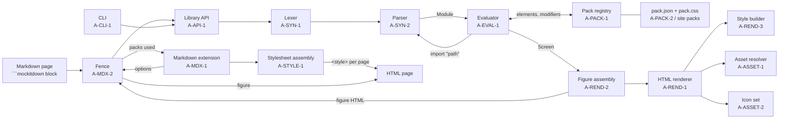

# System overview

mockitdown turns the text of a ```` ```mockitdown ```` block into an HTML figure. The block is
parsed as a declarative subset of Swift, evaluated against a **design pack** into a tree of views,
and rendered through a fixed set of **render roles** into markup that the pack's CSS styles.



## Registered components

The subjects of the normative clauses (EARS "the *component* MUST …") are these components; each
is an architecture element.

| Component | Element | Responsibility |
|---|---|---|
| the lexer | A-SYN-1 | source text → tokens |
| the parser | A-SYN-2 | tokens → module (syntax tree) |
| the evaluator | A-EVAL-1 | module → screen: pack selection, imports, structs, `ForEach`, values, modifiers |
| the pack registry | A-PACK-1 | finding, loading and merging packs |
| a pack | A-PACK-2 | the data and CSS of one framework (the subject of pack-format clauses) |
| the figure assembler | A-REND-2 | device, appearance, chrome, frame, caption, Elements table |
| the renderer | A-REND-1 | views → role markup, presentations |
| the style builder | A-REND-3 | modifiers → inline style, data attributes, classes |
| the stylesheet assembler | A-STYLE-1 | page CSS + pack CSS + tokens, px scaling |
| the page stylesheet | A-STYLE-1 | `page.css`: figure, frame unit, isolation, error box |
| the asset resolver | A-ASSET-1 | image references → `src` |
| the icon resolver | A-ASSET-2 | icon names → glyphs |
| the Markdown extension | A-MDX-1 | site options, per-page CSS |
| the fence | A-MDX-2 | rendering each block, logging, strict mode |
| the CLI | A-CLI-1 | the `mockitdown` command |
| the library API | A-API-1 | `render`, `check`, `evaluate`, `stylesheet` |

## Processing a block

1. **Options.** Site options (R-MDX-002) are overridden by fence attributes (R-MDX-003).
2. **Parse.** The source is tokenized and parsed (R-LANG). A syntax error stops here and the
   block renders as an error box (R-DIAG-005).
3. **Evaluate.** `@Screen` metadata is read; the pack is selected (R-PACK-005); component files are
   imported (R-IMP); structs, `ForEach`, conditions and values are evaluated; modifiers are mapped
   or recorded (R-EVAL). Problems become diagnostics; evaluation always completes.
4. **Render.** Device, appearance and chrome are resolved (R-DEV, R-APP); each view renders through
   its role (R-REND); images and icons are resolved (R-ASSET). Errors are listed above the figure.
5. **Deliver CSS.** The Markdown extension adds one `<style>` per page for the packs used
   (R-MDX-004), with pack CSS scaled to the frame unit (R-DEV-004) and token rules for appearance
   (R-APP-002).

## Conformance

An implementation conforms when every `C` clause of every active requirement holds. The test suite
on `main` automates the test cases (`TC-n`) cited in the requirements; the example site is the
end-to-end fixture (F-14). Packs conform when they pass the pack contract (R-PACK-004, R-PACK-006,
R-PACK-007).

## Revision history

| Version | Date | Change |
|---|---|---|
| 0.2.0 | 2026-11-24 | Page created |
